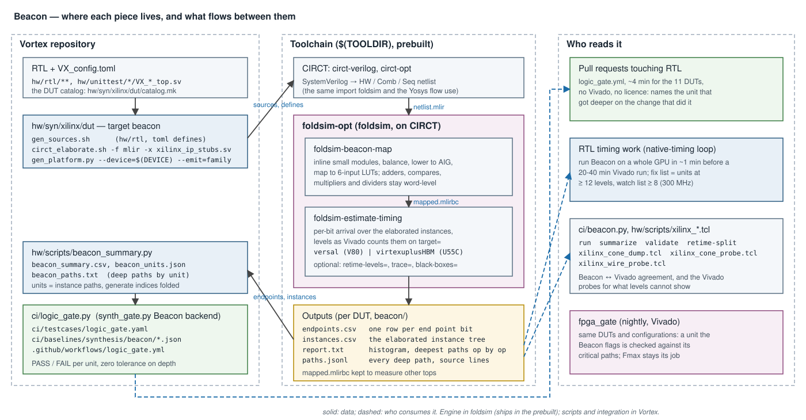
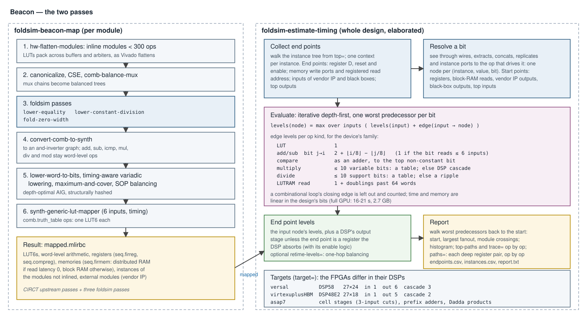

# Beacon — logic depth of every path, before Vivado

Beacon counts the logic levels of every register-to-register path
of a Vortex design the way Vivado counts them, in seconds and without
Vivado. It names the RTL units whose paths are too deep for the target clock,
gates their depth on every RTL change (`logic_gate`), and is the first step
of RTL timing work: run Beacon, fix the deep units, then confirm with one
Vivado run.

| § | contents |
|---|---|
| [1](#1-overview) | Overview and how to run it |
| [2](#2-system-architecture) | System architecture: where each piece lives |
| [3](#3-compiler-architecture) | Compiler architecture: the two passes |
| [4](#4-the-model) | The model: levels per element, devices |
| [5](#5-outputs) | Outputs |
| [6](#6-integration) | Integration: the DUT flow, `logic_gate`, timing work |
| [7](#7-validation) | Validation against Vivado; the learned calibration (§7.1) |
| [8](#8-diagnostics) | Diagnostics beyond levels |
| [9](#9-invariants-and-limitations) | Invariants and limitations |

---

## 1. Overview

It answers one question per register: **how many logic levels is its worst
input path?** At 300 MHz on the V80, failing end points have a median of
7–8 levels, and between half and four fifths of the registers at 12 or more
levels fail, depending on the gate (§7). So Beacon reports:

- **fix list:** units with end points at ≥ 12 levels;
- **watch list:** ≥ 8 levels.

It does not predict slack, because it does not see wires (§9).

One DUT of the synthesis catalog, from a configured build tree:

```bash
make -C hw/syn/xilinx/dut tcu-beacon
# build_tcu/beacon_paths.txt     every path at >= 8 levels, op by op, by unit
# build_tcu/beacon_units.json    deepest end point per RTL unit
```

The whole catalog as a gate, and a baseline update (a human step):

```bash
ci/logic_gate.py -j 2
ci/logic_gate.py -b om --update-baseline
```

Any CIRCT netlist, with `ci/beacon.py` (subcommands `run`,
`summarize`, `paths`, `validate`, `retime-split`, `ports`, `buffers`,
`calibrate`, `score`;
`foldsim-opt` from the `PATH` or `FOLDSIM_OPT`):

```bash
ci/beacon.py run design.mlir runs/full                     # map, then count levels
ci/beacon.py run runs/full/mapped.mlirbc runs/socket \
    top=VX_socket__lift black-boxes=VX_core__lift           # one unit of a mapped design
ci/beacon.py summarize runs/full --min-levels 12           # deep end points by RTL unit
ci/beacon.py paths runs/full --unit lsu_unit               # its paths, op by op (§5)
ci/beacon.py validate runs/socket ep.csv --native VX_socket__lift=dut
```

Or the two passes directly:

```bash
foldsim-opt design.mlir --emit-bytecode -o mapped.mlirbc \
  --pass-pipeline='builtin.module(foldsim-beacon-map{target=virtexuplusHBM})'
foldsim-opt mapped.mlirbc -o /dev/null --pass-pipeline='builtin.module(
  foldsim-estimate-timing{top=VX_core_top target=virtexuplusHBM
    output=endpoints.csv instances=instances.csv report=report.txt
    top-paths=50 trace=lsu_unit})'
```

| `foldsim-estimate-timing` option | meaning |
|---|---|
| `top=` | the top module (default: the one nothing instantiates) |
| `target=` | the Beacon target (§4.2): `versal` (V80, default), `virtexuplus`, `virtexuplusHBM` (U55C), `zynquplus`, or `asap7` (ASIC, §4.3); map with `foldsim-beacon-map` for the same target |
| `black-boxes=` | modules to treat as external, as a harness stubs them |
| `output=`, `instances=`, `report=` | the files of §5 |
| `min-levels=` | write only end points at or above this many levels |
| `top-paths=` | deepest paths to print op by op (default 50) |
| `trace=` | also print the deepest path of each end point whose name contains this |
| `paths=`, `path-levels=` | every path of at least `path-levels` (12) levels, one per pair of registers, op by op (§5) |
| `retime-levels=` | also estimate the depth after Vivado's retiming to this period (§4.4) |
| `ports=`, `port-modules=` | the depth at each port of the named modules' instances (§8) |

## 2. System architecture



The engine is two compiler passes of **foldsim** (`foldsim-opt`), built on
CIRCT like the rest of foldsim, and shipped in the foldsim prebuilt. Vortex
never builds it. The integration is in Vortex:

| Piece | Where | Role |
|---|---|---|
| `foldsim-beacon-map`, `foldsim-estimate-timing` | foldsim `lib/Transforms/Beacon.cpp`, `EstimateTiming.cpp` | map to the target's cells; count levels |
| `ci/beacon.py` | `ci/` | run Beacon on any netlist; read it by unit; compare with Vivado |
| `xilinx_cone_dump.tcl`, `xilinx_cone_probe.tcl`, `xilinx_wire_probe.tcl` | `hw/scripts` | Vivado probes for what levels cannot show (§8) |
| target `beacon` | `hw/syn/xilinx/dut/common.mk` | one DUT: sources → netlist → levels → summary |
| `circt_elaborate.sh -f mlir` | `hw/scripts` | the lowered HW/Comb/Seq netlist, no `firtool` |
| `gen_platform.py --emit=family` | `hw/scripts` | the family of `DEVICE`, from `hw/syn/xilinx/platforms` |
| `beacon_summary.py` | `hw/scripts` | `beacon_summary.csv` and per-unit `beacon_units.json` |
| `Beacon` backend, `logic_gate.py` | `ci/synth_gate.py`, `ci/` | the gate, beside `fpga_gate` and `asic_gate` |
| `logic_gate.yml` | `.github/workflows` | runs it on pull requests that touch RTL |

Beacon reads the same CIRCT import that foldsim and the Yosys flow
use (`circt-verilog --ir-hw`), elaborated from the sources and defines
`gen_sources.sh` writes for Vivado, with the Xilinx floating-point IPs as
black boxes (`xilinx_ip_stubs.sv`).

## 3. Compiler architecture



### 3.1 `foldsim-beacon-map`

Both passes load the same **target** from foldsim's target table
(`foldsim/Beacon.h`): its cells for the mapping, its DSPs and delays for the
level count. A target is named after its FPGA family or its PDK, so every
flow passes the name it already has: the DUT flow the family
`gen_platform.py --emit=family` gives for `DEVICE`, the ASIC flow `PDK`,
`ci/beacon.py run` its `target=`. The mapping is a pipeline of CIRCT's
synthesis passes plus three of foldsim's, per module:

1. **Inline small modules** (`hw-flatten-modules`, < 300 ops) so LUTs pack
   across buffers, arbiters and switches, as Vivado's flattened synthesis
   does. Larger modules stay instances; the estimator elaborates them.
2. **Canonicalize and balance** mux chains (`comb-balance-mux`).
3. **foldsim passes:**
   - `foldsim-lower-equality`: an equality compare is XORs and an OR tree,
     which pack into LUTs;
   - `foldsim-lower-constant-division`: a division by a constant is an
     extract (power of two) or a table (dividend of ≤ 10 bits), as
     synthesis writes it;
   - `foldsim-fold-zero-width`: zero-width values are constants, which
     CIRCT's lowering otherwise rejects.
4. **Lower to an and-inverter graph** (`convert-comb-to-synth`). Adders,
   subtracters, compares, multipliers, dividers and remainders stay
   word-level: the estimator models them as the carry chains, DSPs and
   tables Vivado builds, which a LUT mapping of their gates would not
   reproduce.
5. **Depth-optimize** the graph: timing-aware variadic lowering, maximum
   AND cover, SOP balancing, structural hashing.
6. **Map to the target's cells** (`synth-generic-lut-mapper`, timing
   strategy): 6-input LUTs on the FPGA families, 3-input cuts on ASAP7.

The full GPU maps in about a minute and 18–20 GB.

### 3.2 `foldsim-estimate-timing`

The estimator works on the elaborated design: one **context** per instance,
and one **node** per (context, value, bit). It never enumerates paths:

1. **Collect end points** by walking the instance tree from `top`.
2. **Resolve** each end point bit through wires, extracts, concatenations,
   replicates and instance ports to the op that drives it.
3. **Evaluate** with an iterative depth-first walk: a node's levels are the
   maximum over its inputs of the input's levels plus the edge's (§4), and
   it keeps its one worst predecessor. An input still being evaluated
   closes a combinational loop; that edge is left out and counted.
4. **Report**: each end point's start point is found by walking the worst
   predecessors back; the walk also yields the path's largest fanout and its
   module crossings.

Time and memory are linear in the design's bits: the full GPU runs in
16–21 s and 2.7 GB, a DUT of the catalog in seconds.

## 4. The model

### 4.1 Levels per element

| Element | Levels |
|---|---|
| LUT (`comb.truth_table`) | 1 |
| Adder or subtracter, input bit j to output bit i | 2 + ⌊i/8⌋ − ⌊j/8⌋: a LUT, then the 8-bit carry blocks; 1 if the output bit reads ≤ 6 input bits (one LUT6) |
| Order compare | as an adder, up to the highest bit not constant in both operands |
| Equality compare | lowered to LUTs by the mapping |
| Multiply, ≤ 10 variable operand bits | a table of constants: 1 + ⌈(bits − 6)/2⌉ |
| Multiply, wider | a DSP cascade over the significant bits (§4.2) |
| Divide or remainder | a table over the bits its operand cones depend on, if ≤ 10; else a ripple of one subtracter per quotient bit |
| Distributed-RAM read (`seq.firmem`, latency 0) | 1, plus 1 per doubling past 64 words (MUXF7, MUXF8, LUT), from the address |
| Other ops | 1 per op, listed in the report |

Significant bits exclude constant bits on top and copies of the bit below
(a sign extension). A table is a LUT6 for six inputs and a level of 4:1
multiplexers per two more.

### 4.2 Devices

Versal and the UltraScale+ families all have LUT6s, 8-bit carry blocks
(LOOKAHEAD8, CARRY8) and 64-word distributed RAMs; they differ in their DSPs.
The target is selected by `target=`, with the family names of
`hw/syn/xilinx/platforms`:

| `target=` | Device | DSP multiplier | fabric → registered product | product → fabric | per cascaded DSP |
|---|---|---|---|---|---|
| `versal` | V80 | DSP58, 27 × 24 | 1 | 6 | 3 |
| `virtexuplus` | U200, U250 | DSP48E2, 27 × 18 | 1 | 5 | 2 |
| `virtexuplusHBM` | U50, U55C, U280 | DSP48E2, 27 × 18 | 1 | 5 | 2 |
| `zynquplus` | Zynq UltraScale+ | DSP48E2, 27 × 18 | 1 | 5 | 2 |

A product takes ⌈a/A⌉·⌈b/B⌉ DSPs (the better orientation). The cell counts
are Vivado's: on Versal, M_DATA, ALUMUX, ALUADD and OUTPUT out of a DSP,
and ALUMUX, ALUADD and OUTPUT through each cascaded one. A register fed by
the product is the DSP's own (MREG or PREG), and so is a LUT that reads that
register back, its clock enable or feedback; any other load pays the output
stage. The fabric-to-product value is fitted on the V80 data. A name that
is not a target is an error that lists the targets.

### 4.3 ASAP7

For the ASIC flow (`hw/syn/yosys`, ASAP7 7.5-track RVT, TT corner)
Beacon counts **cell stages**, not LUT levels. `target=asap7`
maps the same balanced and-inverter graph to 3-input cuts, each one cell
(NAND, AOI, MAJ, XOR), and models the word-level operators
as an ASIC builds them:

| Element | Stages |
|---|---|
| cell (`comb.truth_table`, 3 inputs) or unmapped and-inverter gate | 1 |
| adder, input bit j to output bit i | 2 + ⌈log₂(i − j + 1)⌉: a prefix adder |
| order compare | 1 + ⌈log₂ span⌉ |
| multiply | partial products, a Dadda tree of full adders (2 stages each), a prefix adder |
| table of k inputs (small products and dividers) | k (a multiplexer tree) |
| memory of flops (no macro) | 1 + ⌈log₂ depth⌉: a decoder and a multiplexer tree |

SRAM macros (`VX_dp_ram_asic`, `VX_sp_ram_asic`) are black boxes, as in the
flow's synthesis: their pins end and start paths. The report converts the
deepest path to a period:

```
deepest path 45 stages: 58 + 167 + 45 x 24 + 6 = 1311 ps (763 MHz)
                        clk→Q  path  stages × cell  setup
```

The cell (24 ps at fanout 3 and its own slew), clock-to-output (58 ps) and
setup (6 ps) delays come from the Liberty, by `hw/syn/yosys/liberty_stage.py`;
the path term (167 ps: the inverter after a DFFHQN's QN, buffering, slew) is
fitted on OpenSTA (§7). Re-derive them for another corner or threshold
voltage.

### 4.4 Retiming (optional)

All of Vortex's Vivado runs retime. With `retime-levels=N`, the `retimed`
column estimates each end point's depth after one hop of balancing to a
period of N levels. The end register moves backward into the room its
output stage leaves, and the start register moves forward into the room its
input stage leaves. Neither crosses a distributed RAM or a DSP, and only a
register Vivado can retime (synchronous reset) moves. Top ports and
black-box pins count as registers with empty neighbour stages, as a gate
harness makes them. It ranks no better than plain levels, so `levels` stays
the ranking; `retimed ≥ 12` at `retime-levels=10` is a short list of fix
candidates retiming is unlikely to absorb.

## 5. Outputs

| File | Contents |
|---|---|
| `endpoints.csv` | one row per end point bit: `levels,retimed,kind,start_kind,fanout,crossings,start_inst,start,end_inst,end` |
| `instances.csv` | the instance tree: `id,parent,instance,module` (the `*_inst` columns' ids) |
| `report.txt` | counts, combinational loops, ops without a model, the histogram of end points by levels, the `top-paths` deepest paths op by op, and the deepest path of each `trace=` match |
| `beacon_summary.csv` | the DUT flow's one row: max levels, end points ≥ 12, ≥ 8, all |
| `paths.jsonl` | `paths=`: one JSON line per pair of start and end registers whose deepest bit has at least `path-levels` levels: that bit's levels, the pair's bit count, start, end, and `ops`, the path from the end back to the start as `[levels, kind, fanout, instance id, name, source]` |
| `beacon_units.json` | the deepest end point of every unit at ≥ 8 levels, and the 10 deepest paths |
| `beacon_paths.txt` | the DUT flow's `paths.jsonl` at ≥ 8 levels, by unit (`ci/beacon.py paths` for any run) |

A path in `report.txt`, deepest first, one op per line: levels at the op,
its kind, the fanout of its bit, and its instance path and name:

```
#1 levels 20: .../mem_req_queue/pending_size/used_r.d[0] (VX_socket__lift)
    20 lut    fo 0     .../comb.truth_table[0]
    19 carry  fo 1     .../comb.add[0]
    ...
     0 reg    fo 59    .../req_pending/in_fire_r[13]
```

`report.txt`'s deepest paths are often one pair of registers, bit after bit.
The path list has **every** deep path once:

- one per pair of start and end registers, its deepest bit, with the
  number of bits it stands for;
- pairs whose names differ only in generate indices (`g_banks_0`,
  `g_banks_1`) and bits fold into one, as units fold them, so a unit the
  gate names is a heading of the list;
- units deepest first, and in each unit its paths deepest first;
- each op with the **source line** it came from. Mapped LUTs have no name
  of their own, so the file and line are what locate them in the RTL. The
  DUT flow elaborates `hw/rtl` itself (not preprocessed copies), so the
  lines are the repository's.

```
== cache/g_cache_cache/g_banks_*_bank/g_amo_amo: 24 levels, 23 paths

  24 levels, 1024 d bits in 4 copies
  from cache/g_cache.cache/g_banks_0.bank/g_amo.amo/g_commit.chain_match_r[0]
  to   cache/g_cache.cache/g_banks_0.bank/g_amo.amo/g_commit.wbq_data.d[6]
      24 lut    fo 0     VX_cache_amo.sv:211      .../g_amo.amo/comb.truth_table[0]
      22 lut    fo 1     VX_cache_amo.sv:700      .../g_amo.amo/comb.truth_table[0]
      ...
      10 carry  fo 839   VX_cache_amo.sv:689      .../g_amo.amo/comb.sub[1]
      ...
       0 reg    fo 2     VX_cache_amo.sv:773      .../g_commit.chain_match_r[0]
```

On the full GPU, the 3,283 pairs at ≥ 12 levels fold into 169 paths in
69 units.

## 6. Integration

### 6.1 The DUT flow

`hw/syn/xilinx/dut` builds every DUT of `catalog.mk` for Vivado; its
`beacon` target runs Beacon on the same DUT with the same sources, defines and
`DEVICE` (the U55C by default):

1. `gen_sources.sh` into `beacon/sources.f`, a filelist of `hw/rtl` with
   the defines (not preprocessed copies, so source lines are the
   repository's);
2. `circt_elaborate.sh -f mlir` into `beacon/netlist.mlir`, the FP IPs as
   black boxes, with every op's source location;
3. `foldsim-beacon-map`, then `foldsim-estimate-timing`, both with
   `target=` the family `gen_platform.py --device=$(DEVICE) --emit=family`
   names;
4. `beacon_summary.py`: `beacon_summary.csv`, `beacon_units.json` and
   `beacon_paths.txt` (§5).

The ASIC flow has the same target, with the same sources, defines and SRAM
black boxes as its synthesis, and `target=$(PDK)`:

```bash
make -C hw/syn/yosys/dut om TARGET=beacon
# om_VX_om_core_top/beacon/report.txt: the deepest paths and the period
```

### 6.2 `logic_gate`

The third synthesis gate, beside `fpga_gate` (Vivado, nightly) and
`asic_gate` (Yosys + OpenSTA, nightly); see
[continuous_integration.md §3.5](continuous_integration.md). It runs Beacon on
`fpga_gate`'s builds (`ci/testcases/logic_gate.yaml`, all but `top`, whose
`VX_cp_core` keeps LLHD reference ports) in about four minutes, and checks
each against `ci/baselines/synthesis/beacon/`:

- a **unit** that gets deeper fails, by name;
- a **new unit** at or above the fix threshold (12) fails;
- a unit that gets shallower, or leaves the watch list, is an improvement
  to lock in by re-recording;
- end point counts are recorded, not gated (they grow with lanes and warps).

A failing build names its `beacon_paths.txt`, where the failing unit is a
heading with its paths op by op; CI uploads it with the build's logs.

Depth is deterministic, so the tolerance is zero. The baseline fingerprint
is the CIRCT and foldsim versions, `DEVICE` and `XLEN`: a new foldsim reads
as STALE, not as a regression. Baselines are golden data, re-recorded only
by a human (`--update-baseline`), as for the other gates.

### 6.3 RTL timing work: Beacon first

Beacon is the inner loop of any RTL change that can move timing. A DUT takes
minutes in Beacon and hours in Vivado or Yosys, so a deeper path is found and
fixed while the change is still open, and synthesis runs once, to confirm.

1. **Reference.** Beacon on the parent revision, once per base, in a build
   tree of its own:

   ```bash
   git worktree add ../ref HEAD
   ../ref/ci/logic_gate.py -b core -b lmem --build-dir $PWD/build32_beacon_ref
   ```

2. **Change.** The same builds on the working tree, each compared with the
   reference register by register:

   ```bash
   ci/logic_gate.py -b core -b lmem --against build32_beacon_ref
   ```

   Besides the per-unit verdict against the golden baseline, each build
   writes `beacon_diff.txt` (`ci/beacon.py diff`). It lists the registers
   that got deeper, new deep registers, and the ones that got shallower, then
   the units whose deepest register moved. A register that got deeper fails
   the run (`DEEPER`), and so does a new one at the fix threshold (12). A new
   one below it is listed but passes, since a rename looks the same.

3. **Fix.** `ci/beacon.py paths <build>/beacon --unit <unit>` prints a deep
   unit's paths op by op. Edit, and repeat step 2 until nothing got deeper,
   or until each deeper path is one the change intends.

4. **Confirm.** Run synthesis once per change, not once per edit: the
   `fpga_gate` or `asic_gate` builds of the DUTs whose depth moved. Then feed
   the result back. `ci/beacon.py validate <build>/beacon ep.csv` compares the
   run with Vivado's end point table, and a disagreement there is a Beacon bug
   to fix in foldsim.

Beacon counts logic levels; it does not see wire delay, placement, SLR
crossings, congestion or area. A change that moves those (a wide fan-out, a
floorplan, a larger RAM) still needs synthesis before it lands. Compare a fix
against a native gate (`hw/syn/xilinx/dut` or the OOC gates), not the folded
design (§9).

## 7. Validation

Against Vivado, per RTL register or memory: Beacon's deepest bit
against Vivado's deepest failing path and worst slack, on seven V80 datasets
with no new Vivado runs (`ci/beacon.py validate`):

| Dataset | Vivado run | Spearman vs levels | Spearman vs slack | ≥ 12: precision / recall |
|---|---|---|---|---|
| full GPU, folded | 4.0 ns, routed, 270 k end points | 0.75 | 0.45 | — |
| socket | native gate, 4.0 ns, routed | 0.55 | 0.53 | 0.64 / 0.31 |
| D-cache | native, 4.0 ns, routed | 0.71 | 0.55 | 0.67 / 0.38 |
| top | native gate, 3.333 ns, placed | 0.53 | 0.39 | 0.19 / 0.53 |
| socket | native gate, 3.333 ns, placed | 0.50 | 0.33 | 0.52 / 0.18 |
| core | native gate, 3.333 ns, placed | 0.93 | 0.62 | 0.81 / 0.13 |
| compute slice | native gate, 3.333 ns, placed | 0.87 | 0.75 | 0.58 / 0.57 |

Beacon's depths run about 1.25× Vivado's on the native gates. The U55C
profile was checked against `fpga_gate`'s critical paths: it agrees with
the V80 profile wherever no DSP is on the path, and the remaining
disagreement is the same on both devices.

**ASAP7**, against OpenSTA on fresh syntheses of five DUTs (Yosys + ABC as
`hw/syn/yosys` builds them, flip-flops named after their registers,
`hw/syn/yosys/sta_endpoints.tcl` for the slack of each):

| DUT | Registers | Spearman, stages vs arrival | Worst path: OpenSTA → Beacon |
|---|---|---|---|
| om | 93 | 0.91 | 827 → 879 ps |
| cache | 526 | 0.82 | 1450 → 1311 ps |
| dxa | 169 | 0.56 | 1018 → 1215 ps |
| raster | 134 | 0.58 | 879 → 879 ps |
| tex | 1002 | 0.93 | 840 → 807 ps |

Per register, the fitted delay per stage is 17–25 ps, the library's 24.
The worst path is within a mean 8 % on these five, from which the path term
was fitted; on the six larger DUTs, the predicted Fmax is within a mean
13 % (−32 % to +3 %) of the asic_gate baselines, some of which predate the
current RTL. Beacon runs a DUT in 2–52 s, where Yosys and OpenSTA take
2.5–37 min.

### 7.1 Learned calibration (advisory)

Levels rank Vivado's near-critical registers at about half the ceiling set
by one Vivado run predicting another. `ci/beacon.py score` ranks them with a
calibration learned from routed U55C builds instead: gradient-boosted trees
on 38 per-register features, all from Beacon's own outputs (no Vivado input):

- **depth:** levels, mean levels over the bits, the share of bits within one
  level of the deepest;
- **width:** bits, and bits within one level of the deepest;
- **end and start kind:** D, RAM write data or control, RAM read; register,
  port, BRAM, IP;
- **fan-out:** the deepest start's, the cone's (`in_fanout`), the largest
  along the deepest path, nets of 64 or more loads on it;
- **span:** hierarchy depth, crossings, the bits under the lowest common
  instance of the register and its deepest start;
- **the deepest path's op mix** (`paths.jsonl`, at 8 levels or more): levels
  spent in LUT, carry, compare, LUTRAM, BRAM and DSP ops, distinct
  instances and source files, and the levels with a carry level costed at
  0.42 of a LUT level and a compare at 0.15.

The model is three tree ensembles: the worst slack (capped at 1 ns, the
`ep.csv` horizon), the probability of slack under 0.3 ns (near-critical) and
under 0 ns. A register never ranks safer for being deeper (a monotone
constraint on levels). `calibrate` trains them with scikit-learn and writes
them as plain JSON trees; `score` evaluates them in pure Python, in about
4 s for a core. The model trained on the 13 builds below ships as
[`hw/scripts/beacon_calibration_u55c.json`](../../hw/scripts/beacon_calibration_u55c.json);
it applies to the U55C at 300 MHz, the target it was trained on.

```bash
ci/beacon.py score build_core/beacon hw/scripts/beacon_calibration_u55c.json \
    --top 30 --csv score.csv
ci/beacon.py calibrate cal.json --holdout \
    --build build_core/beacon build_core/ep.csv core \
    --build build_cache/beacon build_cache/ep.csv cache
```

Each `--build` is a DUT build's Beacon run (`path-levels=8`, as the DUT flow
writes it) and the end point table of the same sources. `--holdout` prints
the check below for the given builds.

**Validation.** 13 routed U55C builds at 3.333 ns: 8 core revisions, 4 lmem,
1 cache, 19 k registers. Each build is held out and scored by a model
trained on the builds outside its group. Revisions of one RTL lineage share
most of their registers, so they are held out together:

- core with the coretiming lineage (origin, it1, it2, lsuagu);
- core with the lmemwarp lineage (v1, v2, final, p2lsulmem);
- cache;
- lmem.

The stricter test holds out the whole DUT (core trained on cache and lmem
only).

| held out | near-critical AP: levels | levels + 0.35·log2(fan-out) | carry/compare cost | model, lineage out | model, DUT out | Spearman vs −slack: levels / model |
|---|---|---|---|---|---|---|
| core origin | 0.36 | 0.38 | 0.41 | 0.72 | 0.65 | 0.15 / 0.64 |
| core it1 | 0.40 | 0.42 | 0.42 | 0.75 | 0.65 | 0.18 / 0.63 |
| core it2 | 0.44 | 0.46 | 0.48 | 0.77 | 0.68 | 0.24 / 0.68 |
| core lsuagu | 0.68 | 0.70 | 0.70 | 0.80 | 0.71 | 0.33 / 0.54 |
| core lmemwarp v1 | 0.37 | 0.40 | 0.48 | 0.75 | 0.56 | 0.27 / 0.66 |
| core lmemwarp v2 | 0.44 | 0.50 | 0.54 | 0.82 | 0.61 | 0.35 / 0.73 |
| core lmemwarp | 0.37 | 0.41 | 0.52 | 0.81 | 0.59 | 0.32 / 0.64 |
| core p2lsulmem | 0.55 | 0.63 | 0.60 | 0.87 | 0.65 | 0.40 / 0.78 |
| cache | 0.47 | 0.57 | 0.52 | 0.65 | 0.65 | 0.50 / 0.56 |
| **mean** | **0.44** | **0.50** | **0.52** | **0.77** | **0.64** | **0.30 / 0.65** |

On the three lmem builds, with 4–5 near-critical registers each, the AP goes
from 0.02–0.03 to 0.63–0.68. One Vivado run predicting another of nearly
the same RTL (it1, it2) reaches 0.80. AP for failing registers goes from
0.21 to 0.44; that set is mostly placement noise at a WNS near −0.1 ns.

- **Width carries most of it.** Shuffling the bit counts costs 0.29 of AP.
  This is partly selection: a wide register shows the worst of many bits.
  Within registers of one deep bit, though, the AP still goes from 0.47 to
  0.79.
- **Span, the op mix and fan-out carry the rest** (0.03–0.08 each). The op
  mix matters most on the cache (0.27).
- **The DUT-out column is the honest number for a new DUT.** The lineage-out
  column is the one for a new revision of a DUT already trained on.
- **It does not track a whole design's slowdown.** The mean of the 50 lowest
  predicted slacks follows the change in WNS over 10 revision pairs worse
  than the top-50 mean of levels: Spearman 0.15 (lineage out) or 0.42 (DUT
  out), against 0.53. The lsuagu regression, −1.3 ns, moves it by 0.02 ns.

So the model is a ranking for where to look first, not a gate. `diff` and
`logic_gate` keep gating on levels.

## 8. Diagnostics beyond levels

**Port depths.** `port-modules=` names modules whose instances' ports
Beacon reports: the levels at which each input arrives and the levels behind
each output. Small modules are inlined by the mapping, so keep them with
`run --keep`:

```bash
ci/beacon.py run --keep VX_elastic_buffer design.mlir runs/eb \
    port-modules=VX_elastic_buffer
ci/beacon.py buffers runs/eb      # the OUT_BUF advisor
ci/beacon.py ports runs/eb        # every kept module, by unit
```

- The **buffer advisor** lists the `VX_elastic_buffer`s that pass a deep
  ready chain through combinationally (`ready_in`, upstream, driven at
  least as deep as `ready_out` arrives from downstream), where a skid
  buffer (SIZE 2) or `OUT_BUF` would cut it, and those whose output is
  computed rather than registered, where `OUT_REG` would register it. It
  is evidence for an RTL review: the change also moves cycles, so it comes
  with the matching SimX timing update.
- For foldsim, the ports of the class modules (`VX_socket__lift`,
  `VX_core__lift`, ...) show the outputs computed from logic, and how deep,
  rather than registered: in the fold they cost host cycles on the class's
  links.

**Vivado probes.**

`hw/scripts` has three Vivado Tcl probes for questions
Beacon cannot answer, run on a checkpoint
(`vivado -mode batch -source <probe> -tclargs <dcp> ...`):

| Probe | Answers |
|---|---|
| `xilinx_cone_dump.tcl` | the worst path into a register, cell by cell, following retimed start registers back |
| `xilinx_cone_probe.tcl` | whether paths exist between two register sets, and how deep Vivado built them |
| `xilinx_wire_probe.tcl` | per path: length in tiles, bounding box and fanout beside logic and net delay |

## 9. Invariants and limitations

- **Depth, not slack.** On the placed 3.333 ns socket gate, wires are 83 %
  of the worst paths' delay; levels explain 1 % of net delay, and the real
  placement two thirds. No pre-placement wire term ranked slack better than
  levels on every held-out gate, so Beacon has none. Route-dominated
  failures with few levels are invisible to it: recall at ≥ 12 levels is
  0.13–0.57. The learned calibration (§7.1) ranks near-critical registers
  better from width, span and fan-out, but it is trained on three U55C DUTs
  and is advisory.
- **Retiming and packing.** Vivado retimes and packs across what the RTL
  separates: a popcount, its adders and a compare become a LUT6 tree with a
  retimed register inside. Beacon's depths are RTL stage depths, about
  1.25× Vivado's.
- **The fold.** In foldsim's folded designs, the fold turns some registers
  into LUTRAM and cuts some chains, so its paths differ from the RTL's. The
  native gates are the reference for native RTL.
- **Black boxes.** Vendor IPs and `black-boxes=` modules end and start
  paths at their pins: their insides are not timed.
- **Devices.** The V80 and the U55C (Vivado), and ASAP7 RVT TT (the Yosys
  flow). The ASAP7 numbers are Beacon's period estimate, a sizing
  guide, not a sign-off: they come within about 10–30 % of OpenSTA.
- **Toolchain.** The catalog maps only with three CIRCT Synth fixes
  (zero-width mux, constant SOP cut, a failing longest-path query), which
  reach CI through the foldsim prebuilt.
