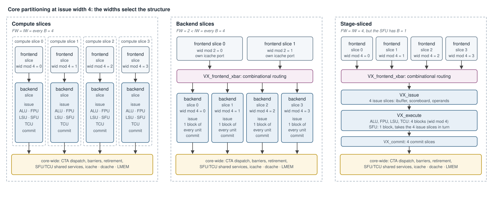

# Core Partitioning — Design

**Scope:** how a Vortex core divides its warps among parallel pipelines — the
fetch width, the issue width and the per-unit block counts, the three core
structures they select, the frontend crossbar that joins slices of different
widths, and the services that stay core-wide. Covers the RTL
([`VX_core.sv`](../../hw/rtl/core/VX_core.sv),
[`VX_frontend_slice.sv`](../../hw/rtl/core/VX_frontend_slice.sv),
[`VX_frontend_xbar.sv`](../../hw/rtl/core/VX_frontend_xbar.sv),
[`VX_backend_slice.sv`](../../hw/rtl/core/VX_backend_slice.sv),
[`VX_compute_slice.sv`](../../hw/rtl/core/VX_compute_slice.sv),
[`VX_issue.sv`](../../hw/rtl/core/VX_issue.sv),
[`VX_execute.sv`](../../hw/rtl/core/VX_execute.sv),
[`VX_commit.sv`](../../hw/rtl/core/VX_commit.sv),
[`VX_lane_dispatch.sv`](../../hw/rtl/core/VX_lane_dispatch.sv)) and the
configuration knobs in [`VX_config.toml`](../../VX_config.toml).

The pipeline stages themselves are described in
[`microarchitecture.md`](microarchitecture.md); the CTA dispatcher that feeds
warps to the slices in [`cta_dispatch_architecture.md`](cta_dispatch_architecture.md);
the LSU blocks in [`lsu_pipeline_design.md`](lsu_pipeline_design.md).



---

## 1. Slicing by warp id

A core holds `VX_CFG_NUM_WARPS` warps. Every parallel structure in it owns a
fixed subset of them, selected by the low bits of the warp id:

| Width | Knob | Owner of warp `wid` | Unit of replication |
|---|---|---|---|
| FW | `VX_CFG_FETCH_WIDTH` | frontend slice `wid mod FW` | warp scheduler, fetch, decode, one icache port |
| IW | `VX_CFG_ISSUE_WIDTH` | issue slice `wid mod IW` | ibuffer, scoreboard, operand collector, commit |
| B  | `VX_CFG_NUM_{ALU,FPU,LSU,SFU,TCU}_BLOCKS` | block `wid mod B` of that unit | one block of the execution unit |

The widths must nest: FW and every B divide IW. FW is a power of two
(`VX_CFG_FETCH_WIDTH` defaults to the lowest set bit of IW), so `wid mod FW`
and `wid mod B` are bit slices of `wid mod IW`, and a warp never changes
slice. Each structure names its warps locally — a frontend slice's warp
`wfs` is core warp `wfs·FW + slice_id` — and instructions leave a slice
carrying the core-wide `wid`.

Defaults: IW is `up(NUM_WARPS / 16)`, so a core of up to 16 warps has one
issue slice; FW follows IW; the ALU, FPU, LSU and TCU have one block per
issue slice (B = IW); the SFU has one block (`VX_CFG_NUM_SFU_BLOCKS = 1`).

## 2. Three structures

[`VX_gpu_pkg.sv`](../../hw/rtl/VX_gpu_pkg.sv) derives the structure from
the widths; there is no switch for it.

```
BACKEND_SLICES = every enabled unit has B == IW   (ALU, LSU, SFU, FPU if F, TCU if TCU)
COMPUTE_SLICES = BACKEND_SLICES && FW == IW
```

| Widths | Structure | Modules |
|---|---|---|
| every B = IW = FW | **compute slices** | IW × `VX_compute_slice`, no crossbar |
| every B = IW, FW < IW | **backend slices** | FW × `VX_frontend_slice`, `VX_frontend_xbar`, IW × `VX_backend_slice` |
| some unit has B ≠ IW | **stage-sliced** | FW × `VX_frontend_slice`, `VX_frontend_xbar`, `VX_issue` / `VX_execute` / `VX_commit` |

All three run the same warps through the same stages with the same
timing; they differ in how many instances there are and what connects them.
With IW = FW = 1 and the default block counts, every condition holds and the
core is a single compute slice.

### 2.1 Compute slices

A compute slice ([`VX_compute_slice.sv`](../../hw/rtl/core/VX_compute_slice.sv))
is a frontend slice and a backend slice joined directly: one end-to-end
pipeline for the warps `wid mod IW == i`, the counterpart of an NVIDIA SM
processing block. Frontend slice *i* serves only issue slice *i* and the
blocks of slice *i*, so there is nothing to route between slices. Only the
core scheduler, the icache, the memory system and the shared SFU/TCU services
are reached through its ports. This is the structure to floorplan by: each
slice is self-contained apart from those ports.

Compute slices with IW > 1 have one SFU block per slice, so each slice's
warp-control requests are arbitrated against the other slices', and a slice
retires its own warps when its exit request is granted (`SLICE_RETIRE`).
With a single slice the core retires them from the registered request.

### 2.2 Backend slices

When FW < IW, frontend slice *f* feeds issue slices `f, f+FW, f+2·FW, …`.
The back end is still IW identical slices
([`VX_backend_slice.sv`](../../hw/rtl/core/VX_backend_slice.sv)): issue,
execute (one block of every unit) and commit for one issue slice. Between
them sits the frontend crossbar (§3).

### 2.3 Stage-sliced

When some unit has fewer blocks than issue slices — by default the SFU — a
block serves several issue slices, so issue and execute cannot be cut into
identical end-to-end slices. The core is cut by stage instead:
[`VX_issue`](../../hw/rtl/core/VX_issue.sv) holds IW issue slices,
[`VX_execute`](../../hw/rtl/core/VX_execute.sv) holds B blocks of each unit,
and [`VX_commit`](../../hw/rtl/core/VX_commit.sv) holds IW commit slices
([`VX_commit_slice`](../../hw/rtl/core/VX_commit_slice.sv)). Each unit's
[`VX_lane_dispatch`](../../hw/rtl/core/VX_lane_dispatch.sv) groups the IW issue
ports into IW / B batches: block *b* takes the issue slices `b, b+B, …` in
turn, which is the `wid mod B` ownership of §1. The batches are granted
round-robin from the last granted one, so no slice is favored. A fixed
priority to the lowest batch, with an idle grant resting on the last one,
made a warp's dispatch latency depend on its slice, so a kernel's time
depended on which warp took a serial role (such as the warp that issues a
CTA's DXA copies), and the low slices could starve the high ones.

## 3. The frontend crossbar

[`VX_frontend_xbar.sv`](../../hw/rtl/core/VX_frontend_xbar.sv) connects FW
frontend slices to IW issue slices and to the ALU and SFU blocks whenever the
core is not built from compute slices. It is purely combinational: it adds
no cycles, so a configuration's timing does not depend on which structure the
widths select.

| Direction | Traffic | Routed by |
|---|---|---|
| frontend → issue | decoded instructions | issue slice *i* takes frontend slice `i mod FW` |
| issue → frontend | issue and commit events, per-warp drain status | the frontend slice that owns the warp |
| ALU blocks → frontend | branch resolution | the owning frontend slice |
| SFU blocks → frontend | warp control, CSR reads of scheduler state, RT unlocks | the owning frontend slice; a read is answered by the slice owning the read `wid` |

## 4. Core-wide services

Some state belongs to the whole core, not to a slice. Each is reached through
one port per slice or per block, in every structure.

| Service | Module | Why core-wide |
|---|---|---|
| CTA launch | [`VX_cta_dispatch`](../../hw/rtl/core/VX_cta_dispatch.sv) in the core scheduler, one lane per frontend slice (`NUM_LANES = FW`) | a CTA's warps span slices |
| barriers, wspawn, warp retirement | [`VX_warp_shared_unit`](../../hw/rtl/core/VX_warp_shared_unit.sv) | a barrier counts warps of every slice |
| DXA, TEX and RTU buses | [`VX_sfu_shared`](../../hw/rtl/core/VX_sfu_shared.sv) | one accelerator of each kind per core; the SFU blocks are arbitrated onto it |
| WGMMA tile buffers | [`VX_tcu_shared`](../../hw/rtl/tcu/VX_tcu_shared.sv) | a warpgroup's B operand is common to its TCU blocks |
| icache, dcache, local memory | [`VX_mem_unit`](../../hw/rtl/core/VX_mem_unit.sv) | one memory system per core; the icache has one request port per frontend slice (`ICACHE_NUM_REQS = FW`) |

`VX_warp_shared_unit` takes one request per cycle, round-robin. Its
requesters register their requests toward the arbiter; a sole requester is
connected directly and its request is registered inside the unit instead, so
a request takes effect at the same distance from its instruction either way.

## 5. Configurations

| Configuration | NW | IW | FW | B (ALU/FPU/LSU/TCU, SFU) | Structure |
|---|---|---|---|---|---|
| default | 4–16 | 1 | 1 | 1, 1 | one compute slice |
| `logic_gate` core (`NT=NW=16`) | 16 | 1 | 1 | 1, 1 | one compute slice |
| U55C image C (`ISSUE_WIDTH=4`) | 8 | 4 | 4 | 4, 1 | stage-sliced |
| `rtx5080` profile | 48 | 4 | 4 | 4, 1 | stage-sliced |
| `rtx5080` with `NUM_SFU_BLOCKS=4` | 48 | 4 | 4 | 4, 4 | 4 compute slices |
| IW = 4, `FETCH_WIDTH=1` | — | 4 | 1 | 4, 4 | backend slices |

To get compute slices at IW > 1, give the SFU one block per issue slice
(`-DVX_CFG_NUM_SFU_BLOCKS=<IW>`). Lowering a block count below IW trades that
unit's throughput and area against arbitration, and moves the core to the
stage-sliced structure.

## 6. Performance and area

**Fetch width.** Each frontend slice schedules and fetches its own warps on its
own icache port, so FW sets how many instructions the core can fetch per
cycle. At FW > 1, slices often fetch from the same icache line in the same
cycle; with `VX_CFG_ICACHE_READ_MERGE` (on by default, no effect at FW = 1)
those reads share one bank access and each slice gets its own word. The
merge cut sgemm cycles by 12.1% at IW = FW = 4, and by 25.8% on one
`rtx5080` core in rtlsim.

**Issue width and blocks.** IW sets how many instructions issue per cycle;
each issue slice has its own ibuffer, scoreboard, operand collector and
commit port. A unit with B < IW issues at most B instructions of that unit
per cycle.

**Area.** A frontend slice replicates the warp scheduler, fetch and decode; a
backend slice, the issue logic and one block of every unit. The crossbar is
combinational routing only. Compute slices replicate the most — every unit
in every slice — and have the shortest connections, since a slice talks to
the rest of the core only through the core-wide services. The stage-sliced
structure shares the units with B < IW at the cost of the dispatch and commit
arbitration between their issue slices.

## 7. SimX

SimX models the timing, not the structure: its core has one pipeline
parameterized by the same widths, and `model_parity` holds it to the RTL in
every structure. A change that moves cycles in one structure moves the SimX
model with it (see [`AGENTS.md`](../../AGENTS.md)).
