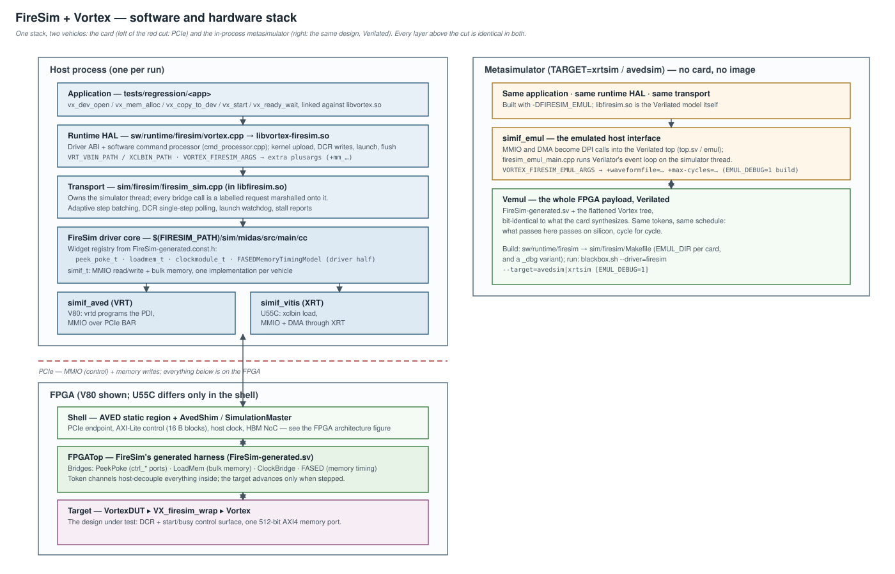
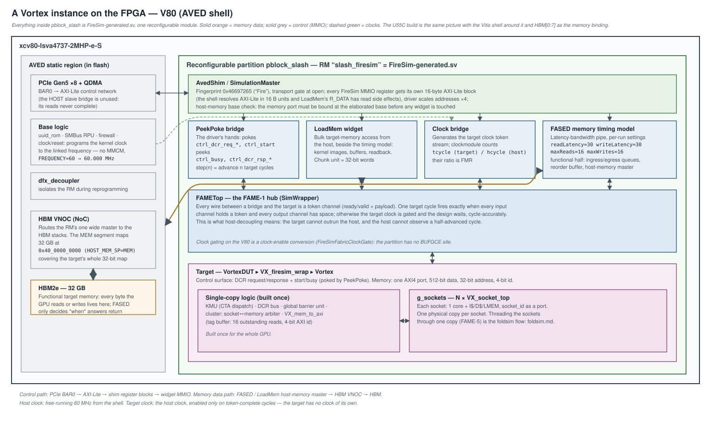
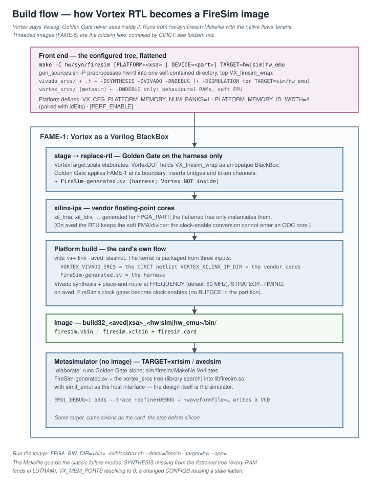
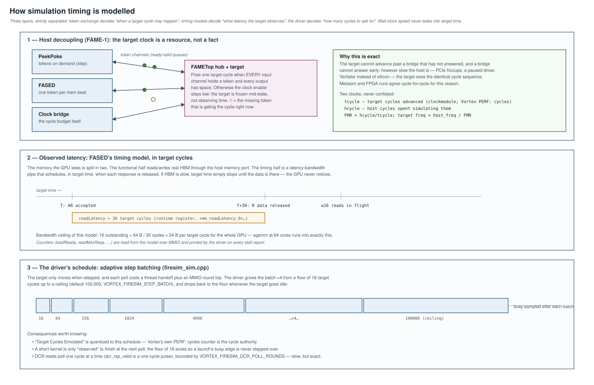
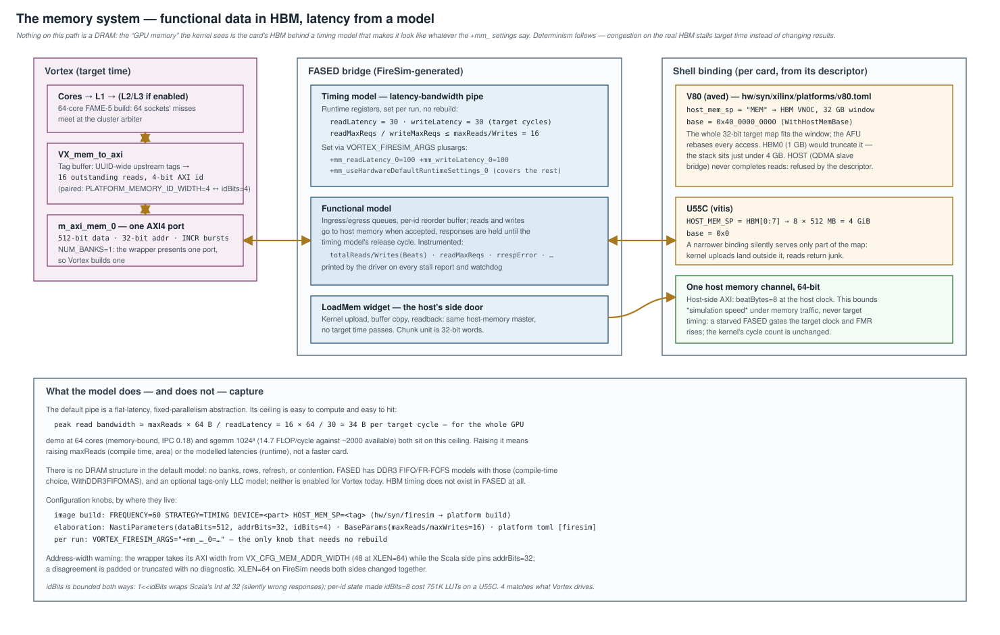

# FireSim integration — host-decoupled FPGA simulation of Vortex

This document specifies how Vortex runs as a [FireSim](https://fires.im/)
target: a multi-core GPU simulated on an FPGA with cycle exactness, on the
Alveo U55C (Vitis/XRT) and the Alveo V80 (AVED/VRT).

| § | contents |
|---|---|
| [1](#1-system-architecture) | System architecture: host stack, FPGA payload, execution model |
| [2](#2-synthesis-of-the-vortex-rtl) | Synthesis of the Vortex RTL |
| [3](#3-threaded-simulation) | Threaded simulation: foldsim |
| [4](#4-the-simulation-timing-model) | The simulation timing model |
| [5](#5-the-memory-system) | The memory system and its configuration; shell configuration |
| [6](#6-observability) | Observability: wave traces, RTL messages and assertions, counters |
| [7](#7-the-transport-layer) | The transport layer |
| [8](#8-running) | Run targets and commands |
| [9](#9-measured-results) | Measured results |
| [10](#10-relationship-to-upstream-firesim) | Relationship to upstream FireSim |
| [11](#11-design-invariants) | Design invariants |
| [12](#12-known-limitations) | Known limitations |

FireSim itself is an external dependency: the
[`vortexgpgpu/firesim`](https://github.com/vortexgpgpu/firesim) fork, consumed
through `$(FIRESIM_PATH)` (default `$(TOOLDIR)/firesim`) and pinned by
`FIRESIM_REV` in `VERSION` — see [§10](#10-relationship-to-upstream-firesim).
For running kernels on hardware generally, see
[`fpga_setup.md`](../fpga_setup.md); for the other simulation vehicles,
[`simulation.md`](../simulation.md).

---

## 1. System architecture



### 1.1 The layering

Everything above the PCIe boundary except the FireSim driver core lives in
this repository — deliberately, so the FireSim checkout stays close to
upstream. From the application down:

- **Application** (`tests/regression/<app>`): the ordinary `vx_*` API; it
  cannot tell FireSim from any other backend.
- **Runtime HAL** (`sw/runtime/firesim/vortex.cpp` →
  `libvortex-firesim.so`): the driver ABI plus the software command
  processor; kernel upload, DCR configuration, launch, flush.
- **Transport** (`sim/firesim/firesim_sim.cpp`, in `libfiresim.so`): owns the
  simulator thread and marshals every operation onto it; stepping policy,
  watchdogs, diagnostics ([§7](#7-the-transport-layer)).
- **FireSim driver core** (`$(FIRESIM_PATH)/sim/midas/src/main/cc`): the
  widgets generated alongside the hardware — `peek_poke_t`, `loadmem_t`,
  `clockmodule_t`, FASED's driver half — over a `simif_t` that is
  `simif_aved` (VRT) on the V80, `simif_vitis` (XRT) on the U55C, and
  `simif_emul` in the metasimulator.
- **FPGA payload** (`FireSim-generated.sv`): the shell shim, FireSim's
  bridges, the FAME hub, and the target — Vortex behind
  `hw/rtl/afu/firesim/VX_firesim_wrap.sv`.

The **metasimulator** (`TARGET=xrtsim`/`avedsim`) is the same stack with the
bottom swapped: `libfiresim.so` *is* the Verilated FPGA payload, reached
through `simif_emul` over DPI, and needs no card, image, XRT or VRT. It runs
the same tokens on the same generated design, which is why it agrees with
silicon cycle for cycle and is the step before every bitstream.

### 1.2 The FPGA payload



On the V80, the AVED static region (permanently in flash) carries the PCIe
endpoint, the AXI-Lite control network, the clock/reset logic and the HBM
NoC. The reconfigurable partition holds one module — `FireSim-generated.sv` —
containing:

- **`AvedShim` / SimulationMaster**: the control-plane adapter. The compute
  shell resolves AXI-Lite in 16-byte blocks and FireSim registers have read
  side effects (LoadMem's `R_DATA` dequeues), so every register gets its own
  block and the shim answers the padding words itself; the driver scales
  addresses by 4. At open, the driver checks the `0x46697265` ("Fire")
  fingerprint, writes and reads back a probe, and verifies the memory port is
  bound at the elaborated base before any widget is touched.
- **Bridges** (the host-visible half of the simulation): PeekPoke (the
  target's DCR/start/busy surface), LoadMem (bulk target memory), the clock
  bridge (`tcycle`/`hcycle`), and FASED (the memory model,
  [§5](#5-the-memory-system)).
- **The FAME hub** (`FAMETop`): token channels between the bridges and the
  target; the mechanism of host decoupling ([§4](#4-the-simulation-timing-model)).
- **The target**: `VortexDUT` ▸ `VX_firesim_wrap` ▸ Vortex.

Clocking on the V80 has one platform quirk worth knowing: FireSim gates the
target clock, the partition has no `BUFGCE` site, and a fabric clock gate is
not safe. `AvedConfig` therefore selects `FireSimFabricClockGate` — a plain
AND marked `gated_clock` that synthesis's gated-clock conversion moves onto
the clock-enable pin of every register, RAM and DSP it drives. `BUFGCE`
semantics, no derived clock; a pre-opt check fails the build if any kernel
clock is still driven by logic. (This is also why vendor OOC IP cannot sit
inside the kernel on aved: the conversion cannot enter it, so the RTU uses
the soft FMA/divider there — `VX_CFG_RTU_USE_DSP=0`.)

### 1.3 Host-decoupled execution

FireSim does not emulate Vortex at wall-clock speed and let the host observe
it. Golden Gate (MIDAS) compiles the design into a FAME-1 transformed model
in which *every* target clock edge is explicitly scheduled. The practical
consequence, and the thing that shapes the entire driver: **the target does
not run unless the host tells it to.** There is no free-running clock to
poll; a driver that issues an MMIO read and waits, waits forever. This is the
single most important difference from the XRT flow, where the kernel clock
free-runs and the host merely observes.

Two clocks matter and must not be conflated:

| | what it counts | where it comes from |
|---|---|---|
| **target cycles** | cycles the Vortex design advanced | `clockmodule_t::tcycle()`, and Vortex's own `PERF: cycles=` |
| **host cycles** | cycles the FPGA spent simulating them | `clockmodule_t::hcycle()` |

Their ratio is **FMR** (FPGA-to-Model Ratio); the effective target frequency
is `host_freq / FMR`. **Do not quote FireSim's `Target Cycles Emulated` as a
kernel cycle count** — it reports cycles the *driver stepped*, quantized by
the batching schedule ([§4.3](#43-the-drivers-schedule)), and can overstate a
short kernel by up to 4×. Vortex's `PERF: cycles=` counter is exact and is
what every measurement in this repository uses.

---

## 2. Synthesis of the Vortex RTL



Vortex stays Verilog: Golden Gate sees it as an opaque BlackBox, transforms
only its boundary (FAME-1), and the card's platform flow synthesizes the
Verilog directly. The build is driven from `hw/syn/firesim/Makefile` with the
same tokens as the native flows:

```bash
source ci/firesim_env.sh          # after the card's Xilinx environment
# U55C (XRT): TARGET=hw | hw_emu
make -C hw/syn/firesim PLATFORM=xilinx_u55c_gen3x16_xdma_3_202210_1 TARGET=hw
# V80 (AVED): TARGET=hw | sim
make -C hw/syn/firesim TARGET=hw PERF=1 CONFIGS="-DVX_CFG_NUM_WARPS=16"
```

The image lands in `<PREFIX>_<aved|xsa>_<TARGET>/bin` as
`firesim.vbin` or `firesim.xclbin`, beside `firesim.card`, which names the
card for `run-firesim`. `PREFIX`, `XLEN`, `CONFIGS`, `PERF=1` work as in the
other synthesis flows; extensions pull their sources in through
`hw/syn/extensions.mk`. Nothing given on this command line reaches FireSim's
own makes (`MAKEOVERRIDES` is cleared): FireSim uses `PLATFORM`, `TARGET` and
`BUILD_DIR` for its own purposes, and each sub-make is handed exactly what it
needs.

### 2.1 The flattened trees

Golden Gate and Vivado take a file list, not include paths, so
`gen_sources.sh -P` preprocesses `hw/rtl` into one self-contained directory
with the macros already inlined, top `VX_firesim_wrap`. Two flattenings
exist because simulation and synthesis need opposite defines:

| flattening | defines | consumed by |
|---|---|---|
| `vivado_srcs/` | `-DSYNTHESIS -DVIVADO -DNDEBUG` (+ `-DSIMULATION` for `TARGET=sim`/`hw_emu`) | platform synthesis |
| `vortex_srcs/` | `-DNDEBUG` only | the Verilator metasimulator |

The invariants here have each cost hours when broken:

- **`-DSYNTHESIS` is not optional.** `VX_dp_ram`/`VX_sp_ram` gate all
  block-RAM inference behind it, and because the tree is *preprocessed*, the
  BRAM branch is not inactive without it — it is deleted. Every memory then
  lands in distributed RAM and place-and-route fails hours later at ~750K
  LUTs-as-memory with nothing pointing at the cause.
- **Verilator gets a library search, not a flat list.** Handing it every
  file makes it stop treating the macro-computed width parameters as
  constants; only the packages (in dependency order) and the wrapper are
  named, the rest resolves via `-y`.
- **A changed `CONFIGS` must invalidate the flatten.** Defines arrive on the
  command line, which no file timestamp reflects; a stamp file rewritten only
  when the flags differ hangs the dependency.
- **Only overrides and type selectors are passed, never the resolved
  config.** Passing the whole resolved `XCONFIGS` replaces `VX_config.vh`'s
  computations with report values, which sets the memory port count to zero;
  both flatten rules grep the result for `VX_MEM_PORTS = 0` and fail fast.

### 2.2 Vortex as a BlackBox

`hw/syn/firesim/src/main/scala/VortexTarget.scala` instantiates Vortex as a
Chisel BlackBox. Golden Gate cannot see inside it, which is the point: the
FAME-1 transform channelizes the boundary signals — the AXI memory port, the
DCR/start/busy control surface — and leaves the internals alone. `image`
then runs, in order: `vivado-sources`, `xilinx-ips` (the `xil_fma`/`xil_fdiv`
floating-point cores for the card's part), `stage` (copy the Scala targets,
harnesses and the generated platform config into the fork — only what
changed, since FireSim's make judges elaboration by these timestamps),
`replace-rtl` (Golden Gate), and the platform's own build (`v++` on vitis,
slashkit on aved), handed:

- `VORTEX_VIVADO_SRCS` — the netlist CIRCT elaborates from the flattened
  tree, packaged into the kernel;
- `VORTEX_XILINX_IP_DIR` — the vendor cores, copied in fresh directories
  (Tcl's `file copy` onto an existing directory nests instead of replacing,
  which silently reuses the previous run's cores);
- `FREQUENCY` (default 60 MHz) and `STRATEGY` (default `TIMING`).

---

## 3. Threaded simulation

This backend simulates Vortex unthreaded: one physical copy of every module.
Threading a GPU's identical units through one physical copy each (FAME-5) is
the foldsim flow, which compiles Vortex with CIRCT rather than Golden Gate and
has its own kernel, driver and image: see [foldsim.md](foldsim.md).

---

## 4. The simulation timing model



Three layers, strictly separated:

### 4.1 Token exchange decides *when a cycle may happen*

Every wire between a bridge and the target is a token channel. The FAME hub
fires one target cycle exactly when every input channel holds a token and
every output channel has space; otherwise the target clock stays gated and
the design is frozen mid-state, not observing time. However slow the host
is — PCIe latency, a paused driver, Verilator instead of silicon — the target
sees the identical cycle sequence. This is why metasim and FPGA agree cycle
for cycle, and why wall-clock speed never contaminates a measurement.

### 4.2 Timing models decide *what latency the target observes*

Latency the GPU experiences is not the card's memory latency — it is whatever
the FASED timing model schedules, in target cycles ([§5](#5-the-memory-system)).
A memory response that takes 400 host cycles to fetch from HBM still arrives,
in target time, exactly `readLatency` cycles after its request; the missing
host cycles simply never existed for the target.

### 4.3 The driver's schedule

The driver decides *how many cycles to ask for*. `is_busy()` must both catch
the launch edge (busy is a level; a batch stepped past a short kernel would
wait forever on a rise that already happened) and give long kernels
throughput (each poll costs a thread handoff plus an MMIO round trip). The
batch therefore grows ×4 from a floor of 16 target cycles to a ceiling
(default 100,000, `VORTEX_FIRESIM_STEP_BATCH`), dropping back to the floor
when the target goes idle. This schedule is what quantizes
`Target Cycles Emulated` (§1.3). DCR reads are the exception: `dcr_rsp_valid`
is a one-cycle pulse, so the poll advances one target cycle at a time,
bounded by `VORTEX_FIRESIM_DCR_POLL_ROUNDS` ([§7](#7-the-transport-layer)).

---

## 5. The memory system



### 5.1 The path

Vortex presents **one AXI4 memory port** (512-bit data, 32-bit address,
4-bit id, INCR bursts at full width). `VX_firesim_wrap` is built with
`VX_CFG_PLATFORM_MEMORY_NUM_BANKS=1` so Vortex builds exactly one internal
port: at the default of two, `VX_mem_to_axi` recovers the originating port
from the *returned* AXI id, which makes correctness depend on the memory
model echoing `rid` bit-exact — an assumption real AXI satisfies but a timing
model need not.

That port terminates in **FASED**, FireSim's memory timing model, which is
two halves:

- **Functional**: data lives in the card's real memory, reached over the
  shell's host-memory port. Reads and writes are performed when accepted;
  responses are held in egress queues (with a per-id reorder buffer) until
  released.
- **Timing**: a latency-bandwidth pipe decides the release cycle. Runtime
  registers, defaults: `readLatency=30`, `writeLatency=30` target cycles,
  ≤16 reads and ≤16 writes in flight.

The **LoadMem widget** is the host's side door onto the same functional
memory — kernel upload, buffer copies, readback — consuming no target time.

### 5.2 Configuring the timing model per run

FASED's registers are set by plusargs, which the runtime forwards from
`VORTEX_FIRESIM_ARGS` (card and metasim alike). Any register set explicitly
requires the rest to be covered by the hardware-defaults plusarg:

```bash
VORTEX_FIRESIM_ARGS="+mm_readLatency_0=100 +mm_writeLatency_0=100 +mm_useHardwareDefaultRuntimeSettings_0" \
  ./ci/blackbox.sh --driver=firesim --target=avedsim --app=demo ...
```

Validated: a 4-core demo runs 15,541 cycles at the default 30-cycle latency
and 47,371 at 100/100 — same 9,776 instructions, `PASSED` both ways.
This is the only memory knob that needs no rebuild.

The model's ceiling is worth computing before trusting a bandwidth-bound
number: `maxReads × 64 B / readLatency` ≈ 34 B per target cycle for the
whole GPU at the defaults. Raising
the ceiling means `maxReads` (compile-time, and the egress area scales with
it) or lower modelled latency (runtime). There is no DRAM structure — banks,
rows, refresh — in the default pipe; FASED has DDR3 FIFO/FR-FCFS models and a
tags-only LLC model as compile-time alternatives (`WithDDR3FIFOMAS`,
`WithLLCModel`), none enabled for Vortex today, and no HBM timing model at
all.

FASED's counters (`totalReads`, `totalWrites`, beat counts, `readMaxReqs`,
response errors) are read over MMIO and printed by the driver on every stall
report and watchdog — the first place to look when a kernel starves.

### 5.3 Configuring the shell

Everything card-specific comes from the platform descriptor
(`hw/syn/xilinx/platforms/<card>.toml`), whose `[firesim]` section names the
FireSim platform, the part, and the host-memory binding; `gen_platform.py`
generates from it both the make fragment and the platform config class
(`V80PlatformConfig` = `WithHostMemBase(0x40_0000_0000)` + `DefaultAvedConfig`),
so one file governs elaboration and link alike.

| | V80 (aved) | U55C (vitis) |
|---|---|---|
| binding | `host_mem_sp = "MEM"`: the HBM VNOC, **32 GB at 0x40_0000_0000** | `HOST_MEM_SP = HBM[0:7]`: 8 × 512 MB = 4 GiB at 0 |
| why | the whole 32-bit target map in one window; HBM0 (1 GB) would truncate it — the stack sits just under 4 GB; `HOST` (QDMA slave bridge) never completes reads and is refused by the descriptor | the card has no DDR bank; a narrower binding silently serves part of the map and kernel uploads land outside it |
| host channel | one, 64-bit, at the host clock | one, 64-bit |
| image-build knobs | `FREQUENCY` (60), `STRATEGY` (`TIMING`), `DEVICE` | + `PLATFORM=<xsa>` |

The host channel's width bounds *simulation speed* under memory traffic,
never target timing: a starved FASED gates the target clock, FMR rises, and
the kernel's cycle count is unchanged.

Two width couplings must move together or nothing warns:

- **`idBits` (VortexTarget.scala) ↔ `PLATFORM_MEMORY_ID_WIDTH`
  (hw/syn/firesim/Makefile).** One shapes the IO the BlackBox is instantiated
  with, the other the module's ports; Verilog pads or truncates a
  disagreement silently. The value is bounded both ways: at 32,
  `1 << idBits` wraps Scala's `Int` and every AXI id shares one response
  queue (silently wrong data); at 8, per-id egress state cost 750,955 LUTs
  against a U55C's 600,960. 4 matches what Vortex drives
  (`CLOG2(TAG_BUFFER_SIZE)`) and FASED's `maxReads` of 16.
- **`addrBits` ↔ `VX_CFG_MEM_ADDR_WIDTH`.** The Scala side pins 32 while the
  wrapper follows XLEN (48 at XLEN=64): XLEN=64 on FireSim needs both changed
  together or addresses truncate silently.

---

## 6. Observability

### 6.1 Wave traces

**Metasimulator (the primary path).** Build the metasim library with tracing
and pass the dump plusargs at run time:

```bash
EMUL_DEBUG=1 \
VORTEX_FIRESIM_EMUL_ARGS="+waveformfile=$PWD/demo.vcd +max-cycles=60000" \
  ./ci/blackbox.sh --driver=firesim --target=avedsim --cores=4 --warps=4 --threads=4 --app=demo
```

`EMUL_DEBUG=1` (sim/firesim/Makefile) Verilates with `--trace
--trace-structs +define+DEBUG` into its own build directory (`…_dbg`) — the
model rule does not depend on flags, so debug and normal builds must not
share one. The plusargs are FireSim's emul-top contract (`top.sv`):
`+waveformfile=<path>` opens the VCD, and `+max-cycles=<n>` is **required** —
dumping runs from `+dump-start` (default 0) for `max-cycles` host clocks and
`$dumpoff`s at the end, so without it the window is empty. The run itself
continues to completion after the window closes. `VORTEX_FIRESIM_EMUL_ARGS`
also takes ordinary Verilator runtime args (e.g. `+verilator+rand+reset+2`
to randomize uninitialized state).

**Size the window before running.** The dump covers every signal of the
FPGA payload: a 4-core demo writes ~23 GB for a 60,000
host-cycle window (~380 KB per host cycle). Place `+dump-start` just before
the region of interest and keep `+max-cycles` in the low tens of thousands;
the simulation itself runs to completion after the window closes, unperturbed
(same 15,541 cycles traced and untraced).

**Reading the waves.** The hierarchy is
`TOP.emul.FPGATop.sim.target.…` — `emul` is the DPI testbench, `FPGATop`
the FPGA payload, `sim.target` the FAME hub's interior. Orientation:

- everything toggles on the **host clock**; one target cycle is one firing
  of the hub, so anchor on the clock channel or `ctrl_busy` rather than
  counting clock edges;
- the target lives under `FPGATop.sim.target…`;
- the bridges' AXI (FASED) and MMIO surfaces are at the top level — the
  fastest way to see whether a hang is the target or the transport.

**U55C `hw_emu`** uses XSIM, not Verilator: waveform capture is governed by
`sw/runtime/firesim/xrt.ini` (`debug_mode=batch` writes the `.wdb`; it is
~800 MB for a demo run and the dominant cost, so it is off by default).

**On the card: none.** There is no ILA in these images (AutoILA is off on
the V80 — Versal has no `ila` core — and not wired on the U55C flow). On-card
visibility is the counters and driver diagnostics below; anything deeper
moves to the metasimulator with the same image configuration.

### 6.2 `$display`, `$error`, assertions

All of Vortex's messages and assertions live behind `SIMULATION`
(`hw/rtl/VX_platform.vh`: `STATIC_ASSERT`, `ASSERT`/`RUNTIME_ASSERT`,
`ERROR`, and the `DBG_TRACE_*` machinery). Where that define exists in this
flow:

| vehicle | `SIMULATION`? | consequence |
|---|---|---|
| `TARGET=sim` (V80 XSIM image), `TARGET=hw_emu` (U55C) | **yes** | `$display`/`$error`/asserts fire in the platform simulator's log |
| metasim `xrtsim`/`avedsim` | no (`-DNDEBUG` only) | compiled out — the metasim flattening carries neither synthesis nor simulation defines, and adding `-DSIMULATION` there is untested (a few library modules would also want the `dpi_trace` objects the metasim does not link) |
| `TARGET=hw` | no (`SYNTHESIS`) | compiled out, as in every synthesis flow |

Golden Gate's own synthesized printf/assert machinery (`SynthPrints`,
`SynthAsserts` — both enabled in the platform config) applies only to
printf/stop nodes authored in Chisel or present in the FIRRTL; Vortex arrives
as a BlackBox containing neither, so it contributes nothing here. In short:
**for RTL-level messages and asserts, use `TARGET=sim`/`hw_emu`, or rtlsim
outside FireSim entirely; on `hw`, instrument via counters and the driver.**

### 6.3 Performance counters and driver diagnostics

Vortex's performance counters are the only view inside the core that needs no
re-elaboration. They are read over the DCR path and gated behind
`PERF_ENABLE`: build the image with `PERF=1`, and note that **without it
every counter reads zero, which is indistinguishable from an idle core**.
The driver prints, on every stall report, watchdog expiry and (optionally)
completion: FASED's request/beat/error counters, the core's scheduler and
pipeline-stall counters, and the D-cache counters — enough to separate "a
stalled pipeline" from "a memory request that never returned".

The transport's own knobs and reports:

| env var | effect |
|---|---|
| `VORTEX_FIRESIM_TRACE=1` | timestamped log of every request the transport services |
| `VORTEX_FIRESIM_ARGS` | extra plusargs to the FireSim driver (`+mm_*`, §5.2) |
| `VORTEX_FIRESIM_EMUL_ARGS` | Verilator runtime args, metasim only (waves, rand-reset) |
| `VORTEX_FIRESIM_TIMEOUT_S` | launch watchdog, wall seconds; expiry prints the full counter report and exits 124 |
| `VORTEX_FIRESIM_STALL_CYCLES` | target-cycles-busy threshold for the wedge report |
| `VORTEX_FIRESIM_STEP_BATCH` | batching ceiling (§4.3) |
| `VORTEX_FIRESIM_DCR_POLL_ROUNDS` | DCR read poll bound, in target cycles |
| `VORTEX_FIRESIM_PREFILL`, `VORTEX_FIRESIM_DUMP_UPLOADS`, `VORTEX_FIRESIM_VERIFY_WRITES`, `VORTEX_FIRESIM_REPORT_ON_IDLE` | debugging aids: pattern-stamp a region before launch; dump every upload to files; read back every write; counter dump on healthy completion |

### 6.4 Choosing a vehicle

| need | vehicle |
|---|---|
| waves of the exact FPGA payload | metasim + `EMUL_DEBUG=1` |
| Vortex `$display`/asserts | `TARGET=sim` / `hw_emu` (or rtlsim) |
| speed with full fidelity | the card |
| memory-timing experiments without rebuilds | any vehicle + `VORTEX_FIRESIM_ARGS` |

---

## 7. The transport layer

`sim/firesim/firesim_sim.cpp` is the largest single piece of the
integration, and where host-decoupling shows up as real complexity.

- **Threading.** FireSim's bridges are not thread-safe and are only touched
  by the simulator thread; every operation is a labelled closure marshalled
  through a queue (the label is what makes a trace attribute a stall to an
  operation). In the metasimulator the same thread runs Verilator's event
  loop, and `entry()` is reached from the emul top's initial block.
- **Memory access.** `access_mem` moves data through LoadMem one host beat
  at a time with read–modify–write on unaligned edges. **LoadMem's chunk is
  counted in 32-bit words, not bytes**; treating it as bytes stores two live
  bytes per eight and drops every unaligned write — a kernel image uploaded
  that way is fetched as a mixture of written and stale memory with no error
  anywhere. Whole-beat writes bypass the RMW path.
- **Stepping** is §4.3's adaptive batching; **DCR reads** single-step
  because the response valid is a one-cycle pulse. Batched DCR polling would
  need the response latched in the wrapper — a target-side change and a new
  bitstream, noted as a follow-up.
- **Peeks after a blocking step are non-blocking.** A blocking peek waits up
  to 0.1 s for the `PRECISE_PEEKABLE` flag before returning; after a blocking
  step the value is already final and the wait adds nothing but time.
- **Watchdogs.** A launch that exceeds `VORTEX_FIRESIM_TIMEOUT_S` or a
  busy-level that exceeds `VORTEX_FIRESIM_STALL_CYCLES` produces the full
  counter report (§6.3) and a clean abort — on this vehicle, "hung" must be
  distinguishable from "slow" without a reboot.

---

## 8. Running

```bash
# metasimulator (no image, no card):
./ci/blackbox.sh --driver=firesim --target=avedsim --warps=4 --threads=4 --app=demo
# the card:
FPGA_BIN_DIR=$PWD/hw/syn/firesim/build32_aved_hw/bin \
  ./ci/blackbox.sh --driver=firesim --target=hw --warps=4 --threads=4 --app=demo
```

| card | FireSim platform | run targets | image / card named by |
|---|---|---|---|
| `u55c` | `vitis` (XRT) | `xrtsim`, `hw_emu`, `hw` | `XCLBIN_PATH` |
| `v80` | `aved` (VRT) | `avedsim`, `sim`, `hw` | `VRT_VBIN_PATH`, `VRT_DEVICE_BDF` (discovered when unset) |

`run-firesim` takes the card from `$(FPGA_BIN_DIR)/firesim.card`; the
metasim targets need no image and default to the card of their platform
(`FIRESIM_CARD` overrides). The architecture flags (`--cores`, `--warps`,
`--threads`, `CONFIGS=`) must match the image's — they configure the runtime
and, in the metasim, the model build. On the V80, `TARGET=hw` runs
`ci/v80_preflight.sh` first (link state, cooldown between PDI loads), and a
first `SIGINT`/`SIGTERM` stops the run cleanly (`FAILED`, exit 130/143; 124
is the launch watchdog). A FireSim run uses the card's native driver
environment — on the V80 that means the slashkit-linked Xilinx tools and the
static shell in flash, as for the native `aved` backend.

---

## 9. Measured results

### 9.1 U55C

1 cluster / 1 core / 4 warps / 4 threads, L1 only, `FPU_USE_DSP=0`, kernel
clock 60 MHz. Kernel-only utilization: 131,578 LUTs (10.1%), 62,004 FFs,
109 BRAM tiles, 8 URAM, 24 DSP. The kernel clock closes at WNS +5.283 ns
(Fmax ≈ 87.8 MHz); the design-level WNS of +0.003 ns belongs to the Vitis
shell's 450 MHz `hbm_aclk`, not to Vortex. `sgemm -n1024`:
instrs=1,187,250,192, cycles=3,229,839,120, 84.6 s of kernel time (~153×
faster than rtlsim on `sgemm -n32`). Instruction counts match rtlsim
exactly; cycle counts differ −1.3%…+7.1% — the FASED timing model, not the
core: FPGA and hw_emu agree exactly.

Threaded images and their results are the foldsim flow's:
[foldsim.md](foldsim.md).

---

## 10. Relationship to upstream FireSim

The FireSim checkout is a clone of the `vortexgpgpu/firesim` fork (branch
`vortex_3.x`, based on upstream 1.21.0), consumed through `FIRESIM_PATH` and
pinned by `FIRESIM_REV` in `VERSION`. `make stage` refuses a checkout that
does not contain the pinned commit; being ahead of it is normal while
developing the fork. The fork's changes are platform plumbing and bug fixes
rather than divergence — the AVED platform (shim, register blocks, fabric
clock gates, host-memory base as a config field), driver lifetime and
toolchain fixes, cycle-accounting fixes, and kernel packaging — all
candidates for upstreaming. Everything Vortex-specific (targets, wrapper,
transport) lives in this repository and is staged in at
build time.

---

## 11. Design invariants

1. **The target only advances when stepped.** Any new driver operation that
   waits on target state must step, and must know whether the signal it
   waits on is a pulse or a level.
2. **`idBits` ↔ `PLATFORM_MEMORY_ID_WIDTH` move together**, and `addrBits` ↔
   `VX_CFG_MEM_ADDR_WIDTH`; disagreements pad or truncate silently.
3. **`SYNTHESIS` must reach the flattened tree** — its absence surfaces
   hours later in place-and-route.
4. **Vortex's `PERF:` counters are the cycle authority**, never
   `Target Cycles Emulated`.
5. **All-zero performance counters mean `PERF_ENABLE` is off**, not that the
   core is idle.
6. **LoadMem's chunk unit is 32-bit words**, not bytes.

---

## 12. Known limitations

- **No RTL `$display`/asserts on `hw`** (§6.2); the metasim
  compiles them out too (no DPI linked). RTL-message debugging belongs to
  `TARGET=sim`/`hw_emu` or rtlsim.
- **DCR reads single-step** — one MMIO round trip per target cycle; batched
  polling needs a latched response in the wrapper (target-side follow-up).
- **XLEN=64 is not wired through FireSim**: `addrBits` is pinned at 32
  (§5.3).
- **One host memory channel** bounds simulation speed under heavy memory
  traffic (never target timing).
- **The default memory model is a flat latency-bandwidth pipe** — no banks,
  rows, refresh or HBM timing (§5.2).
- **The conda environment is not relocatable** as built; re-package with
  `conda-pack` to move it (see
  [`../building_toolchain.md`](../building_toolchain.md)).
