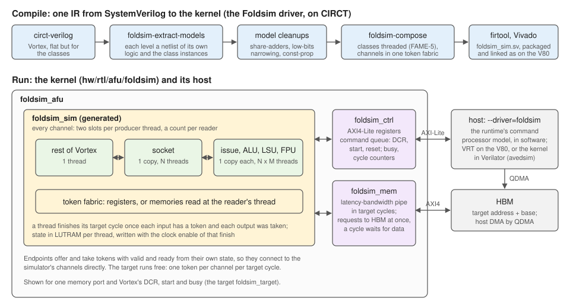

# foldsim — threaded FPGA simulation of Vortex, on CIRCT

foldsim runs Vortex on the Alveo V80 as a host-decoupled, cycle-exact
simulator in which every class of identical units — sockets, issue slices,
ALUs, FPUs, load-store units — is time-multiplexed through **one physical
copy** (FAME-5 model multithreading). A GPU many times the card's size fits
on it, and runs orders of magnitude faster than Verilator.

| § | contents |
|---|---|
| [1](#1-overview) | Overview and how to run it |
| [2](#2-the-compiler) | The compiler: netlists, threading, composition |
| [3](#3-the-simulator) | The simulator: threads, channels, the token fabric |
| [4](#4-the-kernel) | The kernel: memory and control endpoints |
| [5](#5-the-runtime) | The runtime and its register contract |
| [6](#6-validation) | Validation |
| [7](#7-measured-results) | Measured results |
| [8](#8-invariants-and-limitations) | Invariants and limitations |

---

## 1. Overview



The whole flow is one IR from SystemVerilog to Verilog: `circt-verilog`
imports Vortex, foldsim's passes cut it into models and compose the
simulator, `firtool` writes it out, and the card's native flow (IP-XACT
packaging, `slashkit link`) builds the image. foldsim is a project of its own
that builds on CIRCT, as POCL builds on LLVM: the `foldsim` driver and
`foldsim-opt` come from the toolchain (`$(TOOLDIR)/foldsim`), CIRCT from
`$(TOOLDIR)/circt`. Nothing else is in the flow: no Yosys, no sv2v.

```bash
export FOLDSIM_CLASSES="VX_socket__lift VX_issue_slice__lift VX_alu_int__lift VX_alu_muldiv__lift VX_lsu_slice__lift+VX_lsu_scheduler__lift VX_fpu_std"
export FOLDSIM_LIFT="VX_socket:drop=INSTANCE_ID;port=SOCKET_ID VX_issue_slice:drop=ISSUE_ID VX_alu_int:port=BLOCK_IDX VX_alu_muldiv VX_lsu_slice:port=CORE_ID VX_lsu_scheduler"
CONFIGS="-DVX_CFG_NUM_CORES=2 -DVX_CFG_NUM_WARPS=4 -DVX_CFG_NUM_THREADS=4 -DVX_CFG_ISSUE_WIDTH=2"
CONFIGS="$CONFIGS" ./ci/blackbox.sh --driver=foldsim --app=sgemm                 # Verilator
make -C hw/syn/foldsim CONFIGS="$CONFIGS"                                         # the image
FPGA_BIN_DIR=$PWD/hw/syn/foldsim/build32_foldsim_hw/bin CONFIGS="$CONFIGS" \
  ./ci/blackbox.sh --driver=foldsim --target=hw --app=sgemm                       # the V80
```

`FOLDSIM_CLASSES` names the modules threaded as classes; a class may contain
others (the socket contains the issue slices). `FOLDSIM_LIFT` gives
interface-port units a plain-port boundary first, so they can be classes
(`hw/syn/foldsim/lift_boundaries.py`, a source-to-source pass on pyslang; the
RTL is not changed). `port=P` turns an instance-ID parameter into an input
port, and every parameter derived from it below, so that all instances of the
class elaborate to one module: the socket's `SOCKET_ID` carries every core's
`CORE_ID` with it. The tools are found through `FOLDSIM` (the driver) and
`CIRCT_BIN`, by default `hw/syn/common.mk`'s `FOLDSIM_PATH` and `CIRCT_PATH`.

A class `A+B` fuses two modules of the same parent (`foldsim-fuse-models`):
each `A` is paired with the one `B` it exchanges bits with, and each pair is
simulated as one model, so a path from one through the other and back takes
a thread one host cycle instead of a round trip through their channels. The
LSU slice and its scheduler are such a pair (the slice's request, the
scheduler's `ready` on it, the slice's `ready` on that): fused, tinygpu runs
at 3.00 host cycles per target cycle instead of 4.00 (V80), with the same
threads and copies and fewer LUTs.

The flow reads Vortex as source, so it builds the configuration whose units
are source: the STD FPU (`-DVX_CFG_FPU_TYPE_STD`), and the RTU's soft FMAs and
dividers, which the flow's copy of the floating-point units selects in place of
the Xilinx cores. A RAM that asks for block RAM but reads asynchronously reads
synchronously once the target is flattened (CIRCT `seq-retime-firmem-reads`,
see the hardware library's "Block RAM and asynchronous reads");
`gen/memories.rpt` lists each such RAM and the decision.

---

## 2. The compiler

The `foldsim` driver drives four steps, all in one MLIR module of the HW,
Comb and Seq dialects; steps 2 to 4 run in `foldsim-opt`:

1. **Import and flatten.** `circt-verilog` elaborates the target
   (`foldsim_target`: Vortex with its AXI4 port, DCR, start and busy as plain
   ports) with `--detect-memories`; everything but the class modules is
   inlined.
2. **Cut netlists, innermost first** (`foldsim-extract-models{netlist}`). A
   module with class instances becomes `<module>_model` — its own logic, with
   ports for what it exchanges with the instances — and `<module>` becomes a
   netlist of the same ports, instantiating `<module>_model` beside the class
   instances, wired as before. Instances of the module elsewhere stay valid,
   so the socket's netlist is cut out of the top in turn. Bits of a model
   output that are always the same constant stay in the parent, and an input
   driven only by the parent's inputs and constants, or exactly by another
   model's output, is wired to those directly. Small logic (up to 64 ops)
   that drives the same input of every instance of a model from other models'
   outputs is moved into the model (`absorb-logic`), so that input comes from
   those models rather than through the parent's model.
3. **Clean up the models**: `hw-expand-array-writes` (a conditional write of
   one array element becomes a select per element), `seq-reg-const-prop`,
   `comb-share-adders` (`mux(c, a+b, a-b)` → one adder),
   `comb-low-bits-narrowing` (adders whose operands have known-zero low bits),
   canonicalization, and CSE after a topological sort (in a module body, CSE
   cannot merge a duplicate whose users come first). These are what a
   threaded model's area is sensitive to; ExportVerilog emits sign-extended
   multiplies as `$signed` so Vivado maps them to single DSPs.
4. **Compose** (`foldsim-compose`). The top netlist's nested netlists are
   inlined, every instance of a model becomes one thread of that model's
   single threaded copy (§3), and every wire between them a channel of the
   token fabric. The result is `foldsim_sim`: `hostClock`, `hostReset`, a
   channel per target port (`<port>_valid`, `_ready`, `_bits`) and a
   `profile_finish` bit per class.

The driver also writes `foldsim_sim.json` (the ports, and each class's thread
count) and `foldsim_sim.vh` (the class count, for the kernel).

---

## 3. The simulator

**Threads.** A model of N instances is one module that simulates them in turn
(`foldsim-fame5`'s threader): every register becomes an N-entry memory read at
the current thread, every memory N times deeper. A thread finishes its
target cycle when each input channel has its token and each output's token
was taken; its state is then written, on the host clock with that finish as
the enable — no gated clocks. Outputs that depend on no input fire eagerly,
the next cycle's value as soon as the thread finishes. The thread index
advances every host cycle and is a port of the module, so the fabric reads it
rather than keeping its own counter.

**Channels.** Every output of a model, and every input of the target, is a
*producer*; every input of a model, and every output of the target, a
*consumer* that reads bits of one or more producers, for each of its threads.
Each producer thread has two token slots and a count of tokens written; each
reader of it a count of tokens read. A producer is ready while every reader
of the thread has read all but one of its tokens; a consumer's token is valid
when each producer it reads has one for it. This is a two-entry channel
with no flow-through, and with fan-out, so the target's behaviour does not
depend on the host's schedule.

**Storage.** A producer read only by threaded consumers that read the same
bits of it for every thread keeps its slots in a memory addressed by the
reader's thread and slot (LUTRAM); any other, in registers. A target port
that is exactly one port of a model of one thread is wired to the shell
directly, since the shell's valid and ready depend on its own state alone.

---

## 4. The kernel

`hw/rtl/afu/foldsim/foldsim_afu.sv` has the native V80 kernel's ports but for
the host-memory master: `s_axi_control` and `m_axi_mem_0` (linked to the
`MEM` HBM aperture). It instantiates `foldsim_sim` and two endpoints, both
models of the target's surroundings that take one token per channel per
target cycle (`foldsim_token.sv`):

- **`foldsim_mem`** is the target's AXI4 port, timed as a latency-bandwidth
  pipe — cycle for cycle `sim/common/axi_latency_pipe.h`: a fixed latency per
  transaction, bounded reads and writes in flight, one beat per cycle,
  responses in request order. A read goes to HBM (`base` + target address)
  the cycle the target makes it, a write the cycle it has both its AW and its
  W, so HBM only ever sees whole single-beat writes; a target cycle that
  should present a response memory has not returned yet does not finish until
  it has, and a write is acknowledged to the target only after HBM
  acknowledged it. A burst sets the memory error and goes nowhere; from the
  next cycle on the endpoint is ready for nothing, and HBM sees none of it.
- **`foldsim_ctrl`** is the AXI4-Lite register block and the endpoint of the
  target's reset, DCR, start and busy. The target runs free: the endpoint
  gives it a token every target cycle. Host commands are queued and each is
  applied for one target cycle (a reset for its count). Kernel reset holds the
  target in reset for 64 cycles.

**Reset.** The control endpoint also gives the memory endpoint a token each
target cycle: the target's reset in that cycle. A reset command thereby
resets the target's whole memory port, not only the target. A target cycle in
reset takes no request, and finishes only once HBM has answered every
transaction it has from before the reset — reads returned, writes
acknowledged, nothing left offered to it — so the AXI4 port to HBM stays in
protocol. The cycle then drops the pipe: requests the target made and was not
answered, data not delivered to it, the lone half of a write, and the memory
error. No response from before a reset reaches the target after it; writes
HBM already took stay written, as they would behind a real memory
controller.

---

## 5. The runtime

`sw/runtime/foldsim/vortex.cpp` (`--driver=foldsim`) is a transport under the
runtime's software command-processor model: the
model's DCR writes and reads, start and busy become commands and status reads
of the control block, and its device-memory accesses DMA at the target's
addresses. `TARGET=hw` uses VRT — the kernel's registers through
`vrt::Kernel`, device memory through a QDMA queue — and `TARGET=avedsim`
the same kernel in Verilator (`sim/foldsim`), with a sparse device memory and
each register access costing the kernel cycles a PCIe access would.

The register map is `sw/common/foldsim_regs.h` (`hw/rtl/afu/foldsim/foldsim_regs.vh`
for the RTL):

| offset | register |
|---|---|
| `0x00`, `0x04` | ID `"FOLD"`, version |
| `0x08` | control: bit 0 the target runs |
| `0x0C` | status: busy (anything queued, running, or in flight), queue full, DCR response ready, memory error |
| `0x10`, `0x14`, `0x18` | command address, data, and the command: DCR write, DCR read, start, reset |
| `0x1C` | the last DCR read's response |
| `0x20`–`0x2C` | target cycles, kernel-clock cycles |
| `0x30`, `0x38` | kernel-clock cycles a target cycle waited for HBM; the number of classes |
| `0xC0`–`0xD4` | memory model: device base, read and write latency, most reads and writes in flight |
| `0x100 + 8c` | per class, threads finished |

`0x40`–`0xBF` is empty: on the V80 the PCIe block keeps its MSI-X table at
that offset of the BAR the first kernel is mapped at, and answers those
accesses itself (§8). The runtime refuses an image whose `VERSION` differs
from its own map.

`busy` covers queued commands, a start the target has not yet answered with
busy, and transactions the memory model has in flight, so a host that sees
the target idle has every effect of what it asked for.

---

## 6. Validation

- **Token co-simulation** (`foldsim_sim` against the RTL it was compiled from,
  in Verilator): random target inputs, every channel stalled at random, every
  output token compared. s2w4i2: 3,000 target cycles, 51,000 tokens, 0
  differences.
- **The memory endpoint against `AxiLatencyPipe`**, in Verilator: random
  requests and device-memory latency, every target cycle's outputs and every
  read's data compared; five latency and limit settings, 0 differences.
- **The memory endpoint's reset and bursts** (`hw/unittest/foldsim_mem`, in
  Verilator): an AXI4 master as the target, HBM with random ready and
  latency checking the device-side protocol, resets at random points with
  HBM busy, and each kind of burst; every response and id checked, none from
  before a reset delivered after it.
- **Applications** in the in-process simulator and on the V80 (§7).
- **CIRCT lit tests** for every pass (`test/Transforms/foldsim-*.mlir`).

---

## 7. Measured results

Configuration s2w4i2 (2 cores, 4 warps, 4 threads, issue width 2), seven
classes: one rest-of-Vortex model, the socket (2 threads) and six unit
classes (4 threads each).

| | where | demo cycles | sgemm cycles | sgemm n=128 cycles | host / target cycle |
|---|---|---:|---:|---:|---:|
| foldsim, threads in turn, in-process | Verilator | 8,702 | 415,454 | | 12.06 |
| foldsim, ready scheduling, in-process | Verilator | 8,702 | 415,454 | | 8.00 |
| foldsim, threads in turn | V80 | 8,702 | 415,454 | 3,497,994 | 8.00 or 12.00 |
| foldsim, ready scheduling | V80 | 8,702 | 415,454 | 3,497,994 | 8.00 |
| rtlsim, AXI4 with `AxiLatencyPipe` | Verilator | 8,710 | | | |

On the V80 the kernel closes at 149.8 MHz (run at 143 MHz) in 138k routed
LUTs, against 219k for the firesim backend's image of the same configuration.
sgemm n=128 takes 196 ms with ready scheduling: 50× SimX on the same host,
1.7× the firesim backend's image.

Instruction counts equal the firesim backend's and rtlsim's. Cycle counts are
1.5–6 % below the firesim backend's, whose memory model has the same
latency-bandwidth settings but adds channel cycles `AxiLatencyPipe` does not;
foldsim agrees with `AxiLatencyPipe` (rtlsim) instead.

---

## 8. Invariants and limitations

1. **Valid and ready of an endpoint depend on its state alone.** The
   simulator wires target ports to the shell directly; a combinational path
   from a channel's ready to its valid would close a loop.
2. **Every model ticks on its first finish.** A threaded model's target clock
   is enabled from the first finish after reset, so token k of every channel
   is target cycle k.
3. **The memory endpoint takes single-beat transactions**, as Vortex issues
   them; a burst sets the status register's memory error, stops the
   endpoint, and only a reset clears it.
4. **One memory port**: the target is built with one platform memory bank.
5. **Classes are named, not found**: `FOLDSIM_CLASSES` lists them.
6. **No kernel register in `0x40`–`0xBF`.** The V80 shell configures the
   PCIe block's MSI-X table internally, at offset `0x40` of the BAR whose
   offset 0 is the first kernel; reads there return the table's entries and
   writes stick in it, without reaching the kernel.
