# Memory Ordering and Cache Flush — Design

**Scope:** how Vortex makes memory writes visible, from what a program asks for to the work
each cache does. That covers RISC-V fences and ordered atomics, kernel boundaries and host
transfers, the one fence operation (`fence_op`) that carries every such request through the
hierarchy, the rule every cache level applies, and why the result is ordered by construction.
It also gives the measured cost of each part and the tests that hold it.

This document is the end-to-end view. The detail of each block lives in its own document:

| topic | document |
|---|---|
| flush FSM (`VX_cache_init`), bank walk, token routing | [cache_subsystem.md §6](cache_subsystem.md#6-flush-architecture) |
| `CMD_CACHE_FLUSH`, the two-phase DCR flush, DMA | [command_processor.md](command_processor.md) |
| atomics at the last-level cache, `LR`/`SC` | [atomic_memory_operations.md](atomic_memory_operations.md), [multicache_amo_coherence.md](multicache_amo_coherence.md) |
| LSU fence path | [lsu_pipeline_design.md](lsu_pipeline_design.md) |
| OpenCL builtins in the PoCL kernel library | [opencl_on_vortex.md §5](opencl_on_vortex.md#5-the-kernel-builtin-library) |
| the optimizations that shaped this design, with their gains | [mlp_optimizations.md, "Coherence and ordering"](mlp_optimizations.md#coherence-and-ordering) |

## 1. Concepts

### 1.1 No hardware coherence between caches

The L1s (and replicated L2s) keep no coherence protocol between them. Two rules keep them
correct:
- every store writes through to the next level, unless that level is write-back and alone;
- visibility between cores, clusters, fixed-function units and the host is made **explicit**
  by an operation that cleans or invalidates the caches above a chosen level.

NVIDIA and AMD GPUs work the same way. Their L1s are not coherent, and acquire/release
operations at a scope decide which caches are invalidated or drained.

### 1.2 Ordering × scope

Every request for cache work names **what it orders** and **how far it reaches**:

| bit | name | meaning |
|---|---|---|
| 0 | `ACQ` | **acquire**: later reads see writes already made visible at the scope. Caches above the scope's point of coherence are invalidated. |
| 1 | `REL` | **release**: earlier writes reach the scope's point of coherence. Caches above it are written back (write-back) or drained (write-through). |
| 2 | `SYS` | **system scope**: the point of coherence is memory. Without it the scope is the device, and the point of coherence is the shared last-level cache. |
| 3 | `IO` | also wait until earlier writes on the uncached (device) path have reached memory |

This is `fence_op`, 4 bits, defined once in the `[fence_op]` section of
[`VX_types.toml`](../../VX_types.toml). RTL (`fence_op_t` in `VX_gpu_pkg`), SimX, the command
processor and the runtime read the same generated constants. Workgroup scope needs no
hardware action: a work-group runs on one core and shares its L1.

### 1.3 Point of coherence

The device's **point of coherence** is the one cache level that alone serves every memory
client. Once a device-scope release reaches it, every core and unit of the device sees the
data. Above it, a cache may hold a stale copy of someone else's write. Below it, nothing on
the device can observe a difference.

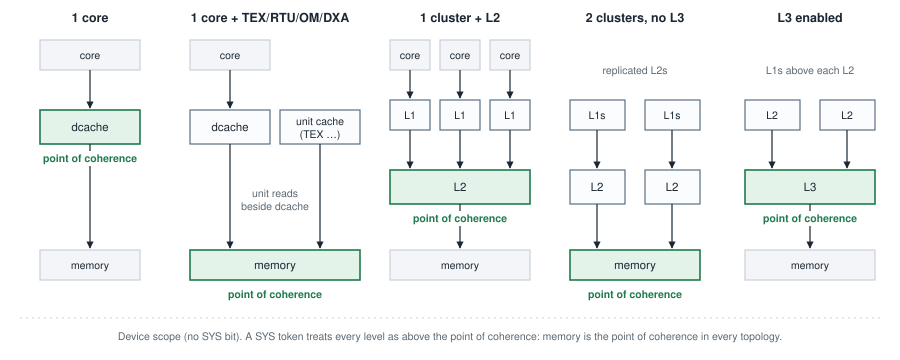

| configuration | device point of coherence | why |
|---|---|---|
| 1 core, no TEX / RTU / DXA / raster / OM | the dcache | it is the only path to memory |
| 1 core with any of those units | memory | the unit reads memory beside the dcache |
| several cores, no L2 | memory | every dcache is a private copy |
| one cluster with an L2 | the L2 | |
| several clusters with per-cluster L2s, no L3 | memory | replicated L2s |
| L3 enabled | the L3 | |

Each cache knows two structural facts, set from the topology at build time:
- `SHARED_LLC`: this level is the point of coherence.
- `NEXT_IS_POC`: the next level is. An acquire alone stops above it.

`Vortex.sv` asserts that a write-back last-level cache has a single instance. A `SYS`
operation treats every level as above the point of coherence.

### 1.4 Flush token

A cache receives its work as a **flush token**: a degenerate read request (`addr = 0`, no data)
with `attr.is_flush` set and the `fence_op` in the attribute's atomic-operation field, with
`amo_valid` clear. A token never carries an atomic, so it needs no new wires. A token is
ordered behind every earlier request **on its own path**, and that ordering is what the whole
design builds on (§5).

## 2. One operation, end to end

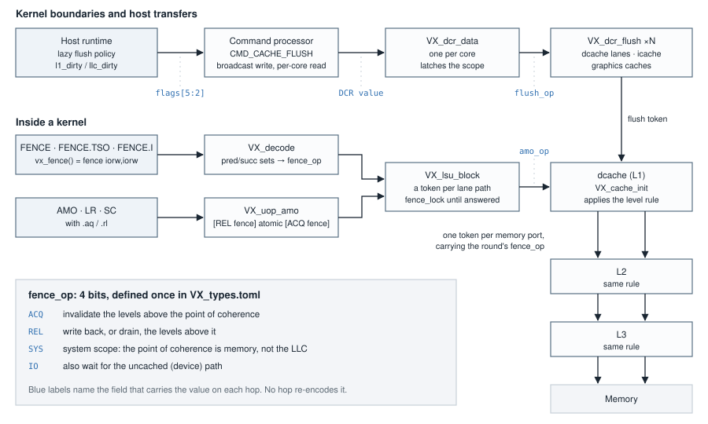

The same 4-bit value rides every hop, and no hop re-encodes it:

| hop | carrier |
|---|---|
| runtime → command processor | `CMD_CACHE_FLUSH` header flags, bits `[5:2]` (`VX_CP_FLUSH_OP_SHIFT`) |
| command processor → cores | the value of the `VX_DCR_BASE_CACHE_FLUSH` DCR write |
| `VX_dcr_data` → `VX_dcr_flush` | `flush_op`. The scope is latched from the START write. |
| decode → LSU | `op_args.lsu.amo_op` of the fence instruction |
| LSU → dcache, and level → level | the token's `amo_op` field |
| SimX | the `fence_op` argument of the cache flush FSM (`Cache::flush_begin`) |

Without the A extension the LSU lanes have no `amo_op` field. Inside the LSU, a fence's
release half rides `is_noalloc` and its acquire half rides `is_addr_io`, which a token has no
other use for. [`VX_lsu_mem_path`](../../hw/rtl/core/VX_lsu_mem_path.sv) restores the typed
field before the token leaves, with `io = ~acq & ~rel`. A dedicated field would cost two
flip-flops per lane.

A cache flush, as a command and as a DCR write, is only `ACQ|REL` or `ACQ|REL|SYS`. Asserts in
the command processor, the DCR receiver and SimX reject anything else.

## 3. Who asks for cache work

### 3.1 Fences in a kernel

[`VX_decode`](../../hw/rtl/core/VX_decode.sv) maps the RISC-V predecessor and successor sets
(`pred = instr[27:24]`, `succ = instr[23:20]`, each I O R W) to `fence_op`. SimX `decode.cpp`
does the same.

| fence | `fence_op` | why |
|---|---|---|
| no R or W in either set: `fence o,o`, `fence io,io` | `IO` | orders device accesses only: drain the uncached path, walk nothing |
| succ has R, pred has no W: `fence r,rw` | `ACQ` | a load-acquire |
| pred has W, succ has no R: `fence rw,w` | `REL` | a store-release |
| both: `fence rw,rw`, `fence.tso` | `ACQ\|REL` | |
| pred has I or O, or `fence.i` | `ACQ\|REL` | |
| neither: `fence r,w` | `REL` | the LSU fence lock already orders earlier loads |

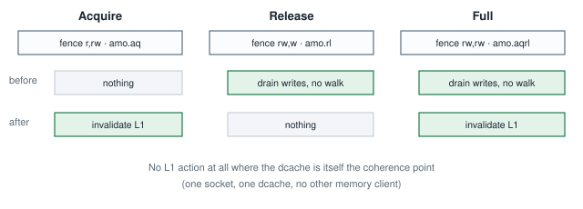

The LSU sends the fence as a flush token, one per buffered lane path (§5). Its `fence_lock`
holds the LSU block's later requests until the answer returns, so no later access passes the
fence.

The kernel library's `vx_fence()` is `fence iorw, iorw` (`ACQ|REL`). `vx_barrier()` and
`__syncthreads()` carry no fence, because the warps of a work-group share one L1. The barrier
drains only the LSU scheduler queue
([`VX_wctl_unit`](../../hw/rtl/core/VX_wctl_unit.sv) `lsu_sched_drained`), though. A store can
still sit in a coalescer or adapter lane buffer
([`VX_lsu_mem_path`](../../hw/rtl/core/VX_lsu_mem_path.sv) `store_empty`) while another warp's
load to the same word reaches the L1 through a different lane (§9).

### 3.2 Ordered atomics

An `AMO`, `LR` or `SC` with `.rl` or `.aq` expands in the uop sequencer
([`VX_uop_amo`](../../hw/rtl/core/VX_uop_amo.sv)), with EXT_A only:

```
[REL fence]  atomic  [ACQ fence]
```

The fences are ordinary LSU fence uops; they read and write no register. Where the dcache is
itself the point of coherence (`DCACHE_SHARED_LLC`), the expander is off. The atomic executes at
that cache, which already orders it against the hart's other accesses. SimX's `LsuUopGen`
expands the same way.

### 3.3 OpenCL

PoCL's Vortex kernel library (`lib/kernel/vortex/barrier.c` in the PoCL tree) lowers the
OpenCL 1.2 synchronization builtins to the cheapest fence their scope allows:

| builtin | emitted | `fence_op` | why |
|---|---|---|---|
| `barrier(CLK_LOCAL_MEM_FENCE)` | `vx_bar` | none | local memory is uncached; the barrier orders the warps |
| `barrier(CLK_GLOBAL_MEM_FENCE)`, `wait_group_events` | `fence w,w; vx_bar` | `REL` | work-group scope: the warps share the L1, so nothing is invalidated. The release closes the lane-buffer window of §3.1. |
| `mem_fence(CLK_GLOBAL_MEM_FENCE)` | `fence rw,rw` | `ACQ\|REL` | kept at device scope, since kernels pair it with atomics across work-groups |
| `read_mem_fence(CLK_GLOBAL_MEM_FENCE)` | `fence r,r` | `ACQ` | orders loads |
| `write_mem_fence(CLK_GLOBAL_MEM_FENCE)` | `fence w,w` | `REL` | orders stores; no walk on a write-through L1 |
| any fence over local memory alone | compiler barrier | none | no fence reaches local memory |

OpenCL 1.2 atomics are relaxed. They lower to `amo*.w` with no `.aq`/`.rl`, and
`atomic_cmpxchg` to an `lr.w`/`sc.w` loop. That loop's branches must be in C rather than in
`asm`: a Vortex branch follows the warp's last active lane, and only the compiler's divergence
pass gives each lane its own outcome.

### 3.4 Kernel boundaries and host transfers

The runtime flushes **lazily**:
- a kernel's results are flushed by the next command that needs them, not at the end of the kernel;
- the flush is appended to the command ring under the same lock as that command, so no other
  command can slip in between.

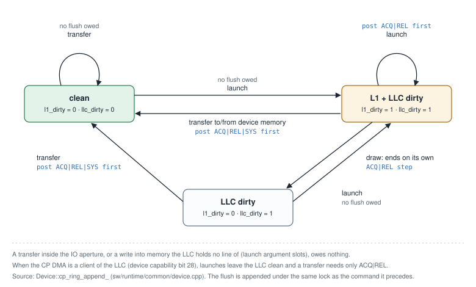

| next command | flush posted before it |
|---|---|
| a launch, after a launch | `ACQ\|REL`: the next kernel reads the previous one's writes at the last-level cache |
| a transfer to or from device memory, with the LLC dirty | `ACQ\|REL\|SYS`: the host DMA path bypasses the LLC |
| a transfer, with only the L1s dirty (CP DMA is an LLC client) | `ACQ\|REL` |
| a write into memory the LLC holds no line of (launch argument slots) | nothing |
| a transfer inside the IO aperture | nothing |

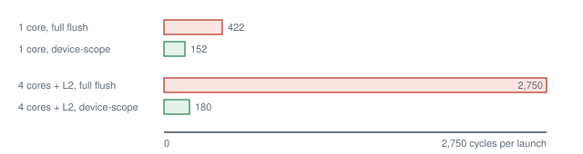

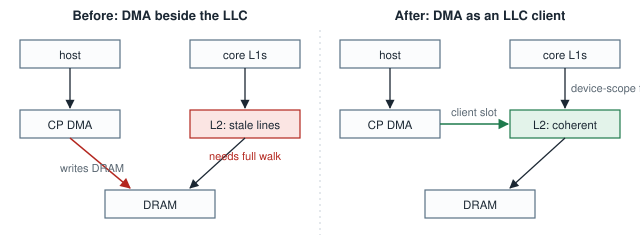

The command processor (RTL `VX_cp_dcr_proxy`, software `cmd_processor.cpp`) runs a flush in
two phases, because the DCR response bus has no back-pressure:

1. One DCR **write** to `VX_DCR_BASE_CACHE_FLUSH`, whose value is the operation. Writes
   reach every core, so all cores start together.
2. One DCR **read** per core, in turn. Each read's response reports that core's completion.

All cores' tokens then reach the shared levels together, and one walk serves them. Only a
system-scope flush also waits for Vortex `busy` to drop.

Inside a core, [`VX_dcr_data`](../../hw/rtl/core/VX_dcr_data.sv) holds the flush, and
`VX_dcr_flush` instances inject tokens into the dcache, icache and graphics caches. Their
level-held `done`s AND back up the tree. The dcache flush waits for `store_drained`: no store
may still be inside the LSU.

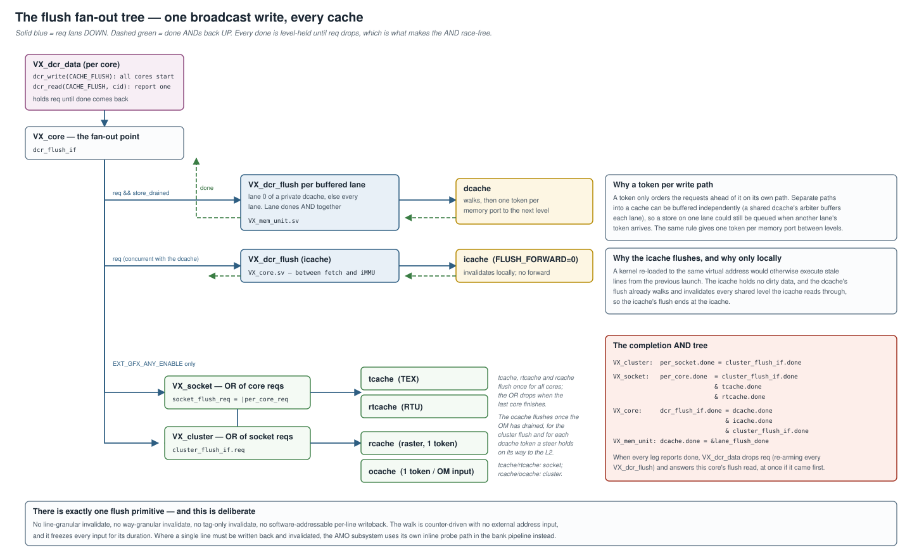

The icache holds no dirty data, so its flush stays local (`FLUSH_FORWARD = 0`). The dcache's
tokens already walk every shared level the icache reads through.

## 4. The rule at every cache level

[`VX_cache_init`](../../hw/rtl/cache/VX_cache_init.sv) and the SimX `Cache` flush FSM apply
one rule. While any token is visible at any input, every input is blocked. The operations of
the tokens a round serves are ORed.

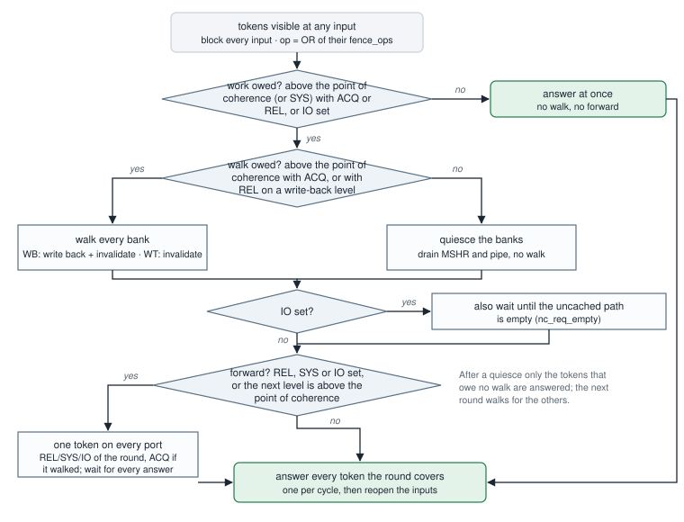

| term | definition (`VX_cache_init.sv`) |
|---|---|
| above the point of coherence | `!SHARED_LLC \|\| op.sys` |
| work owed | above, with `acq` or `rel`; or `io` |
| walk owed | above, with `acq`; or `rel` on a write-back level |
| forward | `rel \|\| sys \|\| io \|\| !NEXT_IS_POC` |
| forwarded operation | the round's `rel`, `sys` and `io`; `acq` only if the level walked |
| forward ready | the memory-request crossbar is empty, and for `io` the uncached path too (`nc_req_empty`) |

What this gives per operation, at a level **above** the point of coherence:

| operation | write-back level | write-through level | forwards |
|---|---|---|---|
| `ACQ` | walk: write back + invalidate | walk: invalidate | unless the next level is the point of coherence |
| `REL` | walk: write back | quiesce: drain MSHR and pipe | yes |
| `ACQ\|REL` | walk | walk | yes |
| `IO` | quiesce, wait for the uncached path | same | yes, down to memory |

At the point of coherence, a device-scope `ACQ`, `REL` or `ACQ|REL` token owes nothing and
is answered at once. Once the token is visible, its input's earlier requests are inside the
cache, ahead of anything the next kernel sends. An `IO` token still quiesces, waits for the
uncached path and forwards, so its answer proves that the earlier IO writes reached memory.

A round that walked answers every visible token. A round that only quiesced answers the tokens
that owe no walk, and the next round walks for the others. ORing the operations means a
token is never answered by a round weaker than its own.

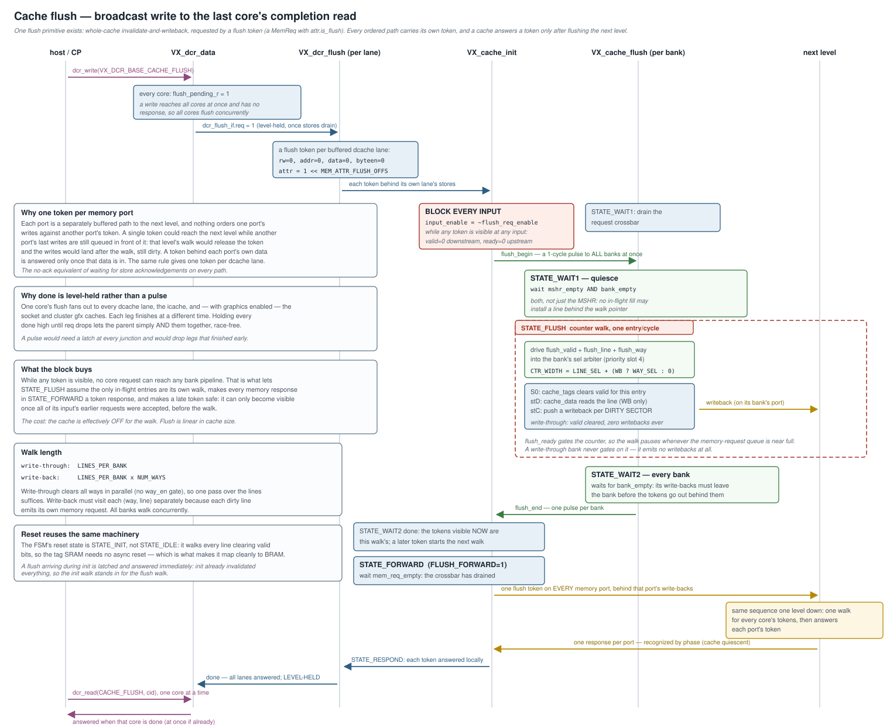

The cache offers only whole-cache maintenance: there is no line-granular clean or invalidate.

## 5. Why it is ordered: one token per path

A token proves only that the requests **ahead of it on its own path** are done. So every
independently buffered path that can carry writes gets its own token:

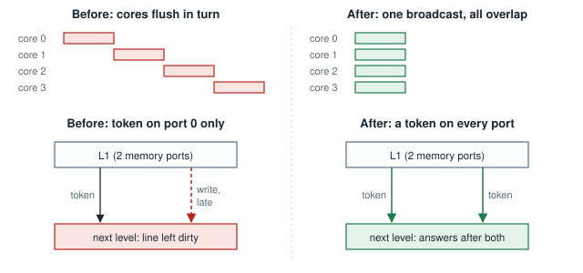

| path | how it is covered | what fails without it |
|---|---|---|
| a cache's memory ports | one token per memory port, through the same registered outputs as the write-backs ahead of it | a token on port 0 only reached the L2 while port 1's last writes were still queued. `flush_coherence` under `DBG_FLUSH_STALL` read stale data. |
| core lanes → private dcache | one token on lane 0. `store_drained` waits for the LSU adapter, which feeds the lanes directly. | |
| core lanes → shared or disabled dcache | one `VX_dcr_flush` per lane ([`VX_mem_unit`](../../hw/rtl/core/VX_mem_unit.sv)), with the dones ANDed | a lane-1 store overtaken by the lane-0 token. Visible only over 24 rounds (`flush_coherence-stress-3`). |
| uncached path into a port arbiter (`VX_cache_bypass`) | a token waits at the arbiter while any uncached request is valid there | an IO write loses arbitration to the token |
| OM aperture stores (`VX_om_steer`) | a token bound for the L2 is held at the steer until the ocache has flushed | draw3d nt16 lost two pixels: OM writes entered the ocache after it answered |
| OM inputs of the ocache | one token per input; the read-only rcache keeps one | |

Supporting rules:
- `done` is **level-held** at every junction, so a parent ANDs its children without a race.
- A **write opens a new flush epoch** in `VX_dcr_data`, so an older completion cannot answer a
  newer flush.
- During the forward phase the cache is quiescent: inputs are blocked, MSHRs are empty, and
  writes have no responses. So every response on a memory port is a token's answer, and no tag
  bit is needed.
- **Device `busy`** stays high until every core write, uncached IO stores included, is visible
  in memory. The runtime and CP sequence on it.

## 6. SimX

SimX models the same rule in its `Cache` flush FSM, with `flush_begin(fence_op)`:
- the same walk/quiesce/forward decisions, per-port forwarding and the same point-of-coherence
  parameters;
- the uop expansion of ordered atomics;
- the release fix for a write-back level beside TEX, RTU, raster, OM or DXA.

`model_parity` keeps the two models in lockstep on the fence cases. The flush itself is
timed, and so is the LLC atomic commit pacing that ordered atomics expose (the `AmoWb` slot in
`sim/simx/mem/cache.cpp`).

## 7. Compiler mapping

What llvm-vortex (LLVM 20.1.8) emits for `riscv32 +a`, and the operation each sequence
becomes:

| source | emitted | `fence_op` |
|---|---|---|
| `atomic_load_explicit(acquire)` | `lw; fence r,rw` | `ACQ` |
| `atomic_store_explicit(release)` | `fence rw,w; sw` | `REL` |
| `atomic_thread_fence(acquire)` / `(release)` | `fence r,rw` / `fence rw,w` | `ACQ` / `REL` |
| `atomic_thread_fence(acq_rel)` | `fence.tso` | `ACQ\|REL` |
| `atomic_thread_fence(seq_cst)` | `fence rw,rw` | `ACQ\|REL` |
| RMW acquire / release / seq_cst | `amo*.aq` / `.rl` / `.aqrl` | fences around the atomic (§3.2) |
| relaxed RMW (HIP `atomicAdd`, OpenCL 1.x `atomic_add`) | `amo*` | none |
| workgroup-scope fence, e.g. OpenCL 2.0 `atomic_work_item_fence(..., memory_scope_work_group)` | `fence.tso` | `ACQ\|REL` (§9) |
| workgroup-scope `acq_rel` RMW | `amo*.aqrl` | fences around the atomic (§9) |

## 8. Performance

Measured in rtlsim. Each change keeps the cache work a fence or flush owes to what its
operation requires.

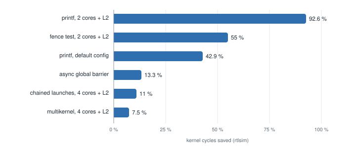

| change | case | before | after |
|---|---|---:|---:|
| broadcast flush; icache flush stays local | flush per launch, 4 cores + L2 | 18,502 | 2,558 cycles |
| | flush per launch, 2 clusters × 2 cores + L2 + L3 | 72,126 | 9,266 cycles |
| device-scope launch flush | flush per launch, 1 core | 422 | 152 cycles |
| | flush per launch, 4 cores + L2 | 2,750 | 180 cycles |
| | chained launches, 4 cores + L2 | | −11 % |
| launch argument slots | multikernel, 4 cores + L2 | | −7.5 % (SimX −8.5 %) |
| targeted fences (device-scope and `IO`) | printf, 2 cores + L2 | 4,006,822 | 295,165 cycles |
| | printf, default configuration | | −42.9 % |
| | fence test, 2 cores + L2 | | −55 % |
| | async global barrier | | −13.3 % |
| acquire/release split | fence, printf, global barrier, sgemm | | unchanged (full fences) |
| OpenCL lowering (§3.3) | `memfence`, 4 cores + L2 | 1,565,337 | 1,531,835 cycles (−2.1 %; SimX −1.9 %) |
| ordered atomics | `amo` test, 2 cores + L2, every atomic seq_cst | 298,208 | 580,315 cycles (+95 %) |
| typed `fence_op` | all 49 perf cases | | unchanged cycles and instruction counts |

The `amo` cost is the price of correct semantics. Before the expansion, `.aq`/`.rl` atomics did
not order the hart's plain accesses past a write-through L1. Relaxed atomics are unaffected, and
so is every atomic on a configuration whose dcache is the point of coherence.

## 9. Limits and future work

- **Workgroup scope is over-paid by the compiler.** LLVM lowers workgroup-scope fences to
  `fence.tso`, and workgroup-scope `acq_rel` atomics to `.aqrl`. On Vortex these need no cache
  action. OpenCL 1.2's `barrier` and `mem_fence` do not go through it (PoCL emits their fences
  itself, §3.3), but scoped OpenCL 2.0 and SPIR-V atomics would. LLVM could:
  - drop the hardware fence for workgroup scope, keeping the compiler barrier;
  - drop `.aq`/`.rl` on workgroup-scope atomics;
  - lower agent-scope `acq_rel` to `fence r,rw` + `fence rw,w`.
- **The barrier does not drain the lane buffers.** `vx_barrier()` and `__syncthreads()` rely
  on the shared L1 alone (§3.1). No test has reached that window: the `memfence` known-bad that
  drops the release from `barrier(CLK_GLOBAL_MEM_FENCE)` passes on SimX and rtlsim. Making BAR
  also wait for the LSU's `store_empty` would close it in hardware, and PoCL could then drop the
  release.
- **No cluster scope.** Making a per-cluster L2 a point of coherence would need a wider scope
  field. Every carrier is sized by `VX_FENCE_OP_BITS`, so no carrier would change.
- **Whole-cache maintenance only.** A fence waits for a whole L1 walk. Line-granular clean and
  invalidate (RISC-V Zicbom `cbo.*`) are not implemented.

## 10. Verification

CI cases ([`ci/testcases/regression.yaml`](../../ci/testcases/regression.yaml)):

| case | what it checks |
|---|---|
| `flush_coherence-1..3` | kernel → readback across topologies. The stress cases run under `DBG_FLUSH_STALL` (random input back-pressure); `-stress-3` runs 24 rounds. |
| `flush_coherence-chain-1..6` | kernel → kernel chains with no host rewrite (device-scope flushes), on both drivers |
| `fence_mp-1..6` | cross-core message passing with full fences (`-m0`), acquire/release fences (`-m1`), and `amoswap.rl` / `amoor.aq` (`-m2`). `-5`/`-6` use the release known-bad layout under `DBG_MEM_BANK0_WDELAY`. |
| `model_parity` fence cases | SimX and RTL cycle parity |
| `memfence-atomics`, `memfence-4c-l2` ([`opencl.yaml`](../../ci/testcases/sw/opencl.yaml)) | the OpenCL lowering of §3.3: work-group exchange through global and local memory, `wait_group_events`, and a last-work-group reduction that needs the release and the acquire |
| `atomicreduce`, `atomicreduce-4c-l2` | every OpenCL 32-bit atomic and its `atom_*` name, on global and local memory, with their return values |
| `cp_dcr_proxy` unittest | the CP's two-phase flush and its encoding |

Debug options for building known-bads, in RTL and SimX:
- `DBG_FLUSH_STALL` injects random input back-pressure. Back-pressure is always legal, so a
  correct design must pass with it.
- `DBG_MEM_BANK0_WDELAY` holds every write-through write of bank 0 for 2048 cycles. It exposes
  a release that does not wait for its writes.

Each part was validated against a known-bad that must fail, and did:
- no flush; no shared-level walk;
- tokens on port 0 only; one token for a shared dcache;
- no steer coupling;
- an acquire sent as a release;
- an OpenCL reader without its acquire (`memfence`, 4 cores + L2);
- a release without its drain;
- no atomic expansion.
