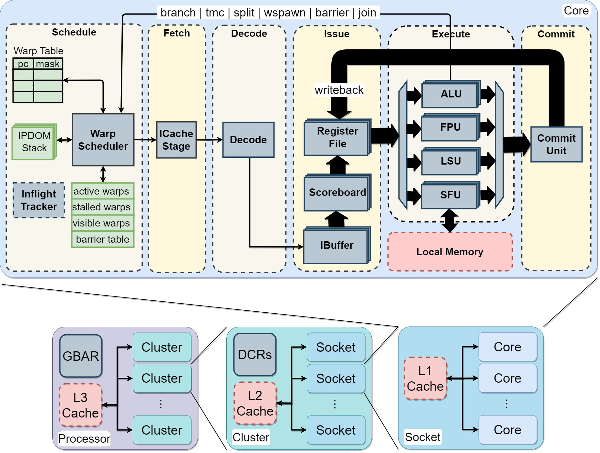

# Vortex Microarchitecture

### Vortex GPGPU Execution Model

Vortex uses the SIMT (Single Instruction, Multiple Threads) execution model with a single warp issued per cycle.

- **Threads**
  - Smallest unit of computation
  - Each thread has its own register file (32 int + 32 fp registers)
  - Threads execute in parallel
- **Warps**
  - A logical cluster of threads
  - Each thread in a warp execute the same instruction
    - The PC is shared; maintain thread mask for Writeback
  - Warp's execution is time-multiplexed at log steps
    - Ex. warp 0 executes at cycle 0, warp 1 executes at cycle 1

### Vortex RISC-V ISA Extension

- **Thread Mask Control**
  - Control the number of warps to activate during execution
  - `TMC` *count*: activate count threads
- **Warp Scheduling**
  - Control the number of warps to activate during execution
  - `WSPAWN` *count, addr*: activate count warps and jump to addr location
- **Control-Flow Divergence**
  - Control threads activation when a branch diverges
    - `SPLIT` *taken, predicate*: apply predicate thread mask and save current state into IPDOM stack
    - `JOIN`: pop IPDOM stack to restore thread mask
    - `PRED` *predicate, restore_mask*: thread predicate instruction
- **Warp Synchronization**
  - `BAR` *id, count*: stall warps entering barrier *id* until count is reached

### Vortex Pipeline/Datapath

Vortex has a 6-stage pipeline:

- **Schedule**
  - Warp Scheduler
    - Schedule the next PC into the pipeline
    - Track stalled, active warps
  - IPDOM Stack
    - Save split/join states for divergent threads
  - Inflight Tracker
    - Track in-flight instructions

- **Fetch**
  - Retrieve instructions from memory
  - Handle I-cache requests/responses
- **Decode**
  - Decode fetched instructions
  - Notify warp scheduler on control instructions
- **Issue**
  - IBuffer
    - Store decoded instructions in separate per-warp queues
  - Scoreboard
    - Track in-use registers
    - Check register use for decoded instructions
  - Operands Collector
    - Fetch the operands for issued instructions from the register file
- **Execute**
  - ALU Unit
    - Handle arithmetic and branch operations
  - FPU Unit
    - Handle floating-point operations
  - LSU Unit
    - Handle load/store operations
  - SFU Unit
    - Handle warp control operations
    - Handle Control Status Registers (CSRs) operations
  - TCU Unit
    - Handle warp matrix multiply accumulate operations
- **Commit**
  - Write result back to the register file and update the Scoreboard.

### Core partitioning

The core splits its warps into slices, each a constant bit-slice of the warp id:
`VX_CFG_FETCH_WIDTH` (FW) frontend slices (`wid mod FW`), `VX_CFG_ISSUE_WIDTH` (IW)
issue slices (`wid mod IW`), and B blocks per execution unit (`wid mod B`), with
FW and B dividing IW. A slice owns its warps' pipeline state; the core scheduler
(CTA launch, barriers, wspawn, retirement), the shared SFU/TCU services and the
memory unit stay core-wide.

The structure follows from the widths:

| Widths | Structure |
|---|---|
| every B = IW = FW | IW compute slices (`VX_compute_slice`), no frontend crossbar |
| every B = IW, FW < IW | FW frontend slices, the frontend crossbar, IW backend slices (`VX_backend_slice`) |
| some unit has B ≠ IW | FW frontend slices, the frontend crossbar, stage-sliced `VX_issue` / `VX_execute` / `VX_commit` |

- **Frontend slice** (`VX_frontend_slice`): warp scheduler, fetch and decode for
  `wid mod FW`, on its own icache port.
- **Backend slice** (`VX_backend_slice`): issue, execute (one block of every
  unit) and commit for one issue slice.
- **Compute slice** (`VX_compute_slice`): a frontend slice and its backend slice,
  joined directly: one end-to-end pipeline for `wid mod IW`. This is the
  counterpart of an NVIDIA SM processing block.
- **Frontend crossbar** (`VX_frontend_xbar`): combinational routing between FW
  frontend slices and the back end whenever the core is not built from
  compute slices. It sends each instruction to its issue slice, and each
  branch, warp-control and CSR event to the frontend slice that owns the warp.
- **Core-wide services**, reached through one port per block in every structure:
  - `VX_sfu_shared` arbitrates the SFU blocks onto the core's single DXA, TEX
    and RTU buses.
  - `VX_tcu_shared` holds the state that spans TCU blocks: the WGMMA tile
    buffers, whose B operand is common to a warpgroup's blocks, and the sparse
    metadata AGU.

### Vortex clustering architecture
- Sockets
  - Grouping multiple cores sharing L1 cache
- Clusters
  - Grouping of sockets sharing L2 cache

### Vortex Cache Subsystem
More details about the cache subsystem are provided [here](cache_subsystem.md).
