# Memory-Level Parallelism Optimizations

A GPU hides memory latency by keeping many memory requests in flight at once. This is memory-level parallelism (MLP). It runs from the lanes of one warp, through the caches and the command processor's DMA, out to the DRAM channels. This document describes the features that raise Vortex's MLP:
- how the cache hierarchy is organized;
- how misses are handled;
- how same-address requests are merged;
- how coherence and ordering are kept cheap;
- how the DMA engines share the memory system;
- how the FPGA shell reaches HBM.

Each section says what problem the feature removes, how it works, and what it gains.

## Reading the numbers

- Gains are changes in total kernel cycles, so −10% means 10% faster. Each gain is measured against the same configuration with the feature off.
- **rtlsim** is the Verilator model of the RTL. **SimX** is the cycle-level C++ model. **xrtsim** is the RTL plus the FPGA shell.
- The GPU shapes (`a100`, `h100`, `rtx5080`, …) are hardware profiles. A profile sets cores, warps, threads, cache sizes, and the DRAM type and timing (HBM2, HBM3, GDDR6) from data-sheet values. See [simulation.md](../simulation.md#hardware-profiles).

## Summary

| Feature | Level | What it removes | Best measured gain | Default |
|---|---|---|---|---|
| [Sectored L2/L3](#sectored-l2-and-l3-caches) | L2/L3 | Half of the LLC tags | Tag area halved | On |
| [Word-size dcache banking](#dcache-banks-follow-the-thread-count) | L1D | Fixed bank count as threads grow | Bank count scales with threads | On |
| [Hashed bank select](#hashed-bank-select) | L1D, L2 | Power-of-two strides on one bank | sgemv −32.8% | On (L2; dcache ≥ 4 banks) |
| [Fill forwarding](#fill-forwarding) | All caches | Replaying waiters after a fill | sgemv −5.0% | On |
| [Back-to-back fills](#back-to-back-fills) | All caches | A bubble after each fill | rtx5080 stream −6.2% | On |
| [MSHR line table](#mshr-line-table) | All caches | One wide address compare per waiting request | sgemm −15.3% at 400-cycle latency | Off |
| [Write-allocate without fetch](#write-allocate-without-fetch-lazy-fetch) | Write-back caches | Reading a line only to overwrite it | DRAM reads −33% | Off |
| [Full-sector refetch skip](#full-sector-refetch-skip) | Write-back caches | Refetching a fully written sector | rtx5080 sgemm −43.5% with lazy L2 | Off (with lazy fetch) |
| [Dcache read merge](#dcache-read-merge) | L1D | Same-word loads serialized on one bank | sgemm −17.2% | On |
| [Icache same-line merge](#icache-same-line-merge) | L1I | Fetch slices serialized on one line | rtx5080 sgemm −25.8% | On |
| [Broadcast flush, per-port tokens](#broadcast-flush-and-per-port-flush-tokens) | Whole hierarchy | Serial per-core flushes; lost writes | Flush 2.76M → 16.5k cycles per launch | On |
| [L1-only launch flush](#l1-only-flush-between-launches) | Whole hierarchy | Walking the LLC at every launch | Flush 2,750 → 180 cycles per launch | On |
| [Argument upload slots](#launch-argument-slots) | Runtime + LLC | A full flush after each argument upload | multikernel −7.5% | On |
| [Targeted fences](#targeted-fences) | L1D, LLC | A full flush per fence | printf 13.6× faster | On |
| [Acquire/release fences](#acquire-and-release-fences) | L1D | Doing both halves of a fence | Ordering-correct atomics at minimal cost | On |
| [Atomics at the LLC](#atomics-at-the-last-level-cache) | L1D, LLC | Atomics racing across private caches | Correct atomics across the hierarchy | With the A extension |
| [Write-through ordering](#write-through-ordering) | L1D | A load returning data older than its own store | Correctness | On |
| [CP DMA through the LLC](#command-processor-dma-through-the-llc) | CP, LLC | An LLC walk for every host transfer | multikernel −42.7% | Off (on in GPU profiles) |
| [LMEM DMA round-robin](#local-memory-dma-round-robin) | Local memory | DXA starving tensor-core reads | WGMMA with DXA −10.2% | On |
| [Per-block LSU memory paths](#per-block-lsu-memory-paths) | Core | One shared core memory path | Scales with LSU blocks | On |
| [Many AXI transactions in flight](#many-axi-transactions-in-flight) | FPGA shell | One outstanding request per port | 4-core sgemv 1.30× | On |
| [Ports follow the GPU; write fall-through](#memory-ports-follow-the-gpu-and-write-fall-through) | FPGA shell | A fixed port count; a cycle per write | Write throughput 2× | On |

## Configuration knobs

Some of these features can be set with a `VX_CFG_*` knob (see [Build Configuration System](build_configuration_system.md)). The rest are always on, or are selected automatically from the cache layout.

| Feature | Knob | Default |
|---|---|---|
| Hashed bank select | `VX_CFG_DCACHE_BANK_HASH`, `VX_CFG_L2_BANK_HASH` | dcache: on with 4 or more banks; L2: on. The L3 has no bank hash. |
| MSHR line table | `VX_CFG_{DCACHE,L2,L3}_MSHR_LINES` | 0 (off): flat MSHR |
| Write-allocate without fetch | `VX_CFG_{DCACHE,L2,L3}_LAZY_FETCH` | 0 (off). Enabling it also enables the dirty-byte masks (`*_DIRTYBYTES`). |
| Full-sector refetch skip | Part of lazy fetch | Follows `*_LAZY_FETCH` |
| Dcache read merge | `VX_CFG_DCACHE_READ_MERGE` | 1 (on) |
| Icache same-line merge | `VX_CFG_ICACHE_READ_MERGE` | 1 (on). No effect with one fetch slice. |
| CP DMA through the LLC | `VX_CFG_CP_LLC_CLIENT` | 0 (off); 1 in the GPU profiles. Takes effect only when one LLC serves every core. |
| Atomics at the LLC | `VX_CFG_EXT_A_ENABLE` | Off |
| Sectored L2/L3 | `VX_CFG_{L2,L3}_SECTOR_SIZE` (a size) | One bus granule. Setting it to the line size removes sectoring. |
| Dcache word-size banking | `VX_CFG_DCACHE_WORD_SIZE` (a size) | Derived from the lane count and XLEN |

**Always on:** fill forwarding, back-to-back fills, broadcast flush and per-port flush tokens, launch argument slots, targeted fences, acquire/release fences, write-through ordering, local-memory DMA round-robin, per-block LSU memory paths, many AXI transactions in flight, and write fall-through.

**Selected automatically:**
- The L1-only launch flush and the fence shortcuts apply whenever a single LLC is the point of coherence.
- The FPGA shell's memory port count follows the GPU's memory ports.

---

## Cache organization

### Sectored L2 and L3 caches

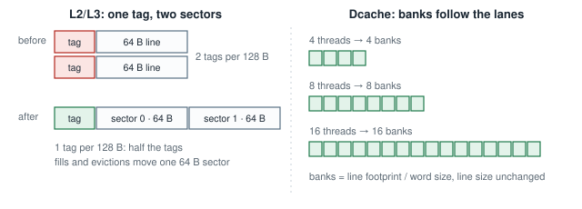

**Problem.** An LLC line as small as the memory bus granule needs one tag per 64 bytes. At GPU LLC sizes (megabytes), that is a large tag array.

**How it works.** L2 and L3 lines are twice the bus granule. One tag covers the line, and the line is split into two sectors of one bus granule each, with a valid bit per sector. Fills and evictions move one sector at a time, so memory traffic stays at bus granularity, while the tag array is half the size. Sector size is set with `VX_CFG_{L2,L3}_SECTOR_SIZE`.

**Gain.** The LLC tag area is halved at the same capacity and the same memory traffic.

### Dcache banks follow the thread count

**Problem.** A dcache with a fixed bank count serializes a warp's lanes once the thread count outgrows it.

**How it works.** The coalescer's word size sets the dcache banking: banks = line footprint / word size, and there is one bank per request lane. Wider warps get more banks without a smaller line. See the right half of the figure above.

**Gain.** Dcache parallelism tracks `NUM_THREADS`, so a 16- or 32-thread warp is not throttled by a 4-bank cache.

### Hashed bank select

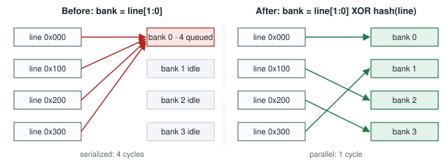

**Problem.** A cache picks its bank from the lowest line-address bits. GPU kernels walk arrays with power-of-two strides: matrix rows, tiles, per-thread blocks. Every request in such a stride has the same low bits, so all of them queue on one bank while the others sit idle.

**How it works.** The bank index is the low line-address bits XORed with a hash of the higher bits. The hash is an IPOLY polynomial: IPOLY(5) for 16 banks, IPOLY(37) for 32, and an XOR fold for other counts. Strided requests spread over all banks. Each line still has exactly one bank, so the rest of the cache is unchanged. It is controlled by `VX_CFG_{DCACHE,L2}_BANK_HASH`: on for the L2, and on for a dcache with 4 or more banks. Below 4 banks, the extra queuing outweighs the spreading.

**Gain (rtlsim):**
- sgemv 512×512 at 16 threads: −32.8%
- fp16 tensor sgemm on 2 cores + L2: −13.8%
- WGMMA with DXA: −13.5%
- multi-core sgemm: −8.2%
- SimX, rtx5080, N=256: −34%

---

## Miss handling

### Fill forwarding

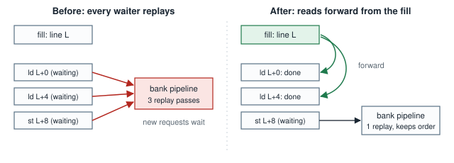

**Problem.** When a miss returns, every request waiting on that line (the MSHR chain) used to replay through the bank pipeline one at a time. Each replay is a full pipeline pass, and new requests are blocked while the chain drains.

**How it works.** The reads at the head of the chain take their data straight from the staged fill sector, which is fill-buffer forwarding, standard in GPU L1s. The first write or atomic in the chain, and everything after it, still replays, so same-line accesses keep program order. The input arbiter stays open to new requests while the chain completes. Always on.

**Gain (rtlsim):** sgemm −2.7%, sgemv −5.0%, multi-core sgemm −2.2%.

### Back-to-back fills

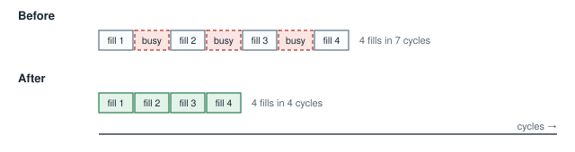

**Problem.** A bank could not take a fill in the cycle right after another fill. Under heavy miss traffic, fills arrived in bursts and the bank accepted only one every other cycle.

**How it works.** Fills follow each other into the bank pipeline back to back. Each staged fill keeps its own sector until it installs, so consecutive fills don't conflict.

**Gain:**
- rtx5080 profile, 4 MiB stream: −6.2%
- the stock configuration (shallow L2): within ±0.5%
- the cache also closed timing faster: Fmax up by 3%

### MSHR line table

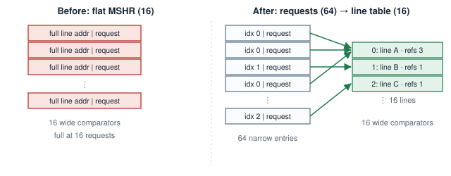

**Problem.** Each MSHR entry holds a full line address, and every new miss compares against all of them. To keep more misses in flight, the MSHR needs more entries, and each one adds a wide comparator. At high memory latency, a 16-entry MSHR was full a fifth of the time, often with only one or two distinct lines in it.

**How it works.** Distinct {line, sector} pairs go into a small reference-counted line table. Each request entry keeps only an index into that table. The cache holds many more waiting requests (for example 64) while comparing addresses against only the line table (for example 16 entries). Controlled by `VX_CFG_{DCACHE,L2,L3}_MSHR_LINES`.

**Gain (rtlsim at 400-cycle memory latency, MSHR 16 → 64 requests over 16 lines):** sgemm −15.3%, raycast −8.1%. Without the dcache read merge, the same sgemm gains 24.8%. At the stock latency the MSHR does not limit, the gain is under 0.5%, and the feature is off by default.

### Write-allocate without fetch (lazy fetch)

**Problem.** A write-back cache that misses on a store normally reads the whole line from memory, then overwrites part or all of it. Streaming writes therefore cost a read for every line they write.

**How it works.** A store miss installs the sector at once, with a per-byte dirty mask and a *partial* bit, without reading memory. A later load or atomic on a partial sector refetches it and merges memory data only under the bytes that were never written. An eviction writes back only the dirty bytes. A refill of one sector keeps the dirty bytes of the line's other sectors. Controlled by `VX_CFG_{DCACHE,L2,L3}_LAZY_FETCH`.

**Gain:** 1-core vecadd DRAM reads −33% and memory requests −25%. Cycles are unchanged because that kernel is latency-bound. Off by default.

### Full-sector refetch skip

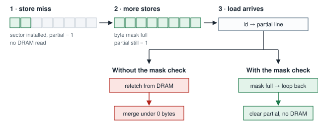

**Problem.** With lazy fetch, once stores have written every byte of a sector, the partial bit still triggered a refetch on the next load. The cache read memory only to merge it under zero unwritten bytes. On L2-heavy kernels, these useless reads made lazy fetch slower than leaving it off.

**How it works.** When the refetch commits, the bank checks the byte mask. If the mask is full, the refetch loops back through the bank as a fill with no data, clears the partial bit, and reads nothing from memory. If the loopback queue has no room, the refetch falls back to memory as before.

**Gain:**
- DRAM reads: 145 → 17 at the dcache and 539 → 27 at the L2, on a fully written stream.
- SimX, rtx5080 profile, 4 cores, sgemm -n192 with L2 lazy fetch: 285,006 → 161,121 cycles (−43.5%). Lazy fetch is now slightly faster than having it off.

---

## Request merging

### Dcache read merge

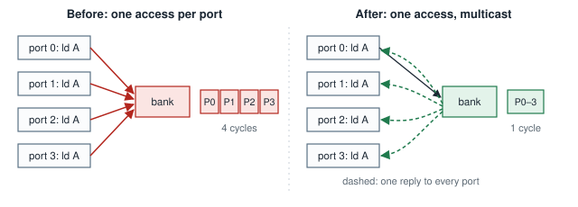

**Problem.** Uniform loads make every lane of a warp read the same word in the same cycle. Kernel arguments and the shared operand of a matrix multiply are typical. Each LSU port sent its own request to the same bank, and the bank served them one per cycle.

**How it works.** Plain reads of the same word from the ports of one LSU block in the same cycle are served by one bank access, and the reply goes to every port that asked. Each port's order into the bank is unchanged, so loads stay ordered against stores. The merge compares request tags in the same form on every port, so it doesn't depend on how wide the tag is. Controlled by `VX_CFG_DCACHE_READ_MERGE`.

**Gain (rtlsim sgemm -n128):**
- 16 threads with an 8-byte dcache word: −17.2%
- 2 banks: −9.8%
- 32 threads: −7.9%
- 16 threads: −6.5%
- 4 cores + L2: −6.5%

At 16 threads, dcache reads fall 25% and bank stalls 55%.

### Icache same-line merge

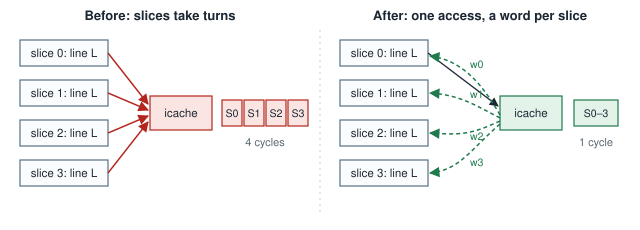

**Problem.** With several fetch slices, the front end fetches up to one instruction per slice per cycle. A dense kernel's inner loop often spans only a few cache lines (sgemm: 3). So the slices keep requesting the same line and take turns at its bank, losing 1 to 2 of 4 fetch slots every cycle even with a 100% hit rate. A warp has only one fetch in flight, so each cycle of waiting lowers its fetch rate directly.

**How it works.** Reads of the same icache line from different fetch slices in the same cycle become one bank access. The bank returns each slice the word it asked for. This differs from the dcache merge: the slices want different words of one line, not the same word. Controlled by `VX_CFG_ICACHE_READ_MERGE`. It has no effect with one fetch slice.

**Gain (rtlsim / SimX):**

| Shape | sgemm | vecadd | conv3 | raycast |
|---|---|---|---|---|
| Issue and fetch width 4 | −12.1% / −12.4% | | | −4.7% / −4.7% |
| rtx5080 core | −25.8% / −20.2% | −15.7% / −20.1% | −3.4% / −4.6% | |

With the merge, 16 icache banks are no longer slower than 4.

---

## Coherence and ordering

### Broadcast flush and per-port flush tokens

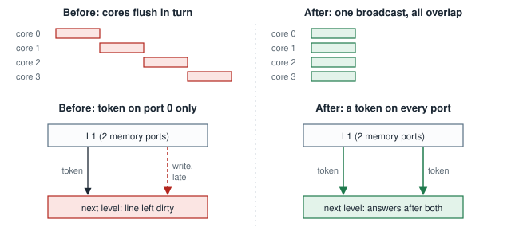

**Problem:**
- The command processor flushed the cores one after another, so a launch boundary cost the sum of every core's flush.
- A cache forwarded its flush token on memory port 0 only. A write still queued on another port could reach the next level after that level had finished its walk, and stay dirty there.

**How it works:**
- One broadcast `CACHE_FLUSH` write starts every core's flush at once. The command processor then collects the completions, so the flushes overlap.
- A cache walks its banks and sends a flush token down **every** memory port. It answers only once all ports have answered.
- Every independently buffered write path carries its own token.
- Read-only caches (icache, texture, ray-tracing caches) no longer forward flushes at all.

**Gain:** flush cost per launch dropped from 2.76M to 16.5k cycles on the measured shape. It also fixed the lost-write case above.

### L1-only flush between launches

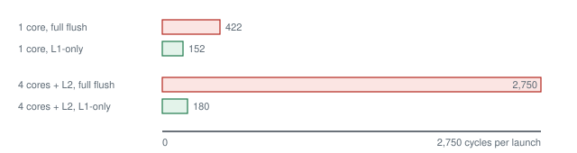

**Problem.** Every kernel launch flushed the whole hierarchy, including a walk of the LLC. Back-to-back launches paid for it each time.

**How it works.** When a single LLC serves every memory client, it is the point of coherence: launches only need the L1s cleaned. The launch flush becomes an L1-only token, which the shared LLC answers without walking. LLCs that are replicated per core or per cluster, and LLCs with peer clients beside them (texture, ray tracing, raster, output merger, DXA), still walk. A dcache counts as the LLC only when it is the single dcache of a single socket with no other memory client. The runtime posts flushes lazily and flushes fully before any device-memory transfer that needs it. The device reports busy until every core write, including uncached I/O stores, is visible in memory.

**Gain:** flush cycles per launch 422 → 152 at 1 core and 2,750 → 180 at 4 cores + L2. Chained launches at 4 cores + L2: −11%.

### Launch argument slots

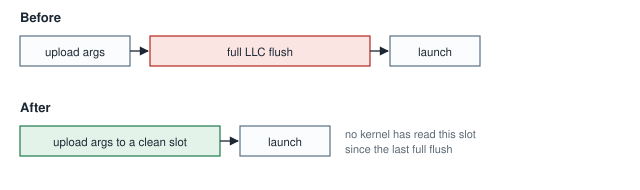

**Problem.** Each launch uploads its arguments and launch descriptors to device memory. That upload made the LLC dirty, so the next launch needed a full flush. Workloads that launch many small kernels behaved as if the L1-only flush didn't exist.

**How it works.** Arguments and descriptors go into a pool of slots. A slot is reused only if no kernel has read it since the last full flush, so no cache can hold a stale copy and the upload needs no flush. This is the same dirty tracking AMD's driver does for its argument buffers.

**Gain:** multikernel at 4 cores + L2: −7.5% on rtlsim, −8.5% on SimX. A workload that reads results back after every launch still needs the full flush and is unchanged.

### Targeted fences

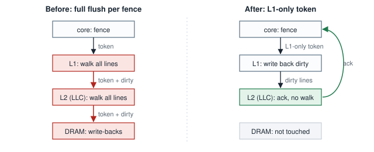

**Problem.** A memory fence flushed the whole hierarchy: every level walked all of its lines and wrote dirty data to DRAM. `printf` fences after every device write, so printf-heavy kernels spent most of their time walking caches.

**How it works.**
- A memory fence sends an L1-only token. The L1s write their dirty lines back to the shared LLC, and the LLC answers without walking. DRAM is not touched.
- A fence that orders only device (I/O) accesses becomes its own LSU operation. Every level drains its in-flight writes to its memory ports, with no walk anywhere.

**Gain (rtlsim):**
- printf at 2 cores + L2: 4,006,822 → 295,165 cycles (13.6×)
- printf at the default configuration: −42.9%
- fence test at 2 cores + L2: −55%
- async global barrier: −13.3%

### Acquire and release fences

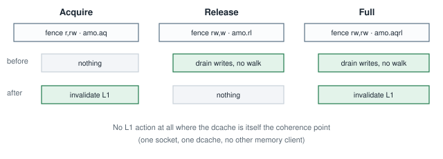

**Problem.** A fence did both halves of a full barrier, even when the program asked for only one. Atomics marked acquire or release (`.aq`/`.rl`) were not ordered at all.

**How it works.** The fence's predecessor and successor sets choose the action:
- **Acquire** (`fence r,rw`, `amo.aq`): invalidates clean L1 lines after the operation. Nothing written back.
- **Release** (`fence rw,w`, `amo.rl`): drains pending writes before the operation, without a walk. Nothing invalidated.
- **Full** (`fence rw,rw`, `amo.aqrl`): does both.

Atomics with `.aq`/`.rl` get these steps around them. All of it is skipped when the dcache is itself the point of coherence.

**Gain:** correct acquire/release ordering for atomics, at the minimum cost the memory model allows. Fences, printf, global barriers and sgemm are unchanged; their kernels use full fences. A test that makes every atomic sequentially consistent pays for the ordering it now gets.

### Atomics at the last-level cache

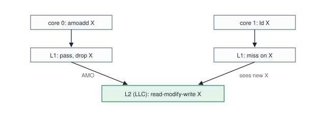

**How it works.** RISC-V `A`-extension atomics run once, as a read-modify-write at the last-level cache. Each private L1 they pass through drops its copy of the line, so the next load of that word from any core misses and sees the new value. `LR`/`SC` use a reservation table. This keeps atomics correct across L1, L2 and L3 without a coherence protocol between the L1s. Controlled by `VX_CFG_EXT_A_ENABLE`.

### Write-through ordering

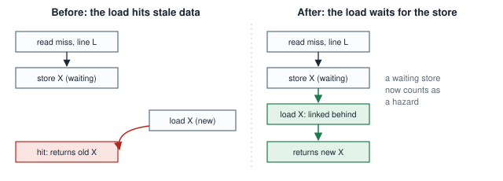

**Problem.** In a write-through L1 (every configuration with more than one core, or with an L2 or L3), a store can be waiting in the MSHR behind an earlier read miss to the same line. A load of the same word that arrived then could hit the cache and return the value from before the store.

**How it works.** A waiting store counts as a hazard. A later access to the same word links behind it in the MSHR chain and sees the stored value. The same rule keeps a newer write from overtaking an older one.

**Gain:** correctness. The ordering test fails without the rule and passes with it.

---

## DMA

### Command-processor DMA through the LLC

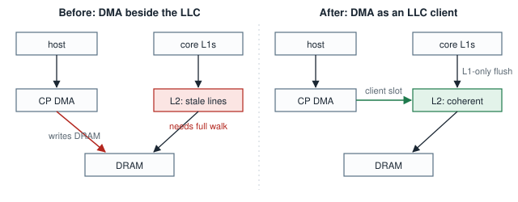

**Problem.** The command processor copied host data straight into DRAM, beside the L2. The L2 could hold stale copies of those lines, so every host transfer needed a full flush and invalidate of the LLC. Launches with uploads between them paid this every time.

**How it works:**
- When one LLC serves every core, the command processor's DMA becomes a client of it on its own slot. A page-table walker attaches the same way.
- Host data flows through the LLC and keeps it coherent, so a transfer needs only an L1-only flush.
- Transfers of at least half the LLC write around it, so they don't evict the working set.
- A launch issued after DMA writes waits for an L1-only flush token sent on the DMA's slot.
- The runtime detects the feature through the `DMA_LLC_CLIENT` capability.
- Controlled by `VX_CFG_CP_LLC_CLIENT`: off by default, on in the GPU profiles.

**Gain (rtlsim):**

| Shape | dogfood | multikernel | sgemm -n32 |
|---|---|---|---|
| 2 clusters + L2 + L3 | −30.0% | −42.7% | −14.1% |
| 4 cores + L2 | −9.1% | −23.4% | |
| 8 MB L3 | −64% | | |

**Virtual memory.** SimX's command processor translates DMA addresses before they enter the LLC. The RTL command processor has no MMU, so host DMA with virtual memory is a SimX-only configuration for now.

### Local-memory DMA round-robin

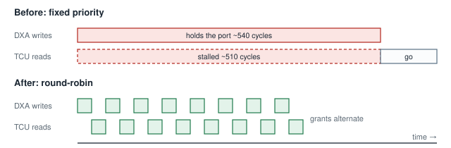

**Problem.** Two clients share the local-memory DMA port: the DXA engine, which writes tiles into shared memory, and the tensor core, which reads WGMMA operands from it. The DXA had fixed priority. One tiled-scatter transfer held the port for about 540 cycles, and a tensor-core batch caught behind it stalled for about 510. That stall delayed the warpgroup barrier, and the barrier delayed the next DXA request.

**How it works.** The port grants round-robin, so a tensor-core read waits at most one DXA write. It costs one bit of state, and a single-client configuration is unchanged.

**Gain (rtlsim):** WGMMA with DXA −10.2%, sparse WGMMA with DXA −11.6%.

---

## Load/store unit

### Per-block LSU memory paths

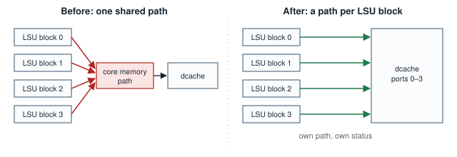

**Problem.** With several LSU blocks per core (one per issue slice), all of them went through one shared core memory path. Both bandwidth and floorplanning were limited by that single funnel.

**How it works.** Each LSU block owns its path to its own dcache ports, along with its own status signals. The tensor-core blocks also get their own metadata ports into their slice's LSU. This is the processing-block organization of NVIDIA SMs: each partition has its own load/store path.

**Gain:** cycle-identical at today's shapes. It is the structure that lets memory bandwidth scale with the number of LSU blocks, and it shortens the wires in the core.

---

## FPGA memory interface

### Many AXI transactions in flight

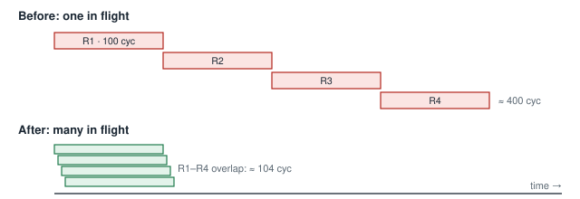

**Problem.** The FPGA shell limited each AXI memory port to very few outstanding transactions. By Little's law, a port's throughput is the number of requests in flight divided by latency. One request in flight at 100 cycles of latency delivers one line per 100 cycles, however much bandwidth the HBM has.

**How it works.** The limit is gone. Requests are arbitrated with their AXI IDs, and responses are routed back by ID, so many transactions overlap their latency. A grant is held while a request is being offered, which keeps the AXI rule that a valid request stays stable.

**Gain (xrtsim):**

| Case | Speedup |
|---|---|
| One port, 100-cycle latency | 1.25–1.27× |
| 4-core sgemv | 1.30× |
| Several ports | 1.06–1.08× |
| Default timing | 1.00–1.13× |

### Memory ports follow the GPU, and write fall-through

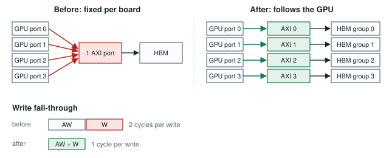

**Problem.**
- The number of AXI memory ports was fixed per board, not set by the GPU configuration. A larger GPU could not use more HBM channels, and some boards left channels unmapped.
- A write's data waited a cycle behind its address.

**How it works.**
- The shell gets one AXI port per GPU memory port, rounded up to a power of two.
- Each port owns a contiguous part of memory, mapped to its own HBM channel group, and the board connectivity is generated from the port count.
- A write's data now leaves in the same cycle as its address. Data stays in address order through a small queue.
- Reset waits for any write already in progress, so it never splits a burst.

**Gain:**
- Single-beat writes: twice the throughput (1,000 writes in 1,000 cycles instead of 2,000).
- Small GPUs (1–4 cores) are not port-bound and see within ±1.2%. The port scaling is what lets larger GPUs use the HBM.

---

## How the gains were measured

- **DRAM model.** All simulators share one DRAM model:
  - independent channels, refresh, and open-page bank interleave;
  - JEDEC-style HBM2, HBM3 and GDDR6 timing from data-sheet values;
  - per-channel response queues.

  The A100 profile's idle latency (216/257 core cycles open-row/conflict) matches GPGPU-Sim's SM80 model (about 215/255).
- **Model agreement.** SimX models every feature here with the same structure as the RTL, and CI checks SimX against rtlsim on each feature's shapes. So gains measured on SimX at full GPU scale reflect the hardware. Each feature has a test that fails when it is broken or turned off.
