# Memory-Level Parallelism Optimizations

A GPU hides memory latency by keeping many memory requests in flight at once. This is memory-level parallelism (MLP). It runs from the lanes of one warp, through the caches and the command processor's DMA, out to the DRAM channels. This document describes the features that raise Vortex's MLP:
- how the front end feeds the core;
- how the cache hierarchy is organized;
- how misses are handled;
- how same-address requests are merged;
- how coherence and ordering are kept cheap;
- how local memory serves a warp;
- how the load/store unit moves data;
- how the DMA engines share the memory system;
- how the FPGA shell reaches HBM.

Each section says what problem the feature removes, how it works, and what it gains.

## Reading the numbers

- Gains are changes in total kernel cycles, so −10% means 10% faster. Each gain is measured against the same configuration with the feature off.
- **rtlsim** is the Verilator model of the RTL. **SimX** is the cycle-level C++ model. **xrtsim** is the RTL plus the FPGA shell.
- The GPU shapes (`a100`, `h100`, `rtx5080`, …) are hardware profiles. A profile sets cores, warps, threads, cache sizes, and the DRAM type and timing (HBM2, HBM3, GDDR6) from data-sheet values. See [simulation.md](../simulation.md#hardware-profiles).

## Summary

Every MLP feature of Phase 1 and Phase 2, plus the earlier features this design builds on. **Phase** is P1, P2, or "pre" for features that were on master before Phase 1. **Compiler** says whether the feature needs compiler support: "N" means it works with the CI compiler and needs nothing new. **Gain** is the best measured change in cycles against the same configuration with the feature off (rtlsim unless marked). **Area** is a Beacon or Vivado measurement where one exists; "n/m" means not measured.

| Phase | Feature | What it does | Commit(s) | Knob | Default | Compiler | Gain | Area |
|---|---|---|---|---|---|---|---|---|
| pre | [Sectored L2/L3](#sectored-l2-and-l3-caches) | One tag per two bus granules, a valid bit per sector | master | `VX_CFG_{L2,L3}_SECTOR_SIZE` | one bus granule | N | LLC tags halved | tags −50% |
| pre | [Word-size dcache banking](#dcache-banks-follow-the-thread-count) | Dcache banks = line / coalescer word, one per lane | master | `VX_CFG_DCACHE_WORD_SIZE` | derived | N | banks scale with threads | n/m |
| pre | [Fill forwarding](#fill-forwarding) | Reads at the head of an MSHR chain take the fill data directly | master | none | on | N | sgemv −5.0% | n/m |
| pre | [Atomics at the LLC](#atomics-at-the-last-level-cache) | A-extension RMW at the last-level cache, L1 copies dropped | master | `VX_CFG_EXT_A_ENABLE` | off | N | correctness | n/m |
| P1 | [Broadcast flush, per-port tokens](#broadcast-flush-and-per-port-flush-tokens) | One flush DCR starts every core; a token down every memory port | `046ff33b0`, `62dc764f4` | none | on | N | flush per launch 2.76M → 16.5k cycles; fixes lost writes | n/m |
| P1 | [Hashed bank select](#hashed-bank-select) | Bank = low line bits XOR an IPOLY fold of the upper bits | `ef75f8e62` | `VX_CFG_DCACHE_BANK_HASH`, `VX_CFG_L2_BANK_HASH` | L2 on; dcache on at ≥ 4 banks | N | sgemv −32.8%, fp16 tensor −13.8%, WGMMA+DXA −13.5% | cache DUT 281.4 vs 278.8 MHz; LUT n/m |
| P1 | [Back-to-back fills](#back-to-back-fills) | Fills enter a bank on consecutive cycles, each with its own staged sector | `f9dfa6a13` | none | on | N | rtx5080 stream −6.2% | cache DUT 300.4 → 309.6 MHz |
| P1 | [L1-only launch flush](#l1-only-flush-between-launches) | The shared LLC answers a launch's L1-only token without a walk | `7ce8a7483`, `9473f26e9` | none (from topology) | on | N | flush 2,750 → 180 cycles; chained launches −11% | n/m |
| P1 | [Write-allocate without fetch (lazy fetch)](#write-allocate-without-fetch-lazy-fetch) | A store miss installs the sector with a dirty-byte mask, no fill | `4f173e313`, `bdf39536d`, `1de9126e6`, default `a99c1be47` | `VX_CFG_{DCACHE,L2,L3}_LAZY_FETCH` | on where the cache is a write-back LLC | N | DRAM reads −33% (cycles flat) | cache DUT +2,629 LUT |
| P1 | [Per-slice fetch and core partitioning](#per-slice-fetch) | FW fetch slices, each with scheduler, fetch, decode and icache port | `e58720478`, `8705e2b7b` | `VX_CFG_FETCH_WIDTH` | = issue width | N | sgemm IW4 −31.6%; SimX profiles −29.7% / −40.7% | +0.33% LUT at FW2 |
| P1 | [Device-wide global barrier](#device-wide-global-barrier) | One gbar unit counts every core across clusters | `5f1ef4fad`, `c1516d3e1` | none | on | N | correctness at > 1 cluster | n/m |
| P1 | [Targeted fences](#targeted-fences) | L1-only token for memory fences; I/O fences drain without a walk | `3f27ba402`, `18b6fe521` | none | on | N | printf 13.6×, fence −55% | n/m |
| P1 | [CP DMA through the LLC](#command-processor-dma-through-the-llc) | The command processor's DMA is a client of the shared LLC | `1d3db49b6`, `cc7bb17cc`, `bbad636e3`, `f93df327f`, default `60d79470a` | `VX_CFG_CP_LLC_CLIENT` | on (acts only with one shared LLC) | N | multikernel −42.7%, dogfood −30% | est. +2–3k LUT (not synthesized) |
| P1 | [Dcache read merge](#dcache-read-merge) | Same-word reads of one LSU block share one bank access | `4e1d2a7ec`, `2342ffdcd`, port 0 `d6be497d7` | `VX_CFG_DCACHE_READ_MERGE` | on | N | sgemm −6.5% to −17.2% | n/m |
| P1 | [LMEM DMA round-robin](#local-memory-dma-round-robin) | DXA writes and TCU reads share the LMEM DMA port round-robin | `c96140253` | none | on | N | WGMMA+DXA −10.2%, sparse −11.6% | 1 bit |
| P1 | [Per-block LSU memory paths](#per-block-lsu-memory-paths) | Each LSU block owns its memory path; TCU blocks their metadata ports | `8e2aa619c`, `304e0db17`, `8410590f4`, `47844854f`, `fc0a35bb4`, `0c603f49b` | none | on | N | cycle-identical; bandwidth scales with blocks | n/m |
| P1 | [Non-power-of-two warps per slice](#non-power-of-two-gpu-shapes) | %, / and * instead of bit slices in OPC, IPDOM, mhartid | `e311957d9`, `365895a61` | none | on | N | enables 48-warp rtx5080 | pow2 netlists unchanged |
| P1 | [Many AXI transactions in flight](#many-axi-transactions-in-flight) | AXI limit removed, responses routed by ID | `45e6a2356` | none | on | N | xrtsim 4-core sgemv 1.30× | n/m |
| P2 | [Non-power-of-two cores, sockets, clusters](#non-power-of-two-gpu-shapes) | Removes pow2 asserts; CP reports the exact socket size | `1a3055f04` | none | on | N | enables 84/108/132-SM shapes | pow2 netlists unchanged |
| P2 | [AFU ports follow the GPU, write fall-through](#memory-ports-follow-the-gpu-and-write-fall-through) | One AXI port per GPU memory port; W leaves with AW | `afd433150`, `3f25c838c`, `5391be583`, `2339de0b9` | none | on | N | single-beat writes 2× | n/m |
| P2 | [Full-sector refetch skip](#full-sector-refetch-skip) | A fully written partial sector loops back as a data-less fill | `05d1237ff`, `d0cb49c70` | follows `*_LAZY_FETCH` | with lazy fetch | N | SimX rtx5080 sgemm −43.5% with L2 lazy | n/m |
| P2 | [Launch argument slots](#launch-argument-slots) | Arguments and descriptors go to clean pooled slots, no flush | `347c914a6` | none | on | N | multikernel −7.5% | n/m |
| P2 | [Acquire/release fences](#acquire-and-release-fences) | Fence pred/succ picks invalidate, drain or both; .aq/.rl AMOs ordered | `03e8304a2`, `a010af42d` | none | on | N | correctness (seq-cst AMOs pay +95%) | n/m |
| P2 | [Icache same-line merge](#icache-same-line-merge) | Same-line fetches of different slices share one bank access | `c9b78161c` | `VX_CFG_ICACHE_READ_MERGE` | on (no effect at FW 1) | N | IW4 sgemm −12.1%; rtx5080 sgemm −25.8% | n/m |
| P2 | [Write-through ordering](#write-through-ordering) | A draining write-through store stays a hazard for same-word loads | `1babe84fb` | none | on | N | correctness | n/m |
| P2 | [Warp-wide local-memory unit](#warp-wide-local-memory-unit) | Whole-warp LMEM requests served in bank passes, same-word reads ride along; a second read engine on the banks' second port | `b95dd2b4d` (read merge), `0b0d7ca4d` (unit) | none | on | N | SimX sgemm2 16×16 −0.4% / −0.5% (mainly timing) | LMEM deepest path 18 → 9 levels; lmem DUT 26,822 LUT |
| P2 | [Lane-gather writeback merge](#lane-gather-writeback-merge) | An instruction's partial lane passes write back as one beat | `c69145562` | none | on | N | sgemm −9.7% (16T) / −20.6% (32T); mixfu −8.7% / −9.1% | −2,428 LUT per gather |
| P2 | [Miss tracking from bandwidth × latency](#miss-tracking-sized-by-littles-law) | MSHRs and the LSU pending pool sized by Little's law from the platform | `7d2883ca0` | `VX_CFG_{DCACHE,L2,L3}_MSHR_SIZE` (derived), `VX_CFG_LSU_PENDING_LIMIT` | derived (stock shapes unchanged) | N | not measured (a100 L2 MSHR 16 → 64) | grows only where the platform needs it |
| P2 | [Victim advance on a new line only](#victim-advance-on-a-new-line-only) | FIFO and random replacement step only when a line is new | `3032f6471` | none | on | N | 8 same-set lines: memory reads 25 → 9 | 0 LUT |
| P2 | [Non-power-of-two way count](#non-power-of-two-way-count) | Exact cache capacities of the profiled parts | `c9c82b7a0` | `VX_CFG_*_NUM_WAYS` | — | N | capacity fidelity | default unchanged |
| P2 | [Stack interleave by whole lines](#stack-interleave-by-whole-lines) | The per-warp stack skew steps by dcache lines | `8b4e6e8d9` | `VX_CFG_LSU_STACK_INTERLEAVE_ENABLE` | on | N | raycast −0.3% | one narrow XOR |
| P2 | [TCU_LD in LSU-lane passes](#tcu-loads-in-lsu-lane-passes) | TCU loads issue in LSU-width passes when the LSU is narrower than the warp | `d47fead9c` | none | on | N | enables narrow-LSU TCU shapes | default unchanged |
| P2 | [Wide loads and stores](#wide-loads-and-stores) | `vx_flw.d/.q`, `vx_fsw.d/.q`: 2 or 4 words to an aligned FP register group, one fetched instruction | `9f116ff7a`, knob and intrinsics `5ad62a09d` | `VX_CFG_EXT_LDST_WIDE_ENABLE` | **off** | N (intrinsics; LLVM `+xvortexldstwide` optional, off by default) | knob on vs off (unrolled scalar): sgemm_v1 −9.5% / −7.5%, sgemm2 −7.2% / −8.3%, sgemm2_dxa_mcast −5.7% / −8.0%, sgemm2_dxa −2.6% / −3.8%, sgemm −2.5% to −6.2%, sgemmx −2.1% | decode +33 LUT, expander +3 LUT per warp; knobs off: core −89 LUT |
| P2 | [Matrix fragment loads and stores](#matrix-fragment-loads-and-stores) | `vx_ldm`, `vx_stm`: a fragment in one macro-op, expanded per register | `d72b25c0a`, knob and TCU decoupling `5ad62a09d` | `VX_CFG_EXT_LDST_MATRIX_ENABLE` | **off** | N (intrinsics) | dense, mx and sparse TCU kernels −3.4% to −10.1% | +169 LUT with TCU, +157 LUT without |
| P2 | [Zero-latency request skids](#request-skids-at-the-l2-and-mmu-inputs) | Registered ready at the L2 core-request and MMU inputs; flushes wait for held requests | `ddd4ea511` | none | on | N | 0 cycles (perf_gate identical); tensor 240.6 → 251.6 MHz, top 243.0 → 256.1 MHz | +0.03% to +0.2% LUT |

## Configuration knobs

Some of these features can be set with a `VX_CFG_*` knob (see [Build Configuration System](build_configuration_system.md)). The rest are always on, or are selected automatically from the cache layout.

| Feature | Knob | Default |
|---|---|---|
| Hashed bank select | `VX_CFG_DCACHE_BANK_HASH`, `VX_CFG_L2_BANK_HASH` | dcache: on with 4 or more banks; L2: on. The L3 has no bank hash. |
| Write-allocate without fetch | `VX_CFG_{DCACHE,L2,L3}_LAZY_FETCH` | On where the cache is a write-back LLC (the dcache with no L2, the L2 with no L3, or the L3), off elsewhere. It also enables the dirty-byte masks (`*_DIRTYBYTES`). |
| Full-sector refetch skip | Part of lazy fetch | Follows `*_LAZY_FETCH` |
| Dcache read merge | `VX_CFG_DCACHE_READ_MERGE` | 1 (on) |
| Icache same-line merge | `VX_CFG_ICACHE_READ_MERGE` | 1 (on). No effect with one fetch slice. |
| CP DMA through the LLC | `VX_CFG_CP_LLC_CLIENT` | 1 (on). Takes effect only when one LLC serves every core. |
| Per-slice fetch | `VX_CFG_FETCH_WIDTH` | The issue width's lowest set bit, so equal to a power-of-two issue width |
| Miss tracking | `VX_CFG_{DCACHE,L2,L3}_MSHR_SIZE`, `VX_CFG_LSU_PENDING_LIMIT` | Derived from the platform's bandwidth × latency; the stock shapes resolve to the earlier values |
| Stack interleave | `VX_CFG_LSU_STACK_INTERLEAVE_ENABLE` | On |
| Wide loads and stores | `VX_CFG_EXT_LDST_WIDE_ENABLE` | **Off.** Needs F with 32-bit FP registers. |
| Matrix fragment loads and stores | `VX_CFG_EXT_LDST_MATRIX_ENABLE` | **Off.** Independent of the TCU. |
| Atomics at the LLC | `VX_CFG_EXT_A_ENABLE` | Off |
| Sectored L2/L3 | `VX_CFG_{L2,L3}_SECTOR_SIZE` (a size) | One bus granule. Setting it to the line size removes sectoring. |
| Dcache word-size banking | `VX_CFG_DCACHE_WORD_SIZE` (a size) | Derived from the lane count and XLEN |

**Always on:** fill forwarding, back-to-back fills, broadcast flush and per-port flush tokens, launch argument slots, targeted fences, acquire/release fences, the device-wide global barrier, write-through ordering, victim advance on a new line only, request skids at the L2 and MMU inputs, the warp-wide local-memory unit, the lane-gather writeback merge, local-memory DMA round-robin, per-block LSU memory paths, TCU loads in LSU-lane passes, non-power-of-two GPU shapes, many AXI transactions in flight, and write fall-through.

**Selected automatically:**
- The L1-only launch flush and the fence shortcuts apply whenever a single LLC is the point of coherence.
- Write-allocate without fetch, the full-sector refetch skip and the dirty-byte masks turn on in whichever cache is a write-back LLC.
- The FPGA shell's memory port count follows the GPU's memory ports.

---

## Front end

### Per-slice fetch

**Problem.** With an issue width above one, the issue slices were fed by a single fetch and decode path, one instruction per cycle. Warps on different slices waited for the front end, not for their operands, so a wider core issued little more than a narrow one.

**How it works.** The front end is split into `FETCH_WIDTH` slices. Each has its own warp scheduler, fetch, decode and icache port, and serves its share of the warps. The core's structure (issue slices, execution blocks, icache banks) is derived from the fetch width, the issue width and the block counts. The slices share the icache; the [icache same-line merge](#icache-same-line-merge) keeps them from queuing on the same line. Controlled by `VX_CFG_FETCH_WIDTH`, which defaults to the issue width (its lowest set bit), so a one-wide core is unchanged.

**Gain:**
- rtlsim, issue width 4: sgemm 103,793 → 70,957 cycles (−31.6%) at two fetch slices; raycast −2.7%.
- SimX GPU profiles at four fetch slices: −29.7% and −40.7%.
- The one-wide default moves by at most 132 cycles.
- Area: +0.33% LUT at two fetch slices.

---

## Cache organization

### Sectored L2 and L3 caches

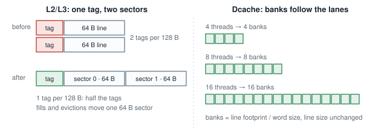

**Problem.** An LLC line as small as the memory bus granule needs one tag per 64 bytes. At GPU LLC sizes (megabytes), that is a large tag array.

**How it works.** L2 and L3 lines are twice the bus granule. One tag covers the line, and the line is split into two sectors of one bus granule each, with a valid bit per sector. Fills and evictions move one sector at a time, so memory traffic stays at bus granularity, while the tag array is half the size. Sector size is set with `VX_CFG_{L2,L3}_SECTOR_SIZE`.

**Gain.** The LLC tag area is halved at the same capacity and the same memory traffic.

### Dcache banks follow the thread count

**Problem.** A dcache with a fixed bank count serializes a warp's lanes once the thread count outgrows it.

**How it works.** The coalescer's word size sets the dcache banking: banks = line footprint / word size, and there is one bank per request lane. Wider warps get more banks without a smaller line. See the right half of the figure above.

**Gain.** Dcache parallelism tracks `NUM_THREADS`, so a 16- or 32-thread warp is not throttled by a 4-bank cache.

### Hashed bank select

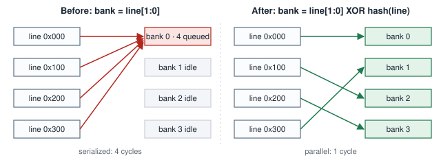

**Problem.** A cache picks its bank from the lowest line-address bits. GPU kernels walk arrays with power-of-two strides: matrix rows, tiles, per-thread blocks. Every request in such a stride has the same low bits, so all of them queue on one bank while the others sit idle.

**How it works.** The bank index is the low line-address bits XORed with a hash of the higher bits. The hash is an IPOLY polynomial: IPOLY(5) for 16 banks, IPOLY(37) for 32, and an XOR fold for other counts. Strided requests spread over all banks. Each line still has exactly one bank, so the rest of the cache is unchanged. It is controlled by `VX_CFG_{DCACHE,L2}_BANK_HASH`: on for the L2, and on for a dcache with 4 or more banks. Below 4 banks, the extra queuing outweighs the spreading.

**Gain (rtlsim):**
- sgemv 512×512 at 16 threads: −32.8%
- fp16 tensor sgemm on 2 cores + L2: −13.8%
- WGMMA with DXA: −13.5%
- multi-core sgemm: −8.2%
- SimX, rtx5080, N=256: −34%

### Non-power-of-two way count

**Problem.** The profiled GPUs have caches with 6, 12, 20 or 24 ways. With power-of-two ways only, a profile had to round its capacity, which changes hit rates.

**How it works.** The way select, the replacement state and the victim choice use the exact way count instead of a bit slice. Power-of-two way counts produce the same logic as before.

**Gain:** the profiles get their parts' exact cache capacities. Beacon shows the default cache unchanged in depth and area.

---

## Miss handling

### Fill forwarding

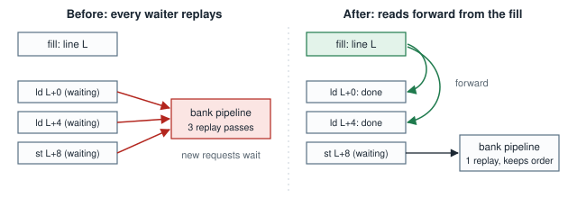

**Problem.** When a miss returns, every request waiting on that line (the MSHR chain) used to replay through the bank pipeline one at a time. Each replay is a full pipeline pass, and new requests are blocked while the chain drains.

**How it works.** The reads at the head of the chain take their data straight from the staged fill sector, which is fill-buffer forwarding, standard in GPU L1s. The first write or atomic in the chain, and everything after it, still replays, so same-line accesses keep program order. The input arbiter stays open to new requests while the chain completes. Always on.

**Gain (rtlsim):** sgemm −2.7%, sgemv −5.0%, multi-core sgemm −2.2%.

### Back-to-back fills

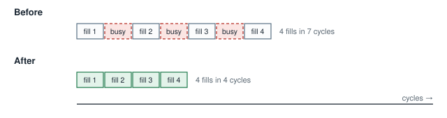

**Problem.** A bank could not take a fill in the cycle right after another fill. Under heavy miss traffic, fills arrived in bursts and the bank accepted only one every other cycle.

**How it works.** Fills follow each other into the bank pipeline back to back. Each staged fill keeps its own sector until it installs, so consecutive fills don't conflict.

**Gain:**
- rtx5080 profile, 4 MiB stream: −6.2%
- the stock configuration (shallow L2): within ±0.5%
- the cache also closed timing faster: Fmax up by 3%

### Write-allocate without fetch (lazy fetch)

**Problem.** A write-back cache that misses on a store normally reads the whole line from memory, then overwrites part or all of it. Streaming writes therefore cost a read for every line they write.

**How it works.** A store miss installs the sector at once, with a per-byte dirty mask and a *partial* bit, without reading memory. A later load or atomic on a partial sector refetches it and merges memory data only under the bytes that were never written. An eviction writes back only the dirty bytes. A refill of one sector keeps the dirty bytes of the line's other sectors. Controlled by `VX_CFG_{DCACHE,L2,L3}_LAZY_FETCH`.

**Gain:** 1-core vecadd DRAM reads −33% and memory requests −25%. Cycles are unchanged because that kernel is latency-bound. On where the cache is a write-back LLC, the same write-validate policy NVIDIA's L2 uses: the DRAM traffic it removes counts even where cycles are flat.

### Full-sector refetch skip

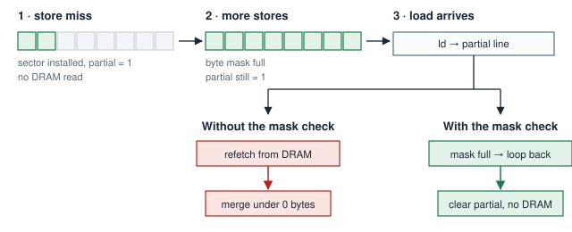

**Problem.** With lazy fetch, once stores have written every byte of a sector, the partial bit still triggered a refetch on the next load. The cache read memory only to merge it under zero unwritten bytes. On L2-heavy kernels, these useless reads made lazy fetch slower than leaving it off.

**How it works.** When the refetch commits, the bank checks the byte mask. If the mask is full, the refetch loops back through the bank as a fill with no data, clears the partial bit, and reads nothing from memory. If the loopback queue has no room, the refetch falls back to memory as before.

**Gain:**
- DRAM reads: 145 → 17 at the dcache and 539 → 27 at the L2, on a fully written stream.
- SimX, rtx5080 profile, 4 cores, sgemm -n192 with L2 lazy fetch: 285,006 → 161,121 cycles (−43.5%). Lazy fetch is now slightly faster than having it off.

### Miss tracking sized by Little's law

**Problem.** To reach a memory system's peak bandwidth, bandwidth × latency bytes must be in flight. The dcache, L2 and L3 MSHRs had 16 entries and the LSU's pending pool was capped at 32, on every platform. A high-bandwidth, high-latency platform could not keep enough misses outstanding.

**How it works.** The configuration computes the bytes in flight the platform needs: peak bandwidth ÷ clock rate × memory latency. Each cache level sizes its MSHR from its bank's share of that, in sectors: a power of two, at least 16, at most 256 (64 for the dcache). `VX_CFG_LSU_PENDING_LIMIT` (32 to 256) bounds the LSU's pending pool per block the same way. Every RTL width derived from these sizes follows them, and SimX uses the same capacities.

**Gain:** the stock shapes resolve to the same sizes as before. The a100 profile gets a 64-entry L2 MSHR; a profile that pins a value keeps it. Not measured separately.

### Victim advance on a new line only

**Problem.** The bank updated the replacement state on every fill, including a sector refill into a line already present. A stream reading both sectors of each line moved the FIFO pointer twice per line, so only every other way was ever chosen as a victim. The random policy stepped its generator on refills too.

**How it works.** The replacement state advances only when a fill brings in a new line. PLRU, which updates on hits, is unaffected.

**Gain:** one thread filling a set to its way count, re-reading it and adding one more line: 25 memory reads before, 9 after (the spread-out control is 9). No area change.

### Request skids at the L2 and MMU inputs

**Problem.** The L2 decided whether to accept a request in the same cycle as its tag lookup, and the MMUs in the same cycle as their TLB lookup. That ready signal fed back into the sender's output register across a module boundary, so the lookup and the sender's register enable formed one long loop. It was the slowest path on the tensor and full-GPU builds.

**How it works.** A zero-latency skid register sits at each L2 bank's core-request input and at each MMU request lane. The sender sees a registered ready: the skid accepts whenever it is empty, and a request passes straight through when the bank accepts it at once, so no cycle is added. A flush waits until no request is held in a skid, so it can't overtake one. SimX models the held requests the same way.

**Gain:** cycles unchanged (perf_gate identical). FPGA: tensor 240.6 → 251.6 MHz and full GPU 243.0 → 256.1 MHz, for +0.03% to +0.2% LUT.

---

## Request merging

### Dcache read merge

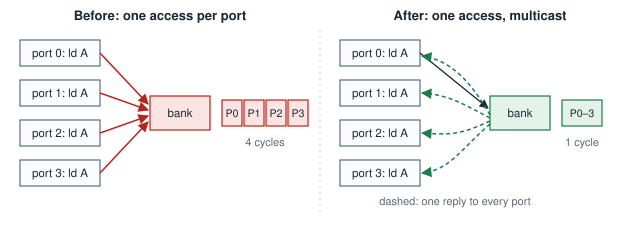

**Problem.** Uniform loads make every lane of a warp read the same word in the same cycle. Kernel arguments and the shared operand of a matrix multiply are typical. Each LSU port sent its own request to the same bank, and the bank served them one per cycle.

**How it works.** Plain reads of the same word from the ports of one LSU block in the same cycle are served by one bank access, and the reply goes to every port that asked. Each port's order into the bank is unchanged, so loads stay ordered against stores. The merge compares request tags in the same form on every port, so it doesn't depend on how wide the tag is. Controlled by `VX_CFG_DCACHE_READ_MERGE`.

**Gain (rtlsim sgemm -n128):**
- 16 threads with an 8-byte dcache word: −17.2%
- 2 banks: −9.8%
- 32 threads: −7.9%
- 16 threads: −6.5%
- 4 cores + L2: −6.5%

At 16 threads, dcache reads fall 25% and bank stalls 55%.

### Icache same-line merge

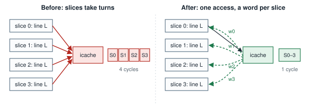

**Problem.** With several fetch slices, the front end fetches up to one instruction per slice per cycle. A dense kernel's inner loop often spans only a few cache lines (sgemm: 3). So the slices keep requesting the same line and take turns at its bank, losing 1 to 2 of 4 fetch slots every cycle even with a 100% hit rate. A warp has only one fetch in flight, so each cycle of waiting lowers its fetch rate directly.

**How it works.** Reads of the same icache line from different fetch slices in the same cycle become one bank access. The bank returns each slice the word it asked for. This differs from the dcache merge: the slices want different words of one line, not the same word. Controlled by `VX_CFG_ICACHE_READ_MERGE`. It has no effect with one fetch slice.

**Gain (rtlsim / SimX):**

| Shape | sgemm | vecadd | conv3 | raycast |
|---|---|---|---|---|
| Issue and fetch width 4 | −12.1% / −12.4% | | | −4.7% / −4.7% |
| rtx5080 core | −25.8% / −20.2% | −15.7% / −20.1% | −3.4% / −4.6% | |

With the merge, 16 icache banks are no longer slower than 4.

---

## Coherence and ordering

### Broadcast flush and per-port flush tokens

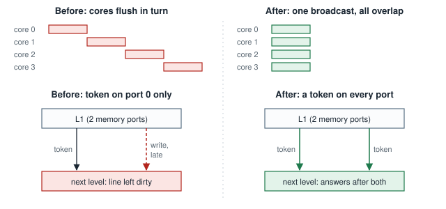

**Problem:**
- The command processor flushed the cores one after another, so a launch boundary cost the sum of every core's flush.
- A cache forwarded its flush token on memory port 0 only. A write still queued on another port could reach the next level after that level had finished its walk, and stay dirty there.

**How it works:**
- One broadcast `CACHE_FLUSH` write starts every core's flush at once. The command processor then collects the completions, so the flushes overlap.
- A cache walks its banks and sends a flush token down **every** memory port. It answers only once all ports have answered.
- Every independently buffered write path carries its own token.
- Read-only caches (icache, texture, ray-tracing caches) no longer forward flushes at all.

**Gain:** flush cost per launch dropped from 2.76M to 16.5k cycles on the measured shape. It also fixed the lost-write case above.

### L1-only flush between launches

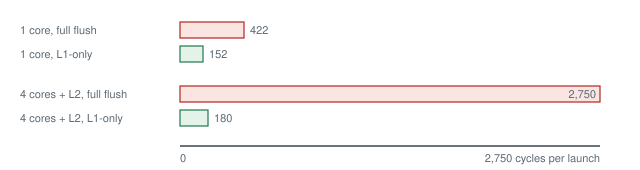

**Problem.** Every kernel launch flushed the whole hierarchy, including a walk of the LLC. Back-to-back launches paid for it each time.

**How it works.** When a single LLC serves every memory client, it is the point of coherence: launches only need the L1s cleaned. The launch flush becomes an L1-only token, which the shared LLC answers without walking. LLCs that are replicated per core or per cluster, and LLCs with peer clients beside them (texture, ray tracing, raster, output merger, DXA), still walk. A dcache counts as the LLC only when it is the single dcache of a single socket with no other memory client. The runtime posts flushes lazily and flushes fully before any device-memory transfer that needs it. The device reports busy until every core write, including uncached I/O stores, is visible in memory.

**Gain:** flush cycles per launch 422 → 152 at 1 core and 2,750 → 180 at 4 cores + L2. Chained launches at 4 cores + L2: −11%.

### Launch argument slots

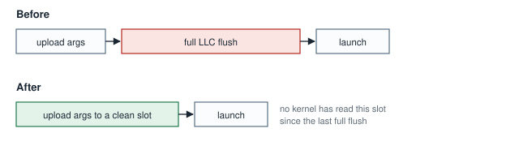

**Problem.** Each launch uploads its arguments and launch descriptors to device memory. That upload made the LLC dirty, so the next launch needed a full flush. Workloads that launch many small kernels behaved as if the L1-only flush didn't exist.

**How it works.** Arguments and descriptors go into a pool of slots. A slot is reused only if no kernel has read it since the last full flush, so no cache can hold a stale copy and the upload needs no flush. This is the same dirty tracking AMD's driver does for its argument buffers.

**Gain:** multikernel at 4 cores + L2: −7.5% on rtlsim, −8.5% on SimX. A workload that reads results back after every launch still needs the full flush and is unchanged.

### Targeted fences

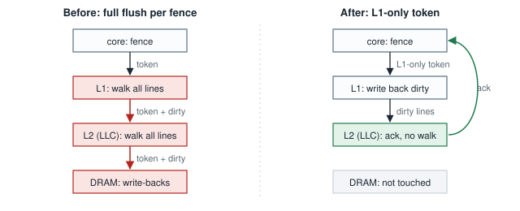

**Problem.** A memory fence flushed the whole hierarchy: every level walked all of its lines and wrote dirty data to DRAM. `printf` fences after every device write, so printf-heavy kernels spent most of their time walking caches.

**How it works.**
- A memory fence sends an L1-only token. The L1s write their dirty lines back to the shared LLC, and the LLC answers without walking. DRAM is not touched.
- A fence that orders only device (I/O) accesses becomes its own LSU operation. Every level drains its in-flight writes to its memory ports, with no walk anywhere.

**Gain (rtlsim):**
- printf at 2 cores + L2: 4,006,822 → 295,165 cycles (13.6×)
- printf at the default configuration: −42.9%
- fence test at 2 cores + L2: −55%
- async global barrier: −13.3%

### Acquire and release fences

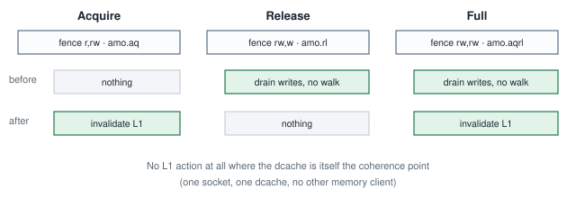

**Problem.** A fence did both halves of a full barrier, even when the program asked for only one. Atomics marked acquire or release (`.aq`/`.rl`) were not ordered at all.

**How it works.** The fence's predecessor and successor sets choose the action:
- **Acquire** (`fence r,rw`, `amo.aq`): invalidates clean L1 lines after the operation. Nothing written back.
- **Release** (`fence rw,w`, `amo.rl`): drains pending writes before the operation, without a walk. Nothing invalidated.
- **Full** (`fence rw,rw`, `amo.aqrl`): does both.

Atomics with `.aq`/`.rl` get these steps around them. All of it is skipped when the dcache is itself the point of coherence.

**Gain:** correct acquire/release ordering for atomics, at the minimum cost the memory model allows. Fences, printf, global barriers and sgemm are unchanged; their kernels use full fences. A test that makes every atomic sequentially consistent pays for the ordering it now gets.

### Atomics at the last-level cache

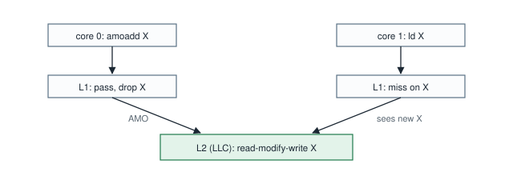

**How it works.** RISC-V `A`-extension atomics run once, as a read-modify-write at the last-level cache. Each private L1 they pass through drops its copy of the line, so the next load of that word from any core misses and sees the new value. `LR`/`SC` use a reservation table. This keeps atomics correct across L1, L2 and L3 without a coherence protocol between the L1s. Controlled by `VX_CFG_EXT_A_ENABLE`.

### Write-through ordering

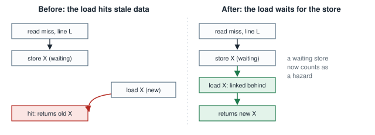

**Problem.** In a write-through L1 (every configuration with more than one core, or with an L2 or L3), a store can be waiting in the MSHR behind an earlier read miss to the same line. A load of the same word that arrived then could hit the cache and return the value from before the store.

**How it works.** A waiting store counts as a hazard. A later access to the same word links behind it in the MSHR chain and sees the stored value. The same rule keeps a newer write from overtaking an older one.

**Gain:** correctness. The ordering test fails without the rule and passes with it.

### Device-wide global barrier

**Problem.** Each cluster had its own global-barrier unit. A barrier across clusters counted each cluster's cores separately, so SimX hung and the RTL timed out or released early with more than one cluster.

**How it works.** One device-level unit counts the arrivals of every core and releases them together.

**Gain:** correct global barriers at any cluster count.

---

## Local memory

### Warp-wide local-memory unit

**Problem.** Local memory served LSU requests lane by lane through a request crossbar. Same-word reads, such as a tile row every thread of a warp reads, each took their own bank access, and the crossbar was an 18-level path that limited the core's clock.

**How it works:**
- The unit takes a whole warp's request per cycle and serves it in passes. In each pass every bank goes to the lowest pending lane that maps to it, and every pending read lane of the same word rides along. Lanes left over replay in the next pass.
- A request retires before the next one starts, so the banks see every lane in program order.
- With several LSU blocks, a second, read-only engine uses the banks' second port, so two warps' reads go through each cycle. Stores and atomics use the first engine and are ordered against every read.
- Each block's response leaves from its own register, with no added latency.
- DXA writes and TCU reads take whole bank rows.

**Gain:**
- Timing: the local memory's deepest path goes from 18 to 9 logic levels (Beacon), and registers at 8 or more levels from 789 to 337.
- Cycles: SimX, sgemm2 at 16 threads × 16 warps, -t16: −0.4% at -n128 (1,065,573 → 1,060,979) and −0.5% at -n256. The same-word ride-along already existed as the earlier LSU-side read merge, which this unit replaces.

---

## DMA

### Command-processor DMA through the LLC

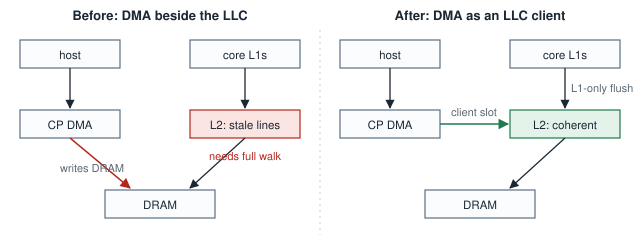

**Problem.** The command processor copied host data straight into DRAM, beside the L2. The L2 could hold stale copies of those lines, so every host transfer needed a full flush and invalidate of the LLC. Launches with uploads between them paid this every time.

**How it works:**
- When one LLC serves every core, the command processor's DMA becomes a client of it on its own slot. A page-table walker attaches the same way.
- Host data flows through the LLC and keeps it coherent, so a transfer needs only an L1-only flush.
- Transfers of at least half the LLC write around it, so they don't evict the working set.
- A launch issued after DMA writes waits for an L1-only flush token sent on the DMA's slot.
- The runtime detects the feature through the `DMA_LLC_CLIENT` capability.
- Controlled by `VX_CFG_CP_LLC_CLIENT`: on by default.

**Gain (rtlsim):**

| Shape | dogfood | multikernel | sgemm -n32 |
|---|---|---|---|
| 2 clusters + L2 + L3 | −30.0% | −42.7% | −14.1% |
| 4 cores + L2 | −9.1% | −23.4% | |
| 8 MB L3 | −64% | | |

**Virtual memory.** Both command processors translate DMA addresses before they enter the LLC, so a client of the LLC sees physical addresses with virtual memory on.

### Local-memory DMA round-robin

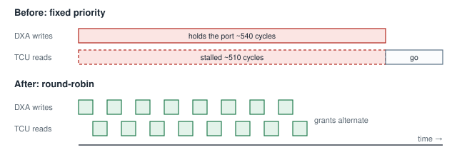

**Problem.** Two clients share the local-memory DMA port: the DXA engine, which writes tiles into shared memory, and the tensor core, which reads WGMMA operands from it. The DXA had fixed priority. One tiled-scatter transfer held the port for about 540 cycles, and a tensor-core batch caught behind it stalled for about 510. That stall delayed the warpgroup barrier, and the barrier delayed the next DXA request.

**How it works.** The port grants round-robin, so a tensor-core read waits at most one DXA write. It costs one bit of state, and a single-client configuration is unchanged.

**Gain (rtlsim):** WGMMA with DXA −10.2%, sparse WGMMA with DXA −11.6%.

---

## Load/store unit

### Per-block LSU memory paths

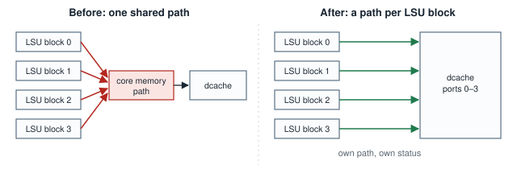

**Problem.** With several LSU blocks per core (one per issue slice), all of them went through one shared core memory path. Both bandwidth and floorplanning were limited by that single funnel.

**How it works.** Each LSU block owns its path to its own dcache ports, along with its own status signals. The tensor-core blocks also get their own metadata ports into their slice's LSU. This is the processing-block organization of NVIDIA SMs: each partition has its own load/store path.

**Gain:** cycle-identical at today's shapes. It is the structure that lets memory bandwidth scale with the number of LSU blocks, and it shortens the wires in the core.

### Lane-gather writeback merge

**Problem.** When the ALU or FPU has fewer lanes than the warp has threads, an instruction executes in several partial passes. Each pass wrote back on its own, so a 32-thread instruction on 8 lanes took 4 writeback beats and held the commit port for all of them.

**How it works.** The lane gather collects an instruction's partial passes and writes them back as one beat. The per-lane demultiplexer that routed each pass is gone.

**Gain (rtlsim):**
- 16 threads, 8 ALU/FPU lanes: mixfu −8.7%, sgemm −9.7%.
- 32 threads, 16 ALU/FPU lanes, 8 LSU lanes: mixfu −9.1%, sgemm −20.6%.
- Area: −2,428 LUT per gather.

### Stack interleave by whole lines

**Problem.** The stack interleave XORs a frame slot's word index with the warp index, so the same slot of different warps lands in different cache sets. When a slot row (one word per thread) is narrower than a dcache line, a one-row skew moved the slot within the same line, and several warps still shared a set.

**How it works.** The warp index is shifted by log2(line ÷ row) before the XOR, so the skew steps by whole lines. It stays a bit permutation plus one narrow XOR, and nothing changes when a row is a line or wider. Controlled by `VX_CFG_LSU_STACK_INTERLEAVE_ENABLE`.

**Gain:** raycast −0.3% (SimX and rtlsim), instructions identical.

### TCU loads in LSU-lane passes

**Problem.** The TCU's operand loads assumed an LSU as wide as the warp. A shape with fewer LSU lanes than threads could not run tensor kernels.

**How it works.** A TCU load issues in LSU-width passes when the LSU is narrower than the warp, like any other load.

**Gain:** narrow-LSU shapes run tensor kernels. Beacon shows the default configuration unchanged.

### Wide loads and stores

**Problem.** A thread that reads consecutive words, such as a row of a matrix tile, fetches and decodes one load per word. At one fetched instruction per cycle, those loads take front-end slots the arithmetic needs.

**How it works:**
- `vx_flw.d` and `vx_flw.q` load 2 or 4 consecutive words into an aligned group of FP registers; `vx_fsw.d` and `vx_fsw.q` store them. Each is exactly its sequence of `flw`/`fsw`: word k goes between address + 4k and register + k, with 4-byte alignment, in any memory space.
- The register must be even (`.d`) or a multiple of 4 (`.q`), and the immediate a multiple of 8 or 16, so the hardware expands the instruction without an adder.
- Decode marks it as a macro-op, and the micro-op sequencer expands it into its 2 or 4 `flw`/`fsw` micro-ops. They issue like scalar loads, each with its own register in the scoreboard. SimX expands it the same way.
- Controlled by `VX_CFG_EXT_LDST_WIDE_ENABLE`, **off by default**. Without it the encodings are not decoded.
- Kernels use it explicitly through the `vx_flw_d/q<FD, OFF>()` and `vx_fsw_d/q<FD, OFF>()` intrinsics in `vx_intrinsics.h`, defined only when the knob is set. The FP register group is a template argument, so two groups can be live at once. They are `.insn` encodings and need no compiler support. LLVM can also emit the instructions itself under its `xvortexldstwide` extension, which is off unless passed.
- The device reports the extension in its ISA flags (`VX_ISA_EXT_LDST_WIDE`).

**Gain:** the comparison is against a scalar loop unrolled the same way, so it measures only the instruction. SimX cycles, default core (one fetch per cycle), knob off → on; rtlsim agrees within 0.1%:

| Kernel | Args | Off | On | Change |
|---|---|---|---|---|
| sgemm | -n32 / -n64 | 115,075 / 799,794 | 107,995 / 779,750 | −6.2% / −2.5% |
| sgemm_v1 | -n32 / -n64 | 130,947 / 898,758 | 118,453 / 831,043 | −9.5% / −7.5% |
| sgemm2 | -n32 -t4 / -n64 -t4 | 200,115 / 1,401,158 | 185,693 / 1,284,375 | −7.2% / −8.3% |
| sgemm2_dxa | default (-n16 -t4 -m1) / -n32 -t4 / -n64 -t4 | 33,883 / 223,860 / 1,363,392 | 34,045 / 213,811 / 1,278,297 | +0.5% / −4.5% / −6.2% |
| sgemm2_dxa_mcast | default / -n64 | 31,717 / 1,351,321 | 29,901 / 1,242,753 | −5.7% / −8.0% |
| sgemmx | -n128 | 4,251,851 | 4,164,415 | −2.1% |
| sgemm2_v1 | default (-n16) / -n32 / -n64 | 100,333 / 655,576 / 4,800,667 | 98,093 / 637,326 / 4,635,080 | −2.2% / −2.8% / −3.4% |

Retired instructions barely change; the gain comes from fetch. Order matters where the loads conflict on banks. In sgemm2_dxa and sgemm2_v1 the threads of a warp read different local-memory rows, and with 4 banks each A load conflicts 4 ways. The quad's 4 uops issue back to back, so they reach the LSU as a burst, where scalar loads from the warps interleave. Issued before the B loads, the quad holds the cheap B loads and the first FMA behind its slow uops: sgemm2_dxa was +1.2% to +4.6% and sgemm2_v1 +0.1% to +0.6% slower than scalar. The compiler orders the scalar loads B0, B1, then A, but it cannot move a load across the intrinsic's `asm volatile`, so these kernels write that order out: B0 and B1, then the quad, then B2 and B3. That gives the gains above; issuing all four B loads first is slower, since the FMA chain then starts later. Two points stay slower:
- sgemm2_dxa's full-K mode (-m1), +0.5%: all warps leave the barrier together, and the last warp's quad waits behind the other three.
- sgemm2_v1 at 16 threads with -n16, +1.7%: the best load order depends on the warp shape.

Both come from the macro-op's uops reaching the LSU as one burst per warp. The fix is in hardware: interleave different warps' macro-op uops, or let the LSU take conflict-free requests ahead of conflicted ones.

Area: +33 LUT in decode and +3 LUT per warp in the expander, with no path deeper. With both load/store knobs off, the core is 89 LUT smaller than when the extensions were always built.

Stepping these kernels' K loop by 4 is worth more than the instruction on any hardware: −16% to −35% against stepping by 1 (the original loops). The kernels now step by 4.

### Matrix fragment loads and stores

**Problem.** A tensor kernel loads each matrix fragment with one `flw` per register and per K step, plus the per-lane address arithmetic. In the K loop that is 21 to 24 fetched instructions per tile for the fragment loads alone.

**How it works:**
- `vx_ldm` and `vx_stm` move a whole fragment. The immediate's low 5 bits name the fragment shape (A, B, C, sparse A, symmetric sparse B, WGMMA C), and the micro-op sequencer expands the instruction into one `flw` or `fsw` per register, with each register's row and column computed from the micro-op counter.
- Any kernel can use it: it does not depend on the TCU. The fragment geometry and shape table live in `VX_gpu_pkg`, and SimX's `fragment_layout.h` is shared by the LSU and the TCU model. Every shape is valid whenever the knob is on; the symmetric sparse B shape needs 4 or 16 threads.
- Controlled by `VX_CFG_EXT_LDST_MATRIX_ENABLE`, **off by default**. Kernels use it through the `vx_ldm`/`vx_stm` intrinsics in `vx_intrinsics.h` (`.insn` encodings, no compiler support needed); `vx_tensor.h` calls them when a context is built with `ldst_matrix`. The device reports it in its ISA flags (`VX_ISA_EXT_LDST_MATRIX`).
- Two shapes that lost to scalar loads on rtlsim were removed: asymmetric sparse B, and sparse MX, which keeps scalar loads.
- A macro-op issues one uop per cycle and is fetched once for the whole fragment. In SimX traces of the kernels that were slower with the knob, the fragment loads and stores themselves were never slower than the scalar ones; the slowdowns came from what that changed downstream. A fragment store at the end of a CTA, for one, changes the order in which the CTA's warps exit, and with it which warp takes the next CTA's serial role (the warp that issues the DXA copies). With the issue batches granted by a fixed priority, a warp's dispatch latency depended on its issue slice (an idle grant rested on the last slice, so every other slice paid a cycle), so that reordering cost `sgemm_tcu_wg_dxa` +1.3% to +2.0% at every size. The batches are now granted round-robin (see [core partitioning](core_partitioning.md)); `sgemm_tcu_wg_dxa` is −0.2% to −0.8% with the knob. Without the knob, the TCU configurations with fewer blocks than issue slices move by −23% (`perf_gate-fp16-isw4`) and −16% (`sgemm_tcu_wg` 64³) to +0.7% (`perf_gate-wgmma-dxa`) in SimX; the default one-wide core is unchanged.
- Some points stay slower with the knob: `sgemm_tcu_mx` at its CI shape, +2.6%, where a new CTA takes the CTA slots strictly in order and so waits for the oldest slot while a later one is already free; `sgemm2_tcu` at 64³, +0.36%, where the fragment address registers spill; and six points at +0.18% or less. The fixes are to dispatch a CTA to the first free slot and to cut the fragment address registers.

**Gain (rtlsim):** dense, MX and sparse TCU kernels −3.4% to −10.1%, with bit-identical results. Fetched instructions per K tile: 21–24 → 9 (NT 8). Area: core with TCU +169 LUT; core without the TCU +157 LUT; nothing deeper.

---

## GPU shape

### Non-power-of-two GPU shapes

**Problem.** Warp, core, socket and cluster counts had to be powers of two, because indices were bit slices. The profiled GPUs are not: 48 warps per SM (RTX 5080), 84, 108 or 132 SMs.

**How it works.** The warp control, IPDOM stack and hart IDs, and the core, socket and cluster indexing use %, / and * instead of bit slices. The command processor reports the exact socket size in a capability word. Power-of-two shapes produce the same netlists as before.

**Gain:** the profiles run at their real shapes (this fixed a 48-warp deadlock). A non-power-of-two shape runs within 1.08% of SimX on rtlsim.

---

## FPGA memory interface

### Many AXI transactions in flight

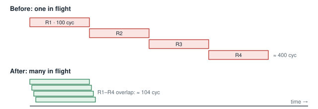

**Problem.** The FPGA shell limited each AXI memory port to very few outstanding transactions. By Little's law, a port's throughput is the number of requests in flight divided by latency. One request in flight at 100 cycles of latency delivers one line per 100 cycles, however much bandwidth the HBM has.

**How it works.** The limit is gone. Requests are arbitrated with their AXI IDs, and responses are routed back by ID, so many transactions overlap their latency. A grant is held while a request is being offered, which keeps the AXI rule that a valid request stays stable.

**Gain (xrtsim):**

| Case | Speedup |
|---|---|
| One port, 100-cycle latency | 1.25–1.27× |
| 4-core sgemv | 1.30× |
| Several ports | 1.06–1.08× |
| Default timing | 1.00–1.13× |

### Memory ports follow the GPU, and write fall-through

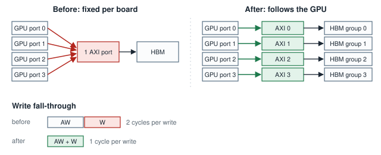

**Problem.**
- The number of AXI memory ports was fixed per board, not set by the GPU configuration. A larger GPU could not use more HBM channels, and some boards left channels unmapped.
- A write's data waited a cycle behind its address.

**How it works.**
- The shell gets one AXI port per GPU memory port, rounded up to a power of two.
- Each port owns a contiguous part of memory, mapped to its own HBM channel group, and the board connectivity is generated from the port count.
- A write's data now leaves in the same cycle as its address. Data stays in address order through a small queue.
- Reset waits for any write already in progress, so it never splits a burst.

**Gain:**
- Single-beat writes: twice the throughput (1,000 writes in 1,000 cycles instead of 2,000).
- Small GPUs (1–4 cores) are not port-bound and see within ±1.2%. The port scaling is what lets larger GPUs use the HBM.

---

## How the gains were measured

- **DRAM model.** All simulators share one DRAM model:
  - independent channels, refresh, and open-page bank interleave;
  - JEDEC-style HBM2, HBM3 and GDDR6 timing from data-sheet values;
  - per-channel response queues.

  The A100 profile's idle latency (216/257 core cycles open-row/conflict) matches GPGPU-Sim's SM80 model (about 215/255).
- **Model agreement.** SimX models every feature here with the same structure as the RTL, and CI checks SimX against rtlsim on each feature's shapes. So gains measured on SimX at full GPU scale reflect the hardware. Each feature has a test that fails when it is broken or turned off.
