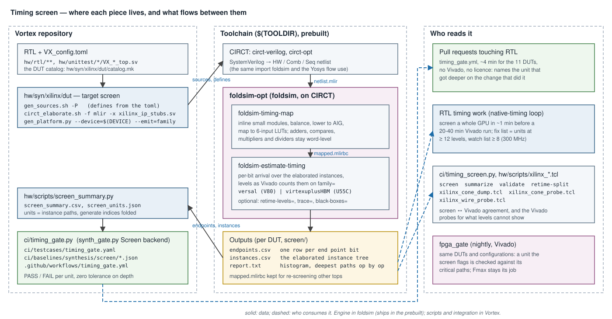
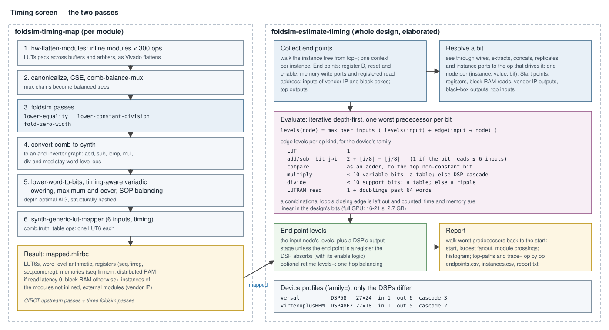

# Timing screen — logic depth of every path, before Vivado

The timing screen counts the logic levels of every register-to-register path
of a Vortex design the way Vivado counts them, in seconds and without
Vivado. It names the RTL units whose paths are too deep for the target clock,
gates their depth on every RTL change (`timing_gate`), and is the first step
of RTL timing work: screen, fix the deep units, then confirm with one Vivado
run.

| § | contents |
|---|---|
| [1](#1-overview) | Overview and how to run it |
| [2](#2-system-architecture) | System architecture: where each piece lives |
| [3](#3-compiler-architecture) | Compiler architecture: the two passes |
| [4](#4-the-model) | The model: levels per element, devices |
| [5](#5-outputs) | Outputs |
| [6](#6-integration) | Integration: the DUT flow, `timing_gate`, timing work |
| [7](#7-validation) | Validation against Vivado |
| [8](#8-diagnostics) | Diagnostics beyond levels |
| [9](#9-invariants-and-limitations) | Invariants and limitations |

---

## 1. Overview

It answers one question per register: **how many logic levels is its worst
input path?** At 300 MHz on the V80, failing end points have a median of
7–8 levels, and between half and four fifths of the registers at 12 or more
levels fail, depending on the gate (§7). So the screen reports:

- **fix list:** units with end points at ≥ 12 levels;
- **watch list:** ≥ 8 levels.

It does not predict slack, because it does not see wires (§9).

One DUT of the synthesis catalog, from a configured build tree:

```bash
make -C hw/syn/xilinx/dut tcu-screen
# build_tcu/screen/report.txt    deepest paths, op by op
# build_tcu/screen_units.json    deepest end point per RTL unit
```

The whole catalog as a gate, and a baseline update (a human step):

```bash
ci/timing_gate.py -j 2
ci/timing_gate.py -b om --update-baseline
```

Any CIRCT netlist, with `ci/timing_screen.py` (subcommands `screen`,
`summarize`, `validate`, `retime-split`; `foldsim-opt` from the `PATH` or
`FOLDSIM_OPT`):

```bash
ci/timing_screen.py screen design.mlir runs/full            # map, then screen
ci/timing_screen.py screen runs/full/mapped.mlirbc runs/socket \
    top=VX_socket__lift black-boxes=VX_core__lift           # one unit of a mapped design
ci/timing_screen.py summarize runs/full --min-levels 12     # deep end points by RTL unit
ci/timing_screen.py validate runs/socket ep.csv --native VX_socket__lift=dut
```

Or the two passes directly:

```bash
foldsim-opt design.mlir --emit-bytecode -o mapped.mlirbc \
  --pass-pipeline='builtin.module(foldsim-timing-map)'
foldsim-opt mapped.mlirbc -o /dev/null --pass-pipeline='builtin.module(
  foldsim-estimate-timing{top=VX_core_top family=virtexuplusHBM
    output=endpoints.csv instances=instances.csv report=report.txt
    top-paths=50 trace=lsu_unit})'
```

| `foldsim-estimate-timing` option | meaning |
|---|---|
| `top=` | the top module (default: the one nothing instantiates) |
| `family=` | `versal` (V80, default), `virtexuplusHBM` (U55C), or `asap7` (ASIC, §4.3) |
| `black-boxes=` | modules to treat as external, as a harness stubs them |
| `output=`, `instances=`, `report=` | the files of §5 |
| `min-levels=` | write only end points at or above this many levels |
| `top-paths=` | deepest paths to print op by op (default 50) |
| `trace=` | also print the deepest path of each end point whose name contains this |
| `retime-levels=` | also estimate the depth after Vivado's retiming to this period (§4.4) |

## 2. System architecture



The engine is two compiler passes of **foldsim** (`foldsim-opt`), built on
CIRCT like the rest of foldsim, and shipped in the foldsim prebuilt. Vortex
never builds it. The integration is in Vortex:

| Piece | Where | Role |
|---|---|---|
| `foldsim-timing-map`, `foldsim-estimate-timing` | foldsim `lib/Transforms/EstimateTiming.cpp` | map to LUTs; count levels |
| `ci/timing_screen.py` | `ci/` | screen any netlist; read it by unit; compare with Vivado |
| `xilinx_cone_dump.tcl`, `xilinx_cone_probe.tcl`, `xilinx_wire_probe.tcl` | `hw/scripts` | Vivado probes for what levels cannot show (§8) |
| target `screen` | `hw/syn/xilinx/dut/common.mk` | one DUT: sources → netlist → screen → summary |
| `circt_elaborate.sh -f mlir` | `hw/scripts` | the lowered HW/Comb/Seq netlist, no `firtool` |
| `gen_platform.py --emit=family` | `hw/scripts` | the family of `DEVICE`, from `hw/syn/xilinx/platforms` |
| `screen_summary.py` | `hw/scripts` | `screen_summary.csv` and per-unit `screen_units.json` |
| `Screen` backend, `timing_gate.py` | `ci/synth_gate.py`, `ci/` | the gate, beside `fpga_gate` and `asic_gate` |
| `timing_gate.yml` | `.github/workflows` | runs it on pull requests that touch RTL |

The screen reads the same CIRCT import that foldsim and the Yosys flow
use (`circt-verilog --ir-hw`), elaborated from the sources and defines
`gen_sources.sh` writes for Vivado, with the Xilinx floating-point IPs as
black boxes (`xilinx_ip_stubs.sv`).

## 3. Compiler architecture



### 3.1 `foldsim-timing-map`

A pipeline of CIRCT's synthesis passes plus three of foldsim's, per module:

1. **Inline small modules** (`hw-flatten-modules`, < 300 ops) so LUTs pack
   across buffers, arbiters and switches, as Vivado's flattened synthesis
   does. Larger modules stay instances; the estimator elaborates them.
2. **Canonicalize and balance** mux chains (`comb-balance-mux`).
3. **foldsim passes:**
   - `foldsim-lower-equality`: an equality compare is XORs and an OR tree,
     which pack into LUTs;
   - `foldsim-lower-constant-division`: a division by a constant is an
     extract (power of two) or a table (dividend of ≤ 10 bits), as
     synthesis writes it;
   - `foldsim-fold-zero-width`: zero-width values are constants, which
     CIRCT's lowering otherwise rejects.
4. **Lower to an and-inverter graph** (`convert-comb-to-synth`). Adders,
   subtracters, compares, multipliers, dividers and remainders stay
   word-level: the estimator models them as the carry chains, DSPs and
   tables Vivado builds, which a LUT mapping of their gates would not
   reproduce.
5. **Depth-optimize** the graph: timing-aware variadic lowering, maximum
   AND cover, SOP balancing, structural hashing.
6. **Map to 6-input LUTs** (`synth-generic-lut-mapper`, timing strategy).

The full GPU maps in about a minute and 18–20 GB.

### 3.2 `foldsim-estimate-timing`

The estimator works on the elaborated design: one **context** per instance,
and one **node** per (context, value, bit). It never enumerates paths:

1. **Collect end points** by walking the instance tree from `top`.
2. **Resolve** each end point bit through wires, extracts, concatenations,
   replicates and instance ports to the op that drives it.
3. **Evaluate** with an iterative depth-first walk: a node's levels are the
   maximum over its inputs of the input's levels plus the edge's (§4), and
   it keeps its one worst predecessor. An input still being evaluated
   closes a combinational loop; that edge is left out and counted.
4. **Report**: each end point's start point is found by walking the worst
   predecessors back; the walk also yields the path's largest fanout and its
   module crossings.

Time and memory are linear in the design's bits: the full GPU screens in
16–21 s and 2.7 GB, a DUT of the catalog in seconds.

## 4. The model

### 4.1 Levels per element

| Element | Levels |
|---|---|
| LUT (`comb.truth_table`) | 1 |
| Adder or subtracter, input bit j to output bit i | 2 + ⌊i/8⌋ − ⌊j/8⌋: a LUT, then the 8-bit carry blocks; 1 if the output bit reads ≤ 6 input bits (one LUT6) |
| Order compare | as an adder, up to the highest bit not constant in both operands |
| Equality compare | lowered to LUTs by the mapping |
| Multiply, ≤ 10 variable operand bits | a table of constants: 1 + ⌈(bits − 6)/2⌉ |
| Multiply, wider | a DSP cascade over the significant bits (§4.2) |
| Divide or remainder | a table over the bits its operand cones depend on, if ≤ 10; else a ripple of one subtracter per quotient bit |
| Distributed-RAM read (`seq.firmem`, latency 0) | 1, plus 1 per doubling past 64 words (MUXF7, MUXF8, LUT), from the address |
| Other ops | 1 per op, listed in the report |

Significant bits exclude constant bits on top and copies of the bit below
(a sign extension). A table is a LUT6 for six inputs and a level of 4:1
multiplexers per two more.

### 4.2 Devices

The V80 and the U55C both have LUT6s, 8-bit carry blocks (LOOKAHEAD8,
CARRY8) and 64-word distributed RAMs; they differ only in their DSPs. The
profile is selected by `family=`, with the names of
`hw/syn/xilinx/platforms`:

| `family=` | Device | DSP multiplier | fabric → registered product | product → fabric | per cascaded DSP |
|---|---|---|---|---|---|
| `versal` | V80 | DSP58, 27 × 24 | 1 | 6 | 3 |
| `virtexuplusHBM` | U55C | DSP48E2, 27 × 18 | 1 | 5 | 2 |

A product takes ⌈a/A⌉·⌈b/B⌉ DSPs (the better orientation). The cell counts
are Vivado's: on Versal, M_DATA, ALUMUX, ALUADD and OUTPUT out of a DSP,
and ALUMUX, ALUADD and OUTPUT through each cascaded one. A register fed by
the product is the DSP's own (MREG or PREG), and so is a LUT that reads that
register back, its clock enable or feedback; any other load pays the output
stage. The fabric-to-product value is fitted on the V80 data. Any other
family is an error.

### 4.3 ASAP7

For the ASIC flow (`hw/syn/yosys`, ASAP7 7.5-track RVT, TT corner) the
screen counts **cell stages**, not LUT levels. `foldsim-timing-map-asic`
maps the same balanced and-inverter graph to 3-input cuts, each one cell
(NAND, AOI, MAJ, XOR), and `family=asap7` models the word-level operators
as an ASIC builds them:

| Element | Stages |
|---|---|
| cell (`comb.truth_table`, 3 inputs) or unmapped and-inverter gate | 1 |
| adder, input bit j to output bit i | 2 + ⌈log₂(i − j + 1)⌉: a prefix adder |
| order compare | 1 + ⌈log₂ span⌉ |
| multiply | partial products, a Dadda tree of full adders (2 stages each), a prefix adder |
| table of k inputs (small products and dividers) | k (a multiplexer tree) |
| memory of flops (no macro) | 1 + ⌈log₂ depth⌉: a decoder and a multiplexer tree |

SRAM macros (`VX_dp_ram_asic`, `VX_sp_ram_asic`) are black boxes, as in the
flow's synthesis: their pins end and start paths. The report converts the
deepest path to a period:

```
deepest path 45 stages: 58 + 167 + 45 x 24 + 6 = 1311 ps (763 MHz)
                        clk→Q  path  stages × cell  setup
```

The cell (24 ps at fanout 3 and its own slew), clock-to-output (58 ps) and
setup (6 ps) delays come from the Liberty, by `hw/syn/yosys/liberty_stage.py`;
the path term (167 ps: the inverter after a DFFHQN's QN, buffering, slew) is
fitted on OpenSTA (§7). Re-derive them for another corner or threshold
voltage.

### 4.4 Retiming (optional)

All of Vortex's Vivado runs retime. With `retime-levels=N`, the `retimed`
column estimates each end point's depth after one hop of balancing to a
period of N levels. The end register moves backward into the room its
output stage leaves, and the start register moves forward into the room its
input stage leaves. Neither crosses a distributed RAM or a DSP, and only a
register Vivado can retime (synchronous reset) moves. Top ports and
black-box pins count as registers with empty neighbour stages, as a gate
harness makes them. It ranks no better than plain levels, so `levels` stays
the ranking; `retimed ≥ 12` at `retime-levels=10` is a short list of fix
candidates retiming is unlikely to absorb.

## 5. Outputs

| File | Contents |
|---|---|
| `endpoints.csv` | one row per end point bit: `levels,retimed,kind,start_kind,fanout,crossings,start_inst,start,end_inst,end` |
| `instances.csv` | the instance tree: `id,parent,instance,module` (the `*_inst` columns' ids) |
| `report.txt` | counts, combinational loops, ops without a model, the histogram of end points by levels, the `top-paths` deepest paths op by op, and the deepest path of each `trace=` match |
| `screen_summary.csv` | the DUT flow's one row: max levels, end points ≥ 12, ≥ 8, all |
| `screen_units.json` | the deepest end point of every unit at ≥ 8 levels, and the 10 deepest paths |

A path in `report.txt`, deepest first, one op per line: levels at the op,
its kind, the fanout of its bit, and its instance path and name:

```
#1 levels 20: .../mem_req_queue/pending_size/used_r.d[0] (VX_socket__lift)
    20 lut    fo 0     .../comb.truth_table[0]
    19 carry  fo 1     .../comb.add[0]
    ...
     0 reg    fo 59    .../req_pending/in_fire_r[13]
```

## 6. Integration

### 6.1 The DUT flow

`hw/syn/xilinx/dut` builds every DUT of `catalog.mk` for Vivado; its
`screen` target screens the same DUT with the same sources, defines and
`DEVICE` (the U55C by default):

1. `gen_sources.sh -P` into `screen/src`;
2. `circt_elaborate.sh -f mlir` into `screen/netlist.mlir`, the FP IPs as
   black boxes;
3. `foldsim-timing-map`, then `foldsim-estimate-timing` with
   `family=$(gen_platform.py --device=$(DEVICE) --emit=family)`;
4. `screen_summary.py`.

The ASIC flow has the same target, with the same sources, defines and SRAM
black boxes as its synthesis, and `family=$(PDK)`:

```bash
make -C hw/syn/yosys/dut om TARGET=screen
# om_VX_om_core_top/screen/report.txt: the deepest paths and the period
```

### 6.2 `timing_gate`

The third synthesis gate, beside `fpga_gate` (Vivado, nightly) and
`asic_gate` (Yosys + OpenSTA, nightly); see
[continuous_integration.md §3.5](continuous_integration.md). It screens
`fpga_gate`'s builds (`ci/testcases/timing_gate.yaml`, all but `top`, whose
`VX_cp_core` keeps LLHD reference ports) in about four minutes, and checks
each against `ci/baselines/synthesis/screen/`:

- a **unit** that gets deeper fails, by name;
- a **new unit** at or above the fix threshold (12) fails;
- a unit that gets shallower, or leaves the watch list, is an improvement
  to lock in by re-recording;
- end point counts are recorded, not gated (they grow with lanes and warps).

Depth is deterministic, so the tolerance is zero. The baseline fingerprint
is the CIRCT and foldsim versions, `DEVICE` and `XLEN`: a new foldsim reads
as STALE, not as a regression. Baselines are golden data, re-recorded only
by a human (`--update-baseline`), as for the other gates.

### 6.3 RTL timing work

Screen first, then Vivado:

```bash
ci/timing_screen.py screen gen/design.mlir runs/full
ci/timing_screen.py summarize runs/full --min-levels 12     # the fix list, by unit
```

The screen ranks the units; one Vivado run confirms the fix. Compare a fix
against a native gate (`hw/syn/xilinx/dut` or the OOC gates), not the
folded design (§9).

## 7. Validation

Against Vivado, per RTL register or memory: the screen's deepest bit
against Vivado's deepest failing path and worst slack, on seven V80 datasets
with no new Vivado runs (`ci/timing_screen.py validate`):

| Dataset | Vivado run | Spearman vs levels | Spearman vs slack | ≥ 12: precision / recall |
|---|---|---|---|---|
| full GPU, folded | 4.0 ns, routed, 270 k end points | 0.75 | 0.45 | — |
| socket | native gate, 4.0 ns, routed | 0.55 | 0.53 | 0.64 / 0.31 |
| D-cache | native, 4.0 ns, routed | 0.71 | 0.55 | 0.67 / 0.38 |
| top | native gate, 3.333 ns, placed | 0.53 | 0.39 | 0.19 / 0.53 |
| socket | native gate, 3.333 ns, placed | 0.50 | 0.33 | 0.52 / 0.18 |
| core | native gate, 3.333 ns, placed | 0.93 | 0.62 | 0.81 / 0.13 |
| compute slice | native gate, 3.333 ns, placed | 0.87 | 0.75 | 0.58 / 0.57 |

The screen's depths run about 1.25× Vivado's on the native gates. The U55C
profile was checked against `fpga_gate`'s critical paths: it agrees with
the V80 profile wherever no DSP is on the path, and the remaining
disagreement is the same on both devices.

**ASAP7**, against OpenSTA on fresh syntheses of five DUTs (Yosys + ABC as
`hw/syn/yosys` builds them, flip-flops named after their registers,
`hw/syn/yosys/sta_endpoints.tcl` for the slack of each):

| DUT | Registers | Spearman, stages vs arrival | Worst path: OpenSTA → screen |
|---|---|---|---|
| om | 93 | 0.91 | 827 → 879 ps |
| cache | 526 | 0.82 | 1450 → 1311 ps |
| dxa | 169 | 0.56 | 1018 → 1215 ps |
| raster | 134 | 0.58 | 879 → 879 ps |
| tex | 1002 | 0.93 | 840 → 807 ps |

Per register, the fitted delay per stage is 17–25 ps, the library's 24.
The worst path is within a mean 8 % on these five, from which the path term
was fitted; on the six larger DUTs, the predicted Fmax is within a mean
13 % (−32 % to +3 %) of the asic_gate baselines, some of which predate the
current RTL. A DUT screens in 2–52 s, where Yosys and OpenSTA take
2.5–37 min.

## 8. Diagnostics beyond levels

`hw/scripts` has three Vivado Tcl probes for questions the
screen cannot answer, run on a checkpoint
(`vivado -mode batch -source <probe> -tclargs <dcp> ...`):

| Probe | Answers |
|---|---|
| `xilinx_cone_dump.tcl` | the worst path into a register, cell by cell, following retimed start registers back |
| `xilinx_cone_probe.tcl` | whether paths exist between two register sets, and how deep Vivado built them |
| `xilinx_wire_probe.tcl` | per path: length in tiles, bounding box and fanout beside logic and net delay |

## 9. Invariants and limitations

- **Depth, not slack.** On the placed 3.333 ns socket gate, wires are 83 %
  of the worst paths' delay; levels explain 1 % of net delay, and the real
  placement two thirds. No pre-placement wire term ranked slack better than
  levels on every held-out gate, so the screen has none. Route-dominated
  failures with few levels are invisible to it: recall at ≥ 12 levels is
  0.13–0.57.
- **Retiming and packing.** Vivado retimes and packs across what the RTL
  separates: a popcount, its adders and a compare become a LUT6 tree with a
  retimed register inside. The screen's depths are RTL stage depths, about
  1.25× Vivado's.
- **The fold.** In foldsim's folded designs, the fold turns some registers
  into LUTRAM and cuts some chains, so its paths differ from the RTL's. The
  native gates are the reference for native RTL.
- **Black boxes.** Vendor IPs and `black-boxes=` modules end and start
  paths at their pins: their insides are not timed.
- **Devices.** The V80 and the U55C (Vivado), and ASAP7 RVT TT (the Yosys
  flow). The ASAP7 numbers are the screen's period estimate, a sizing
  guide, not a sign-off: they come within about 10–30 % of OpenSTA.
- **Toolchain.** The catalog maps only with three CIRCT Synth fixes
  (zero-width mux, constant SOP cut, a failing longest-path query), which
  reach CI through the foldsim prebuilt.
